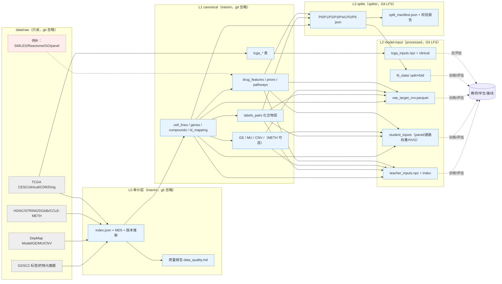

# 2026-11-17 数据预处理详细规划（G0 数据管线执行方案）

- **文档性质**：Agent 生成（数据预处理专项实施规划），非正式论文
- **任务来源**：用户「[@计划书](<端侧肿瘤药敏师生模型_详细计划书.md>) 现在制定一下关于数据预处理的规划」
- **实施**：Team Lead（架构/契约/设计）+ 4 名数据审计员（GDSC / DepMap / 先验与甲基化 / TCGA）并行实测 + 1 名独立评审（v1.1 修订依据）
- **关联**：
  - 主计划书 §3（数据方案）、§3.3（预处理规范）、§3.8（目录/版本/许可）、§5.1–5.3（学生输入与补全）、
    §7.2（P0–P6 划分）、§8.2（TCGA 审计）、附录 B（仓库/工程规范）
  - 实测审计笔记（本文§1 的事实来源，均只读实测）：
    [GDSC 标签与药物元数据](data_audit/2026-11-17_gdsc2_audit.md) ·
    [DepMap 组学与细胞系匹配](data_audit/2026-11-17_depmap_audit.md) ·
    [STRING/HGNC/DGIdb 与 CCLE 甲基化](data_audit/2026-11-17_prior_meth_audit.md) ·
    [TCGA 可得性](data_audit/2026-11-17_tcga_audit.md)
  - 现有约定：[`data/raw/README.md`](../data/raw/README.md)、[`docs/leakage_checklist.md`](../docs/leakage_checklist.md)、
    [`docs/data_cards/_TEMPLATE.md`](../docs/data_cards/_TEMPLATE.md)、[`configs/README.md`](../configs/README.md)
- **状态**：**v1.1（2026-11-17，已按独立评审修订：7 项严重 + 11 项中等问题全部处理，见附录 E）**｜W1 契约评审后冻结 v1.2，变更走 `docs/adr/` 并回写计划书 §12

---

## 0. 摘要：这份规划解决什么

### 0.1 一句话目标

在 **W1–W4 内**把 `data/raw/` 的 8.3 GB 原始资源，变成**泄漏安全、可一键重建、可版本冻结**的
三层产物（canonical → model-input → splits），使 G0 门禁可签（计划书 §0.6/§10.3）：
数据管线一键重建 + split 公开 + naive 基线复现 + 泄漏审查第 1–5/8/11/15 项通过。

### 0.2 规划前必须知道的 8 个实测结论（决定后续一切口径）

| # | 实测结论 | 影响 |
|---|---|---|
| 1 | **主训练可用细胞系仅 509 株**（GDSC2 有标签 ∩ GE ∩ MU ∩ CNV，default 条目过滤后）；GDSC 可映射 968 株的 **52.6%**。CNV 是唯一瓶颈（1,118 个模型有 CNV） | 全项目样本量比计划书隐含的 809 少 37%；所有指标 CI 变宽，必须调整预期与统计方案（§1.3-A1） |
| 2 | GDSC2 实测 **242,036 行 / 969 株 / 295 DRUG_ID / 286 化合物**，观测密度 84.67%；计划书 §3.2 的 809/198/135,242 是 8.2 版转述，均偏低 | 所有文献对比口径与"观测率 84%"结论需改写（§1.2） |
| 3 | **9 个化合物各有 2 个 DRUG_ID**（6,288 重叠对，占 2.60% 行；标签差中位 1.10、54.1%>1） | 标签必须在**化合物层**去重/合并，否则 LDO 泄漏 + 标签自相矛盾（§3.3、§4.1） |
| 4 | GDSC 自带 `Z_SCORE` **严格等于药内 z(LN_IC50)**（ddof=1，max\|diff\|=1.18e-6），但它是在**全量数据**上算的 | 只能作交叉校验；训练标签必须在**训练 fold 内**重算（§4.1、§5） |
| 5 | 本地"CCLE 甲基化"实为 **2018 RRBS TSS±1kb（hg19）**，不是 450K；文件 1+2+843 列（843 个样本列）中 10 列全空、缺失 5.47%（MNAR）、仅 559 株 ∩ GDSC2（∩ 主池 404 株） | 教师 METH 降级为**可选+掩码**模态；VAE METH 头与 TCGA HM450 域迁移**默认不做**（§4.5，新决策 D21） |
| 6 | **STRING links 每对互作存双向两行**：10,826,054 行 = 5,413,027 唯一无向边；≥700 去重后 282,864 对 / 17,525 蛋白 | 建 PPI 图前必须 (min,max) 去重，否则边数/度分布虚高 1 倍（§4.8） |
| 7 | **TCGA file→case 映射缺失（P0 阻断）**：文件名/manifest/.parcel/annotations 均无 barcode，四模态交集只能引用前次审计值 274/281，**需 GDC API 一次性建派生表**；MU 侧可离线确证 287 例 / ∩clinical=287 | L1/L3 预处理的第一步是"映射表+冻结"，不是建矩阵（§4.9） |
| 8 | 药物侧 **SMILES 0/295、RDKit 未安装**；Reactome/GO/Hallmark 通路库、panel 清单全部缺失 | 教师药物图、学生通路特征、scaffold split 三项**受外部资源阻塞**，需 W1 联网补齐或启用降级（§1.4） |

### 0.3 本文新增/收紧的 12 个决策（完整版见 §10，需回写计划书 §12）

| # | 决策 | 一句话 |
|---|---|---|
| D20 | 主训练口径 | **M-509 主**（三模态全齐）/ M-716（GE+MU 全数据口径补充 + CNV 失败降级；CNV 用 mask）；仅 MU+CNV 的 4 株排除并记录 |
| D21 | 教师 METH 降级 | 默认 **GE+MU+CNV 三模态**；METH 仅"可选+掩码"做 E2-METH 消融，不进主表 |
| D22 | 细胞系主键 | **ACH（DepMap ModelID）为主键**，SangerModelID 为外键；LCO 分组键 = `cell_line_uid` + 同源组 |
| D23 | 标签口径 | 化合物层键（InChIKey > 标准化药名）；双 ID 合并主口径取**均值**；z-score/阈值**只在 fold 内**拟合 |
| D24 | 组学单一来源 | 教师/学生组学**只用 DepMap**；计划书 §3.6 的"GDSC 芯片 vs CCLE RNA-seq 校正"从主训练中移除，平台校正只用于 TCGA 域对齐 |
| D25 | 学生表达路线实现 | 通路分数默认 **Reactome+GO 均值 z 打分**（可离线、可冻结为端侧矩阵）；ssGSEA 仅消融；Hallmark 只本地用不再分发 |
| D26 | VAE 目标基因空间 | 规则化定义（PPI v12.5 ≥700 ∩ CNV ∩ 教师图基因，按度排序取 ~1,600），先冻结占位、M4 与教师图定稿 |
| D27 | 学生突变 panel | 优先外部公开 panel 清单（W1 补齐）；拿不到则用**频率定义 panel** 并在数据卡/论文明确口径 |
| D28 | 划分自建 vs DrEvalPy | **自建为主**（必须支持 scaffold/LTO），DrEvalPy 仅作同口径对照（可得时） |
| D29 | TCGA 映射表 | GDC API 一次性拉取 → 冻结 `tcga_file_index.parquet`（含 md5），后续所有 TCGA 预处理只读它 |
| D30 | 再分发边界 | `data/processed/` 走 LFS 但**不是公开 release**；仓库转公开前必须重评 GDSC/DepMap 条款（§7.4） |
| D31 | 突变口径 | **教师用 B（driver，LikelyLoF/Hotspot）、学生 panel 用 A（非沉默）**；两口径都产出，A 作教师覆盖率消融 |

### 0.4 交付物与工作量

| 交付物 | 位置 | 规模估计 | 负责 |
|---|---|---|---|
| 数据契约与产物规格（本文 §7） | 本文件 | — | Lead + 全员评审 |
| `data/interim/audit/inventory.json` + 质量报告 | `data/interim/audit/` | < 5 MB | D |
| canonical 表（ID/标签/组学/药物/先验/TCGA） | `data/interim/canonical/` | ≈ 400–600 MB（git 忽略） | A/B/C |
| model-input 产物 | `data/processed/`（LFS） | ≈ 220–280 MB（v1.1 重算） | A/B/C |
| split 文件（P0/P1/P2/P3/P4/LPO/P6） | `data/splits/`（LFS） | < 10 MB | D |
| fold 内统计量（fit stats） | `data/processed/fit_stats/`（LFS） | ≈ 20 MB | C |
| 单测 + 集成测试 + CI 门禁 | `tests/data/`、`tests/integration/` | — | D |
| 数据卡 ×6 + 许可文件 ×8 | `docs/data_cards/`、`data/licenses/` | — | A |
| 计划书回改 + 新决策 D20–D31 | 计划书 §3/§5/§7/§8/§12 + `docs/adr/` | — | Lead |

**人力与排期**：按计划书 §10.1（本科生 A 数据/临床、B 教师/图、C 学生/蒸馏、D 平台/实验）分工，
4 周 20 个工作日（每周 8–12 h/人），详见 §9。**总关键路径 = 契约 → ID/标签 → 组学三模态 → split/fit-stats → 验收**。

---

## 1. 现状与约束（实测事实）

> 本节所有数字均来自 2026-11-17 四次只读审计（命令见各审计笔记 §复现命令）；与计划书冲突处一律以实测为准，
> 差异清单见 §1.2，计划书回改清单见附录 C。

### 1.1 原始数据资产与可用性判定

| 资产 | 实测规模 | 本规划用途 | 状态 |
|---|---|---|---|
| `gdsc/GDSC2_fitted_dose_response_27Oct23.csv` | 242,036 行 × 16 列；969 株 / 295 DRUG_ID / 286 化合物 | **主标签**（LN_IC50/AUC/Z_SCORE） | ✅ 可用（有口径问题） |
| `gdsc/screened_compounds_rel_8.4.csv` + `_8.5_inchi.csv` | 621 DRUG_ID × 6/8 列 | 药物元数据：靶点、InChIKey、ChEMBL（**无 SMILES**） | ⚠️ 部分（无 SMILES） |
| `gdsc/Cell_Lines_Details.xlsx` | 3 sheet；1,002 行 × 13 列 | 细胞系元数据 **fallback**（正式用 Model.csv） | ⚠️ fallback |
| `depmap/Model.csv` | 2,154 行 × 49 列 | **ID 唯一权威表**（ACH↔SANGER↔COSMIC↔Oncotree） | ✅ 可用 |
| `depmap/DepMap_ExpressionTPMLogp1…csv` | 1,775 行 × 19,221 列（19,215 基因）；default 后 **1,719** 模型 | 教师 GE + 学生 GE（通路分数/HVG） | ✅ 可用 |
| `depmap/DepMap_SomaticMutations.csv` | 1,172,688 行 × 68 列；default 后 736,094 行 / **1,968** 模型 | 教师 MU + 学生 panel 突变 | ✅ 可用（需口径） |
| `depmap/DepMap_CNGeneWGS.csv` | 1,132 行 × 19,961 列；default 后 **1,118** 模型；811 基因列全 NaN | 教师 CNV + VAE 补全目标 | ✅ 可用（**瓶颈模态**） |
| `ccle/CCLE_DNA_methylation_TSS1kb.txt` | 21,338 行（1 行占位）× 1+2+843 列（843 个样本列）；**RRBS TSS±1kb（hg19）** | 教师 METH **可选+掩码** | ⚠️ 降级使用 |
| `string/9606.protein.links.v12.5` | 10,826,054 行 = **5,413,027 唯一无向边**；≥700 → 282,864 对 | PPI 图（A_GG） | ✅ 可用（须去重） |
| `hgnc/Gene.csv` | 44,083 行 × 56 列；protein-coding **19,291** | **基因单一真源** | ✅ 可用 |
| `dgidb/*.tsv` | 122,904 交互 / 80,483 药 / 85,738 基因 | A_DG 兜底 + 可解释性校验（覆盖 GDSC 药 202/286） | ⚠️ 仅兜底 |
| `tcga/CESC/` | 1,204 数据文件 / 6.421 GB（GE 309 / MU 289 / CNV 294 / METH 312） | L1/L2/L3 | 🚧 **P0 映射缺失** |
| `tcga/clinical/…tar.gz` | 202 列 × 1,454 行 / 307 例；43 个 `treatments.*` | L2/L2′ 协变量与治疗记录 | ⚠️ 稀疏+占位符 |
| `tcga/cdr/TCGA-CDR…xlsx` | 11,160 例 / 33 癌种；CESC 307 | L2′ 生存（PFI 主、OS 敏感性） | ✅ 可用 |
| `tcga/ding2016/*.zip` | Table S2 2,572 条；CESC 97 条/69 例，**顺铂 62 条/59 例** | L2 唯一弱标签（**仅探索性**） | ⚠️ 严重不平衡 |

### 1.2 实测 vs 计划书数字对照（回改依据）

| 指标 | 计划书 / 既有文档（含第三方转述，标"待核实"） | 本次实测 | 处理 |
|---|---|---|---|
| GDSC2 细胞系 / 药物 / 观测 | 809 / 198 / 135,242（8.2 版） | **969 / 295 / 242,036**（286 化合物） | 全部按实测改写；论文引用前核对官方 release |
| 观测密度 | ≈84% | **84.67%**（242,036/(969×295)）；化合物层 85.07% | 成立，但需注明分母口径 |
| GDSC1 | 987 / 367 / 310,904 | 本地无文件，**无法核验** | 标"待核实"，外部验证前置下载 |
| 教师模态 | GE+MU+CNV+METH（D2 核心四模态） | METH 为 RRBS、∩主池 404 株 | **改三模态主 + METH 可选**（D21） |
| 补全目标基因空间 | Edge 预印本 1,603 基因（STRING v11） | 清单缺失；STRING 本地为 v12.5 | 改为规则化定义并声明口径差异（D26） |
| STRING 边数 / 许可 | "0.5–3 万条子图" / "学术需签许可" | 全库 5,413,027 无向边；**CC BY 4.0** | 去重口径 + 许可更正（§4.8） |
| TCGA CESC 四模态交集 | 274（前次审计）/ 281（补 CNV） | 离线仅可确证 MU=287、∩clinical=287；274/281 **待映射表复核** | 保留为"前次值"，P0 建表后复核（§4.9） |
| TCGA clinical 列数 / Ding 行数 / CNV 值域 | 207 / 2,573 / 0–104 | **202 / 2,572 / 0–111** | 修 README 与数据卡 |
| DepMap 表达/MU/CNV 规模 | `data/raw/README.md`：1,775×19,215 / 1,172,688 行 / 1,132×19,955 | 一致；但**必须 default 条目过滤**后才是 1,719 / 736,094 行（1,968 模型）/ 1,118，且 CNV 811 个基因列全 NaN | 口径补充（见 §4.2–4.4） |

### 1.3 阻断性问题（P0）与处置

| # | 问题 | 证据 | 影响 | 处置（见 §） |
|---|---|---|---|---|
| **A1** | **主训练集仅 509 株**（非 800+） | DepMap 审计 §2.5：GDSC∩GE∩MU∩CNV=509；缺 CNV 455/968 | 统计功效、per-drug 指标方差、LDO 可行性 | 接受并三档口径（§3.1、D20）；报告 drop 漏斗；统计方案按 n=509 调整（§9.4） |
| **A2** | 药物 **SMILES 全缺**、RDKit 未装 | GDSC 审计 §2.5：SMILES 0/295 | 教师 GIN 药物图、Morgan FP、**scaffold split** 全部阻塞 | W1 联网补 SMILES（PubChem by InChIKey 242 + ChEMBL 198）+ 装 RDKit（`graph` extra）；期间用靶点 multi-hot 占位（§4.7） |
| **A3** | 通路库（Reactome/GO/Hallmark）缺失 | 先验审计 §5 | 学生表达路线 A（主方案）无法开工 | W1 下载 Reactome/GO；Hallmark 仅本地；兜底切 HVG 路线 B（§4.2、D25） |
| **A4** | panel 清单缺失 | 先验审计 §5 | 学生突变输入无定义 | W1 补公开 panel；兜底频率定义 panel（D27） |
| **A5** | TCGA file→case 映射缺失 | TCGA 审计 §2.3（文件名/manifest/parcel/annotations 均无 barcode） | L1/L3 无法建立患者级矩阵 | GDC API 一次性建表并冻结（D29）；若网络受阻，用 GDC Portal 网页导出人工落表 |
| **A6** | 药物 21/286 无 InChIKey/ChEMBL/靶点；53 药无 InChIKey | GDSC 审计 §2.5 | 药物特征覆盖 92.9% → 有 mask | 21 药置 mask + 名称嵌入；报告覆盖率（§4.7） |
| **A7** | DepMap 四文件版本不齐（组学 2026-07-13 / Model.csv 2026-11-10） | DepMap 审计 T1 | 基因/ID 注释漂移 | 以 MD5 内容冻结（非 release 号）；ID 集合已验证为子集关系（§2.5、D24） |

### 1.4 需补充的外部资源（仅列清单，W1 执行下载）

| 优先级 | 资源 | 用途 | 许可提示 | 责任/时点 |
|---|---|---|---|---|
| **P0** | Reactome v97（GMT/NCBI Human） | 学生通路分数（路线 A）；教师通路先验/解释 | 开放许可（CC BY 4.0，待核原文） | A / W1 |
| **P0** | GO（go-basic.obo + GAF/GMT） | 补充通路集与解释 | CC BY 4.0 | A / W1 |
| **P0** | SMILES（PubChem PUG-REST 按 InChIKey 501 → 242 可用；ChEMBL 补充 198） | 药物图/FP/scaffold | PubChem 公共；ChEMBL CC BY-SA | B / W1 |
| **P0** | RDKit（`uv sync --extra graph`） | 分子图、Morgan FP、Bemis–Murcko scaffold | BSD-3 | D / W1 |
| **P0** | 突变 panel 公开清单（409/410/523 或 MSK-IMPACT 468 等） | 学生 MU 输入定义 | 基因列表为事实信息，无版权风险 | A / W1 |
| **P0** | GDC API `file→case` 映射（1,204 文件） | TCGA 四模态交集 | GDC 开放层 | A / W2 |
| P1 | Open Targets（CC0）targets/drugs | A_DG 首选开源边源（补 DGIdb 未覆盖 84 药） | **CC0 4.0** | B / W2 |
| P1 | ChEMBL v36（mechanisms/SMILES） | 药名桥接、A_DG、SMILES 兜底 | CC BY-SA 4.0（copyleft） | B / W2 |
| P1 | MSigDB Hallmark（本地使用） | 通路集对照 | 学术免费需注册；**不得再分发原始 GMT** | C / W2 |
| P2 | Edge 预印本 1,603 基因清单；CCLE legacy 450K；TCGA-BRCA/LUAD；GDSC1/CTRPv2/PRISM；DrugBank；KEGG | 后续里程碑 | 各自条款，下载前补数据卡；**KEGG/DrugBank 不可再分发** | A/B / M2+ |

> 下载纪律（写进 `scripts/download_missing.sh` 骨架）：①先写 `data/licenses/<source>.md` 再下载；
> ②落地后立即 `md5sum` 追加进 `data/raw/CHECKSUMS.md5` 并更新 `data/raw/README.md`；
> ③不得把受限数据提交 git（`data/raw/` 已忽略）。

### 1.5 结论：可开工边界

- **可立即开工（离线）**：ID 统一、标签化合物化、GE/MU/CNV 预处理、STRING/HGNC/DGIdb 先验、
  教育式 split（LCO/LDO/random/LTO/LPO）、fit-context 与泄漏测试、TCGA MU/clinical/CDR/Ding 解析。
- **需联网后才开工**：学生通路分数（A3）、药物分子图/指纹（A2）、scaffold split（A2）、
  TCGA 四模态患者映射（A5）。
- **明确不做（本期）**：VAE METH 头、TCGA HM450 域迁移补全、RPPA、KEGG/DrugBank 打包分发。

---

## 2. 设计原则与总体架构

### 2.1 八条硬原则（写入代码评审检查项）

1. **ID 先行**：任何模态矩阵在落盘前必须已完成 ID 归一（细胞系→ACH；基因→HGNC symbol；药物→化合物键），
   且每一次归一的结果与冲突清单可追溯（`id_mapping.parquet` + `id_conflicts.json`）。
2. **划分先于预处理**：split 只依赖"身份信息"（细胞系/化合物/组织/scaffold）生成，**不读取标签**；
   所有依赖统计量的预处理（z-score、HVG、ComBat、阈值、VAE 训练集）一律在 split 之后按 fold 拟合。
3. **Fit-context 单一入口**：fold 内统计量只能通过 `FitContext` 接口获得（§5），禁止在 Dataset/模型里
   现算 `mean/std/quantile`；违反即 CI 失败。
4. **确定性**：同一 raw + config + seed ⇒ 同 hash 产物。所有集合遍历前排序，所有随机性走 `numpy.random.Generator(seed)`，
   禁止 `set` 迭代顺序、禁止未设种子的 `sklearn` 默认。
5. **原子产物 + manifest**：每个产物写临时文件后 `os.replace`；`manifest.json` 记录 sha256/尺寸/schema/输入 hash/代码 commit/命令。
6. **只读缓存**：`data/processed/**` 与 `data/splits/**` 生成后只读（`chmod` 只读 + 校验），训练侧严禁写回。
7. **受限数据不出仓**：`data/raw/` 与受限派生（STRING? 否；KEGG/DrugBank 是）不进 git；公开 release 只含代码/脚本/split 摘要。
8. **可降级**：每个外部依赖（通路库/SMILES/RDKit/TCGA 映射）都有显式降级分支与"降级后结果不可比"的标注（§4 各节末）。

### 2.2 数据流 DAG



**DAG 顺序铁律**：`L0 → L1(身份/标签/无监督变换) → L3 splits → L2 fit_stats → L2 model-input(装配)`。
其中 **L3 在 L2 fit_stats 之前、在 L1 无监督变换之后**；任何"先 z-score 后切分"的实现视为泄漏（§5.3）。

### 2.3 四层产物契约

| 层 | 目录 | 是否进 git | 定位 | 版本化方式 |
|---|---|---|---|---|
| L0 审计 | `data/interim/audit/` | 否 | 清单/质量报告/冲突清单 | 随代码重生成 |
| L1 canonical | `data/interim/canonical/` | 否 | ID 归一后的"原始尺度"表（不 fold 变换） | `manifest.json`（interim 内） |
| L3 splits | `data/splits/` | **是（LFS）** | 分组定义 + 校验报告 | `split_manifest.json` |
| L2 model-input | `data/processed/` | **是（LFS）** | 模型可直接消费的装配产物 + fold 统计量 | 顶层 `manifest.json` |

**为什么 canonical 不提交而 processed 提交**：processed 是"无 raw 也能训练"的最小分发单元（协作/复现）；
canonical 体积大且可由 raw 一键重建（≈15 min CPU）。公开 release 前需按 D30 重评 processed 的再分发合规。

### 2.4 运行环境与命令约定

- 本仓库训练/数据环境：**`.venv/bin/python`**（3.12，pandas 3.1.1/numpy 2.5.4/scikit-learn 1.9.1/pyarrow 已装）。
- 当前沙箱 `uv run` 因 home 缓存只读会失败；在开发机请用 `uv sync --locked` 后 `uv run`（CI 同）。
  所有文档/脚本中**必须**同时给出两种入口；离线/受限环境用 `.venv/bin/python -m kite_drp...`。
- 额外 extras：`graph`（rdkit/torch-geometric）→ 药物图/scaffold；`explain`（gseapy/captum/shap）→ ssGSEA/解释；
  `clinical`（lifelines）→ L2′；`deploy`（onnx/onnxruntime）→ 导出。G0 只需 core + graph。

### 2.5 版本冻结与指纹

**冻结对象**：`data/raw/` 中参与主流程的文件 + 本文定义的所有 config 字段。
**指纹规则**（写入 `manifest.json` 与 split 文件）：

```
artifact_hash = sha256( filename | columns | dtypes | content_hash )
content_hash  = sha256( 按行/列排序后的二进制 payload )      # npz/parquet 语义 hash，非文件字节
code_hash     = sha256( git HEAD + 未提交 diff )            # 可复现三件套之一
input_hash    = { <artifact_name>: <artifact_hash>, ... }   # 递归到 raw 的 md5
config_hash   = sha256( 规范化后的生效配置 dict )
fit_scope     = { split_id, fold_id, train_index_hash }     # 仅 fit_stats 产物带
```

**定版决策（D24）**：DepMap 四文件以**内容 MD5 冻结**，不以 release 号命名（三组学 mtime 2026-07-13、
Model.csv 2026-11-10 不同版；但已实测三组学 ModelID ⊆ Model.csv，无孤儿 ID，故 ID 层可安全混用；
基因注释漂移由 `gene_master` 统一吸收）。数据卡记录"release 待核实 + 冻结 MD5"。

---

## 3. 统一 ID 体系（第一块基石）

### 3.1 三张主表 + 一张映射表

| 表 | 键 | 内容 | 来源与规则 |
|---|---|---|---|
| `cell_lines.parquet` | `cell_line_uid` = `ACH-######` | SangerModelID、COSMICID、CCLEName、StrippedCellLineName、原 CellLineName、OncotreeLineage/PrimaryDisease/Subtype/Code、ModelType、SourceType、Sex、Age、engineered 标记、`source_group` | `Model.csv` 2,154 行（权威）；GDSC 侧仅映射，不新增细胞系 |
| `genes.parquet` | `hgnc_symbol` | hgnc_id、entrez_id、ensembl_gene_id、locus_group（protein-coding 等）、prev_symbols、aliases（展开列 `alias_json`）、是否进入各模态宇宙 | `hgnc/Gene.csv` 44,083 行；**单一真源** |
| `compounds.parquet` | `compound_uid` | `inchikey:<INCHI_KEY>` 优先，否则 `gdscname:<归一化名>`；DRUG_ID 列表（1 或 2 个）、标准名、GDSC 名、靶点文本、解析后靶点基因、CHEMBL_ID、InChIKey、SMILES（待补）、scaffold（待补）、`has_mask` | 标签文件 286 化合物 + `screened_compounds` 621 行元数据 |
| `id_mapping.parquet` | 各源 ID | `source_table, source_id, → cell_line_uid/compound_uid/gene`、`method`（sid/name/cosmic/alias）、`status`（ok/ambiguous/failed）、`evidence` | 全部映射的单一审计入口；冲突进 `id_conflicts.json` |

### 3.2 细胞系映射规则（实测匹配率 968/969）

1. **主键路径**：GDSC `SANGER_MODEL_ID` ↔ `Model.csv.SangerModelID`（967/969 命中，99.79%；覆盖 968 个 ModelID 行）。
2. **一对多仲裁**：全库只有 `SIDM00117`（→ ACH-000837 NCI-H322 / ACH-002172 NCI-H322M）；
   GDSC 侧名字为 NCI-H322M 且 COSMICID=905967 → **仲裁到 ACH-002172**（名字+COSMIC 双重一致）。仲裁规则写入配置常量。
3. **名字兜底**：仅对 SID 未命中的 2 株执行，归一化 `[^A-Za-z0-9] → 去 → upper`；
   `NCI-H748` 命中 ACH-003071；`RH-1`（SIDM00427）**无任何映射** → 显式排除并记入 `id_conflicts.json`
   （实测影响 **279 行标签**，占 0.12%，可忽略但必须记录）。
   兜底命中若归一化后对应 >1 个 Model 行（实测 5 例，如 `MS-1`/`MSDASH1`）→ **不自动采用**，转人工裁决表。
4. **同源组 `source_group`**：用于 LCO 防泄漏。规则 = `cosmicid:<id>`（有 COSMIC 时）；
   否则 `name:<归一化 StrippedCellLineName>`；并强制把已知同源对（Model.csv 中 StrippedCellLineName 归一化相同者）合并。
   实测 Model.csv 内细胞系名 0 重复、COSMIC 无重复 → 同源组主要是"跨库重名/后缀变体"，规则仍必须实现（CI 断言组数 ≤ 细胞系数）。
5. **Not-usable 标记**：GDSC `CANCER_TYPE=Non-Cancerous`（7 株 / 1,949 行）→ `eligible=False`（保留数据，默认排除训练/评估）；
   `Model.csv.ModelType=Organoid`（24 个）→ 仅报告，默认不排除（若出现在主池需人工确认）。
6. **覆盖漏斗（必须写进数据质量报告）**：
   `GDSC 969 株 → 可映射 968（缺 RH-1）→ ∩GE 717 / ∩MU 959 / ∩CNV 513 → 三模态 509`。

### 3.3 药物映射规则（化合物层，286 个）

1. **化合物键优先级**：`InChIKey`（242/295 DRUG_ID 有键）> `标准化药名`（大写、去标点、去剂量后缀如 `(50 uM)`）。
   实测：295 ID → 286 化合物；InChIKey 重复组恰为 9 个双 ID 化合物 → 与药名口径一致（互为验证）。
2. **9 个双 ID 化合物**（Acetalax/Dactinomycin/Docetaxel/Fulvestrant/GSK343/Oxaliplatin/Selumetinib/Ulixertinib/Uprosertib）：
   - 主口径：对同一 (细胞系, compound_uid) 的两个 LN_IC50 **取均值**（同为 Sanger 同平台拟合值）；
   - 敏感性口径：取覆盖株数更多的 DRUG_ID（1911/1007/1200/1627/1089/1062/1908/1553/1803）；
   - 两口径在 E8/主结果中报告差异（|Δ| 中位 1.10，最大 8.98 → 不是无关紧要的选择）。
3. **同名/同化合物跨库**：`screened_compounds` 内 542 唯一药名 / 621 ID（71 个药名 >1 ID）；跨库同物异名
   （AZD8931↔Sapitinib、Venotoclax↔Venetoclax 拼写错）由 InChIKey 合并，名称仅作显示。
4. **药物特征缺口 mask**：`has_inchikey / has_target / has_smiles / has_scaffold` 四个布尔列随化合物表落盘，
   供模型做 mask 与报告覆盖率（禁止静默用 0 填充伪装成"无靶点"）。

### 3.4 基因映射规则（三层，全部落 `id_mapping`）

1. **解析**：DepMap 列头 `SYMBOL (ENTREZ)` → 正则 `^(.+) \((\d+)\)$`（GE 100% 成功、0 重复；CNV 19,366/19,955 成功，
   589 列为 `_PAR_Y`/裸 ENSG → 标记 `par_y=True` 或经 HGNC ENSG→symbol 映射，失败则丢弃并计数）。
   TCGA：`gene_id` 去版本号（GENCODE v36 → ENSG 无版本）→ HGNC `ensembl_gene_id` → symbol（需处理 HGNC 2,635 缺 ENSG、
   50 个 protein-coding 缺 ENSG 的例外）。
2. **映射顺序**：当前 symbol → `prev_symbol`（**仅当目标唯一且不与任何当前 symbol 冲突**）→ `alias_symbol`（同规则）。
   实测 1,083 个 alias 多义、231 个 prev_symbol 与其他基因当前 symbol 冲突 → 一律不采用并计数。
3. **基因宇宙（嵌套定义，冻结写盘）**：

| 宇宙 | 定义（全部由构建脚本从同一 `gene_master` 计算并落 manifest） | 实测维度 | 用途 |
|---|---|---|---|
| `U_hgnc_pc` | HGNC `locus_group='protein-coding gene'` | 19,291 | 所有模态的上界 |
| `U_teach_ge` | DepMap GE symbol（19,215）∩ CNV 可解析 symbol（19,130）→ 删除 5 个**全局零方差**基因（见下"唯一例外"） | **19,125** | 教师 GE 输入、**所有模态的统一对齐基准** |
| `U_teach_mu` | 突变 A/B 口径基因 **∩ `U_teach_ge`（19,125，不再对 GE 全集 19,215）** | **A：18,449 / B：17,035** | 教师 MU 输入、学生 panel 上界 |
| `U_cnv` | CNV 有效基因（删 811 全 NaN 列 = 19,144）∩ `U_teach_ge` = **U_teach_ge** | **19,125** | 教师 CNV、VAE 目标上界 |
| `U_vae` | **规则**：STRING(v12.5, ≥700) 基因 ∩ `U_cnv` ∩ 教师图基因节点（M4 定稿）；按 PPI 度降序取 ~1,600 | 占位 1,600（M4 定稿 1,600–2,200） | VAE 解码器输出（D26） |
| `U_panel` | 外部 panel 清单 ∩ `U_teach_mu`；无清单时用 **fold 内**训练集突变频率 top-N 兜底（N≈500，列表进 fit_stats） | ≈500 | 学生突变输入（D27） |
| `U_pathway` | Reactome+GO 基因集并集 ∩ `U_teach_ge` | ≈15k | 学生通路打分 |

> **口径纪律（v1.1 评审修正）**：①上表维度为 2026-11-17 实测值（U_teach_mu 的 18,449/17,035 是**按 U_teach_ge=19,125 重算**后的数字，
> 旧版 18,495/17,074 是相对 GE 全集 19,215 的口径，已废弃）；②代码断言必须读 `manifest.json`，正文数字只作评审参照；
> ③**所有"数据依赖性"基因选择（零方差掩码、分位裁剪、HVG、频率 panel、通路可用性）一律进 fit_stats（§5.1），不得在 canonical 阶段全局执行**；
> ④**唯一例外**：删除"跨全部 DepMap 模型零方差"的 5 个基因——数学上"全局零方差 ⇒ 任意子集零方差"，
> 该删除决策与划分无关，且 §5.3 补反驳测试（每个 fold 断言 `zero_var(train) ⊇ global_zero_var`）。

4. **PAR_Y/裸 ENSG 处理**：589 列单独存放标记 `par_y`，**不与常染色体同名基因合并**（假基因与 X/Y 同源基因语义不同）；
   若最终不进入任何宇宙，在报告中写明丢弃数量。

---

## 4. 各模态预处理规范

> 每节结构：**输入 → 步骤（含参数默认值）→ 输出 schema → 校验 → 降级分支**。所有参数进 `configs/data/*.yaml`。

### 4.1 标签（GDSC2）——主训练的因变量

**输入**：`GDSC2_fitted_dose_response_27Oct23.csv`（242,036 行）+ `compounds.parquet`（化合物映射）。

**步骤**：
1. 类型规范化：`SANGER_MODEL_ID/DRUG_ID` 读字符串（防前导 0 丢失；实测无但需防御）；`CELL_LINE_NAME` 仅显示用。
2. **化合物层聚合**（D23）：按 (cell_line_uid, compound_uid) 聚合；双 ID 化合物主口径取 LN_IC50 均值，同时保留
   `n_source_ids`、`delta_dual_id`（两 ID 差，质量标记）。
   **RH-1（SIDM00427）映射规则（v1.1 修正）**：无 ACH → `cell_line_uid = null`、`mapped=False`，行**保留**在 canonical 供全库统计，
   但不进入任何模型池；因此两个口径必须同时报告：**全 969 株 = 235,748 对 / 映射 968 株 = 235,478 对**（差 270 对）。
3. 有效性过滤（默认全保留，只打标记）：
   - `eligible_cell_line = (CANCER_TYPE != 'Non-Cancerous')`（7 株/1,949 行）；
   - `extrapolated = LN_IC50 ≥ ln(MAX_CONC)`（实测 71.81%！）→ 存布尔列，供删失敏感性分析；
   - `suspect = |Z|>3 或 RMSE>0.215(p99)` → 标记，不删（§4.1 校验报告给分布）。
4. **标签模式按划分协议分离（交 `FitContext` 执行，canonical 不落任何 fold 统计量）**——
   这是 v1.1 评审修正的关键设计：**LDO/scaffold 的测试化合物在训练 fold 中完全缺失，逐药 μ_c/σ_c 与逐药阈值不可定义**
   （若用测试集估计即标签泄漏），因此必须换标签口径：

   | 协议 | 标签模式 | 回归目标 | 分类阈值 |
   |---|---|---|---|
   | LCO / LTO / P0 / LPO | `within_drug_z`（默认） | `y = −z_c(LN_IC50)`，μ_c/σ_c 用**训练 fold 内该化合物**（ddof=1） | 训练 fold 内该化合物中位数（z=0） |
   | **LDO / P3 scaffold** | `raw_ln_ic50` | `y = LN_IC50`（原始尺度；跨药量纲由模型与指标处理） | **不设逐药阈值**：分类只报阈值无关指标（全局 AUROC/AUPRC）；F1/ACC 用训练 fold 全局中位数并明确标注 |
   | 外部验证 P5 | 由外部库标签定义 | 同左 | 同左 |

   **禁止直接使用现成 `Z_SCORE` 列**（全量拟合 → 泄漏；仅作 sanity 交叉校验，逐药 `|Δ|<1e-5` 视为实现正确）；
   `label_scaler` 行数 = **训练 fold 内出现的化合物数**（LDO 下不含测试药）+ 一行 `global`（全部训练标签的 μ/σ/median）。
5. 辅助标签：`AUC`（方向**越大越耐药**，已实测 r=+0.763；若要使用先取 `−AUC` 并 logit 变换）；原始 LN_IC50（报告尺度）。
6. `min_obs_per_compound` 默认 30（训练 fold 内）：不足则从该 fold 的 label set 剔除并记录（实测 509 池内 min=94，不会触发）。

**输出**：`data/interim/canonical/labels.parquet`
`cell_line_uid(nullable), mapped, sanger_model_id, compound_uid, drug_ids, n_source_ids, ln_ic50, ln_ic50_dual_id_mean, delta_dual_id, auc, z_score_gdsc(仅校验), rmse, max_conc, min_conc, extrapolated, suspect, eligible_cell_line` → 精确列见附录 A.2；**不含任何 fold 统计量**。

**校验（自动化，失败即阻断）**：
- (cell_line_uid, compound_uid) 唯一（`cell_line_uid=null` 的 RH-1 行按 `sanger_model_id` 参与唯一性）；行数 = 242,036 − 6,288 = **235,748**（全库）；
  `mapped=True` 子集 = **235,478**；M-509 池内 = **126,803**（由 130,372 行合并 −3,569 行；复算脚本见附录 B-0）。
- 化合物数 286；M-509 池内每种化合物标签数 min=94、中位 475。
- `within_drug_z` 模式：每化合物训练 fold 均值 ≈0、样本 sd ≈1（ddof=1）；测试集**不参与**拟合（§5 扰动测试）。
- `raw_ln_ic50` 模式（LDO/P3）：训练/测试标签均为原始尺度；断言测试化合物不在 `label_scaler` 的逐药行内（只有 global 行可用）。
- 方向一致性：`corr(y, LN_IC50) < 0`（within_drug_z 模式）。

**降级**：若 509 池某化合物 label 数 <30 → 该 fold 剔除；极端情况切 M-716（GE+MU，CNV 用 mask）主口径（D20）。

### 4.2 表达 GE（DepMap，教师与学生共用）

**输入**：`DepMap_ExpressionTPMLogp1HumanProteinCodingGenes.csv`（1,775 行×19,221 列；**首列无列名**）。

**步骤**：
1. 读取：`index_col=0`（跳过无名首列，防整体错位）；`usecols` 只取 `ModelID,IsDefaultEntryForModel` + 所需基因列；
   filter `IsDefaultEntryForModel=='Yes'` → **1,719 模型**（**不要用 `IsDefaultEntryForMC`**：实测 1 行 MC=Yes/model=No）。
2. 值语义：已是 `log2(TPM+1)`（列名 TPMLogp1，推断；**不再 log**）；0 值占 17.60% 属生物学零表达，不插补。
3. 基因对齐：取 `U_teach_ge`（**19,125**，最终维度由构建脚本写入 manifest）；删除实测的 5 个**全局零方差**基因
   （DEFB106A/KRTAP23-1/KRTAP20-3/DEFB113/SCYGR7 —— 见 §3.4 的"唯一例外"论证）；记录 `PAR_Y` 丢弃数。
   **其余任何基因过滤（低表达、HVG、方差阈值）一律不得在此步执行**，只在 fit_stats 内按 fold 生成 mask/列表。
4. 落 canonical：float32 矩阵（行=1,719 ModelID 排序，列=U_teach_ge 排序）；**不在此处 z-score**。
5. 训练期两种消费视图（均由 §5 `FitContext` 生成）：
   - **教师**：`z = (x − μ_g) / σ_g`（μ/σ 只在训练 fold 细胞系上拟合；σ<1e-8 的基因置 0 并 mask；
     该 mask 写进 `fit_stats/.../usable_gene_mask.npz`，覆盖"全局非常数但训练 fold 内常数"的基因）；
   - **学生路线 A（默认）**：先 fold 内 z，再按通路权重矩阵 `W[p,g]`（全局、只来自外部通路库）做
     `pathway_score = mean_{g∈p, |z|有效} z_g`（要求每通路 ≥10 个可用基因，否则丢该通路）；输出维度 ≈ 500–1,000；
   - **学生路线 B（对照）**：训练 fold 内按方差取 top-2,000 HVG（+L1000 landmark 978 可选）。
6. 学生/教师输入不含任何 fold 外信息；**HVG 与 z 统计量不得写入 canonical**。

**输出**：
- `data/interim/canonical/expression.parquet`（1,719 × 19,125 float32，≈131 MB）
- `data/processed/teacher_inputs.npz`（GE 部分）与 `data/processed/student_inputs/pathway_weights.npz`（见 §4.2 注）
- `data/processed/student_inputs/route_a_meta.json`（通路集版本、基因覆盖、维度）

> **通路权重矩阵是端侧资产**：需冻结 `W`（通路×基因，float16 可压到 ~20 MB）与每个通路的基因数，
> 随部署包下发（计划书 §5.2 的 10–30 MB 估算成立）。`W` 只依赖外部通路库（无标签、无数据拟合）→ 可全局。

**校验**：矩阵无 NaN/Inf；基因顺序与 `gene_master` 映射一致；维度 = manifest 的 19,125（重跑 hash 一致）；
**反驳测试**：对任选 fold，打乱测试 fold 的表达值后 canonical 产物逐字节不变（canonical 不含任何 fold 统计量）、
fit_stats 也逐字节不变（§5.3）；学生通路分数在训练 fold 均值 ≈0（因 z 的均值为 0）。

**降级**：通路库/权重不可得 → 学生默认切路线 B（HVG-2,000），并在 E3 中标注"A 未评估"（D25）。

### 4.3 突变 MU（DepMap → 基因×细胞系 0/1）

**输入**：`DepMap_SomaticMutations.csv`（1,172,688 行 × 68 列）。

**步骤**：
1. 读取 `IsDefaultEntryForModel=='Yes'` → 736,094 行 / **1,968 模型**（每模型恰 1 默认 MC）。
2. **过滤（禁止用 `MolecularConsequence`/`VepSomatic`，实测不可用：前者 95.75% NaN、后者是索引串）**；
   官方文件已预筛（AF≥0.15、DP≥5、非沉默 + rescued），故只需：
   - `VepBiotype ∈ {protein_coding, protein_coding_LoF}`；
   - **主口径 B（严格 driver，v1.1 修订为默认）**：`LikelyLoF=='True' | Hotspot=='True'`（对齐官方 MatrixDamaging/Hotspot 语义，
     HLA-A/B 已按 26Q1 排除）→ 17,035 基因 / 每样本中位 25 个突变（信息密度高、噪声低）；
   - 对照口径 A（宽松非沉默）：`VariantInfo` 按 `&`/`,` token 后不含纯沉默 token → 18,449 基因 / 中位 172 个突变；
   - **理由**：该文件已被官方预筛（AF≥0.15/DP≥5），A 口径的每样本 172 个突变以 passenger 为主，
     对 509 株小样本是噪声；B 与官方 Damaging/Hotspot 矩阵语义一致，便于与文献对齐（新决策 **D31**）。
     A 口径完整保留，作教师 MU 的覆盖率/信息量消融；
   - **不要**再做 `VepImpact in (HIGH,MODERATE)` 叠加（与 A 近似等价，实测仅差 372 行）。
3. 二值化：`(ModelID, HugoSymbol)` 去重 → 0/1；可选官方 0/1/2 口径（同基因 AF 求和 >0.95 → 2，作为"双等位"标记，暂存不用）。
4. **"突变负荷"特征（v1.1 更正，不再称 TMB）**：该文件是官方预筛后的"高质量非沉默 + rescued"集（AF≥0.15、DP≥5、无 matched-normal），
   **不能当真实肿瘤突变负荷**，也**不除以 30 Mb 伪装成 TMB**。定义 `mut_burden_proxy = 该样本在 B（或 A）口径下的突变基因数`
   （整数计数代理），仅作特征与分层变量；论文中明确写"不能与真实 TMB 比较"。
5. 对称化到 TCGA：把 MAF 的 `Variant_Classification/IMPACT/One_Consequence` 映射到同一 B/A 口径字典（§4.9）。
6. 学生 panel：`U_panel` 子集 0/1 矩阵（**A 口径**：临床 panel 报告的是"该基因是否检出非沉默变异"，与 B 的 driver 语义不同，
   因此学生输入用 A 口径、教师输入用 B 口径，二者在报告中分别标注）+ `mut_burden_proxy`（1 维）。

**输出**：
- `data/interim/canonical/mutations_A.npz`（1,968 × 18,620 **packbits**，≈4.4 MB）、`mutations_B.npz`（1,968 × 17,186，≈4.1 MB）、
  `mutation_long.parquet`（A 730,652 行 / B 124,610 行，含 AF/DP/来源列，供解释与扰动分析）
- `data/processed/student_inputs/panel_mutations_A.npz`（**716 池** × U_panel，packbits，A 口径）+ `mut_burden.parquet`

**校验**：每样本至少 1 个突变（实测 A 口径最小 21）；A/B 口径行数分别 = 730,652 / 124,610，基因数 = 18,620 / 17,186；
**与 `U_teach_ge`（19,125）的交集 = A：18,449 / B：17,035**（v1.1 同源重算；旧值 18,495/17,074 已废弃）；样本顺序一致。

**降级**：A/B 口径之争不阻塞（两口径都产出；主 B、A 作消融，见 D31）。

### 4.4 CNV（DepMap → 教师 CNV 与 VAE 目标）

**输入**：`DepMap_CNGeneWGS.csv`（1,132 行 × 19,961 列；**首列无列名**；811 基因列全 NaN）。

**步骤**：
1. 读取同 §4.2（`index_col=0`）；default 过滤 → **1,118 模型**（14 个重复 ModelID 由 default 标记消除）。
2. **变换**：线性相对 CN（中位 1.02）→ `log2(x)`；删除 811 个全 NaN 列（记录）→ 19,144 基因；再与 `U_teach_ge` 对齐 → **canonical 落 19,125**。
   **极值裁剪不在 canonical 做（v1.1 修正）**：裁剪边界由 `fit_stats` 在**训练 fold** 上按 [0.1%, 99.9%] 分位估计并记录；
   canonical 保留 log2 原值（便于复核），训练/评估时由 FoldContext 施加裁剪。
3. 落 canonical：float32（1,118 × 19,125，≈86 MB）；**不做 z-score、不做裁剪**（均在 fold 内做，§5）。
4. 教师视图：fold 内逐基因 z-score（教师用连续 log2 主口径；阈值化 -2/-1/0/+1/+2 仅用于可解释性与 VAE 二分类 AUROC 评估）。
5. VAE 目标视图：取 `U_vae`（§3.4 规则；临时 1,600 基因），在**训练 fold 细胞系**上拟合逐基因 μ/σ，
   目标为 `z(log2 CN)`（或按 S-A 配方直接回归 z 后的值）；缺失（若基因宇宙扩展到未观测区）置 NaN + mask。
6. **禁止**把测试 fold 的 CNV 统计量带入 VAE 预训练（VAE 训练集 = 训练 fold 细胞系，§5.3）。

**输出**：
- `data/interim/canonical/cnv.parquet`（1,118 × 19,125 float32，log2 原值）
- `data/processed/vae_target_cnv.parquet`（**716 池** × 1,600 原始 log2 值 + mask（207 株无 CNV）+ `vae_target_genes.json`）

**校验**：log2 后分位与审计一致（q1%≈−1.11、q99%≈1.01）；无 0/负值残留；`U_vae` 基因全部在 CNV 与 PPI 基因集中；
裁剪边界来自 `fit_stats`（不得用全量分位）；重跑 hash 稳定。

**降级**：CNV 覆盖导致主池仅 509（D20 已内建 M-716）。若 VAE 目标空间需扩大/缩小：规则不变、只改 N，
参数预算在 §5.5 复核（计划书 §5.5 已给维度→参数映射）。

### 4.5 甲基化 METH（**降级为可选模态**）

**实测真相**：`CCLE_DNA_methylation_TSS1kb.txt` = 2018 CCLE **RRBS** 的 hg19 TSS±1kb 窗口汇总
（行名 `GENE_chr_start_end`，窗口恒 1,000 bp；列 `CELLLINE_TISSUE`；缺失 5.47% 且随 `avg_coverage` 单调下降 → MNAR；
10 个样本列全空（文件共 1+2+843 列）；843 个样本列 → 663 有 SangerID → **559 株 ∩ GDSC2，∩ 主池 404 株**）。

**决策（D21）**：
- 主教师 = **GE+MU+CNV 三模态**；METH 仅作 E2-METH 消融（"多组学是否值得"），
- 处理口径：删 `NA_NA` 行 + 10 全空列 → 按基因聚合（多 TSS 窗口取均值，保留窗口数与 `avg_coverage`） →
  旧符号经 HGNC（prev/alias 唯一才用）映射 → 13,691 coding 基因 → `logit(clip(1e-3))` → **缺失 mask**（不做均值插补）→
  fold 内 z-score；
- **不做**：VAE METH 头（跨平台不可信）、TCGA HM450 域迁移补全、L1 补全目标包含 METH。

**输出**：`data/interim/canonical/methylation_rrbs.parquet`（833 × 13,691 float32 + mask + coverage；≈46 MB）
——默认**不进入** processed 主产物，仅 E2-METH 消融时按需装配。

**校验**：完全复现审计缺失率/覆盖率分位；与服务 `input_modalities` 不含 METH 的断言（CI 检查 config）。

### 4.6 蛋白 RPPA（本期不做）

TCGA RPPA 仅 172 文件 manifest、数据未下载；细胞系无 RPPA。`modality` 枚举保留但默认关闭，不作任何预处理。

### 4.7 药物特征（SMILES/图/指纹/靶点/scaffold）

**输入**：`compounds.parquet`（286 化合物）+ 待补 SMILES。

**步骤**：
1. **SMILES 补全（P0 阻塞项）**：以 InChIKey 为键从 PubChem PUG-REST 拉 242 个；ChEMBL 补 198 个 ChEMBL_ID 对应药；
   仍未获得的 21 个"三无"药 → `has_smiles=False` + mask（不得用空字符串占位）。
2. **Morgan FP**：RDKit `MorganGenerator(radius=2, fpSize=2048)` → 286×2048 **packbits**（≈0.07 MB）；
   盐型/立体化学由 RDKit 默认处理，记录 canonical SMILES。
3. **分子图（供 GIN）**：OGB 规范原子特征（77 维：原子类型/度/形式电荷/手性/杂化/芳香性/环等）+ 边（键型）→
   `drug_graphs.npz`（每药 node_feat/edge_index/edge_attr，按 `compound_uid` 索引；小分子 <100 原子）。
4. **靶点 multi-hot**：优先 GDSC 元数据 `TARGET`（257/295 药可用，185 可解析为基因名）+ DGIdb/Open Targets 补充 →
   286 × |U_teach_ge| 稀疏 0/1（packbits ≈0.6 MB）；21 个三无药全 0 + mask。
5. **scaffold（Bemis–Murcko）**：RDKit `MurckoScaffold` → scaffold 字符串；用于 P3 split。
   **注意**：InChIKey 首段**不是** scaffold 代理（实测 232 组 / 231 单例 ≈ 化合物身份），不得替代。
6. 覆盖率写入 `drug_feature_coverage.json`（供 §4.7 校验与论文报告）。

**输出**：`data/interim/canonical/drug_features.npz`（morgan/graphs/targets/scaffold + mask）、
`data/processed/student_inputs/drug_morgan.npz`（学生 B 档用）。

**校验**：286 化合物全部有 `compound_uid`；覆盖率数字与 `drug_feature_coverage.json` 一致；
Morgan FP 对同一 InChIKey 幂等；分子图无孤立原子（除单原子离子）。

**降级**：SMILES 长期不可得 → 教师药物编码器退化为"靶点 multi-hot + 可学习 ID 嵌入"（B0 档双线性可跑通），
P3 scaffold split 相应降级为"target-family split"并明确标注非真 scaffold（§6.2）。

### 4.8 先验网络（PPI / 药物-靶点 / 通路）

1. **PPI（A_GG）**：
   - 读取 v12.5 links（3 列，空格分隔）；**按 (min(p1,p2), max(p1,p2)) 去重**（10,826,054 行 → 5,413,027 唯一无向边）；
   - 阈值：主 **combined_score ≥700**（282,864 对 / 17,525 蛋白；gene 级 282,789 边 / 17,518 基因），
     消融 ≥900（125,344 对）与 ≥400（1,076,224 对）；
   - ENSP→symbol：aliases 文件 `source=Ensembl_HGNC_symbol`（映射率 97.67%；458 个无 symbol → 丢弃并计数；
     1 个歧义蛋白 CCL3L1/CCL3L3 → 丢弃）；
   - 与教师图基因节点取子图 → 边属性 `combined_score`（float32/1000 归一）；自环 0；
   - **注意 hub**：TP53 度 872（其后 H4C6 715、RPS27A 710、MAPT 616、ACTB 612）→ 随机重连对照必须同度分布（E6）。
2. **A_DG（药物-靶点）**：
   - 主源 **GDSC `TARGET`**（257/295 药、185 可解析）；次源 **Open Targets（CC0）**；DGIdb 仅兜底/解释校验
     （覆盖 202/286 药；限 HGNC coding 后仅 158 药/5,401 对）；
   - 边 = (compound_uid, hgnc_symbol)；三源合并去重后预计 **~1.5k–2k 靶点基因、覆盖 220–260/286 化合物**
     （DGIdb 单源可用部分为 158 药/5,401 对/1,468 基因；GDSC TARGET 可补 185 药；Open Targets 补齐剩余），
     最终数字以 `drug_feature_coverage.json` 实测为准；未覆盖药进 mask。
3. **通路（U_pathway 先验）**：
   - 主源 Reactome（人工审编、开放）+ GO BP/CC/MF（CC BY 4.0）；Hallmark 仅本地；
   - 产出 `pathways.parquet`（gene×pathway 稀疏成员矩阵，`pathway_id/source/n_genes`）与
     `pathway_weights.npz`（学生打分用，见 §4.2）；
   - 每通路 ≥10 个 `U_teach_ge` 基因才保留；**KEGG 不作为本地打包数据**（只允许本地实验，禁止进 release）。
4. **通路先验用于教师可解释性**：与 §4.8-3 同一份成员矩阵，避免两套通路定义（保证解释语言一致，计划书 §5.2 要求）。

**输出**：`data/interim/canonical/ppi.parquet`、`dti.parquet`、`pathways.parquet`；
`data/processed/graph_inputs.npz`（T1 图需要的节点表/边表/特征，M2 生成）。

**校验**：去重前后行数比 = 2.0（±0 假阳性）；主阈值边数 282,864；断言的 gene 级边数 282,789；
蛋白→基因映射率 97.67%；通路覆盖基因数 ≥15,000；`pathways` 无重复 (pathway,gene) 对。

### 4.9 TCGA 患者域（L1/L2/L2′/L3）

**P0 第一步（阻断项，必须先做）**：`tcga_file_index.parquet`
1. GDC API 按 1,204 个 file_id 拉 `associated_entities`（case_id、case_submitter_id(barcode)、sample_type、aliquot）→
   联 `cases.case_id→submitter_id`；用 MAF 的 **287 例 barcode 真值校验**（MAF 的 `case_id` 与映射表一致率应 100%）；
2. 记录接口查询串、时间、返回 JSON 的 md5；**冻结后所有 TCGA 预处理只读该表**（D29）；
3. 复核前次审计 274/281；不足 274 需在 L1 报告中说明覆盖。

**各模态预处理**：
| 模态 | 输入 | 步骤 | 输出 |
|---|---|---|---|
| GE | STAR counts（2 行表头、4 个 `N_*` 行、GENCODE v36 versioned ENSG） | `skiprows=1`；剔 `N_*`；`tpm_unstranded` → **log2(TPM+1)** 对齐 DepMap；ENSG 去版本 → HGNC → symbol；对齐 `U_teach_ge`（**注**：18,818 是相对 DepMap GE 全集 19,215 的交集=94.4%；相对冻结的 `U_teach_ge`=19,125 的交集以构建时实测为准，不得混用两个口径）；样本按 patient 聚合（多 aliquot 取均值并记 n） | `tcga_ge.npz` |
| MU | MAF 140 列（`Hugo_Symbol` 100%、`IMPACT` 字段实为 `IMPACT` 不是 `VepImpact`） | A/B 口径映射（`Variant_Classification`→silent 判定；`IMPACT` HIGH/MODERATE）；`(barcode 前 12 位, gene)` 二值；TMB 同样计 | `tcga_mu.npz` + `tcga_tmb.parquet` |
| CNV | ASCAT3 整数总拷贝数 0–111（1.33% 空） | `log2(max(cn,0.5)/2)` → 对齐（实测 19,013 gene_name 命中）；**QC 剔除 `CN==2` 占比 >90% 的 20/294 文件**（低纯度/正常样） | `tcga_cnv.npz` |
| METH | HM450 `sesame.level3betas`（486,427 探针；无表头无 barcode；缺失中位 14.77%） | **本期只做 schema 解析与统计**；探针→基因注释缺失（需 HM450 manifest，P1 下载）→ **不进入 L1 主评估**；如后续启用：探针注释 → TSS 窗口聚合 → logit + mask | `tcga_meth_stats.parquet`（统计） |
| clinical | 202 列 × 1,454 行（一行=一条治疗记录） | `'--'/Not Reported/Unknown → NA`；按 `cases.submitter_id` 聚合 treatments；提取 `therapeutic_agents/dose/days_to_treatment_*/treatment_outcome`；**`best_overall_response` 全占位不可用** | `tcga_clinical.parquet` + `tcga_treatments.parquet` |
| CDR | 11,160 例 / CESC 307 | 取 CESC；主终点 `PFI/PFI.time`（307 全覆盖、事件 71），敏感性 `OS`；`DFI` 仅 176 子集；**OS 与 PFI 在 243/307 完全一致 → 不当两个独立终点** | `tcga_cdr_cesc.parquet` |
| Ding2016 | Table S2 2,572 行；CESC 用**全称标签**（按缩写过滤会得 0 行） | 全称映射 → CESC 97 条/69 例；顺铂 62 条/59 例；`measure_of_response` CR/PR → 敏感，PD/SD → 耐药（**严格响应 CR+PR=52/62，不平衡**）；与 clinical 交叉 QC（clinical 顺铂 128 例 ≠ Ding 59 例，不得混用） | `tcga_ding2016.parquet` |

**域对齐口径（对应计划书 §3.3-8；主训练不涉及平台校正，只用于 TCGA 评估侧）**：
- GE：`log2(TPM+1)` 后用**分位数映射**把 TCGA 分布对齐到"细胞系训练 fold 的分布"——映射参数（经验分位点）
  只在**训练 fold 的细胞系**上拟合，再 transform TCGA；**不得**用 TCGA 自身分布去 fit（否则等于用评估域信息）。
- CNV：两侧都先转 log2（DepMap 线性相对 CN；TCGA 整数总 CN/2），再做逐基因 z-score，统计量同样来自训练 fold 细胞系。
- 可选消融：ComBat（以"数据集"为 batch，参数只在训练 fold 拟合）；任何域对齐结果与"未对齐"并列报告（计划书 §3.6）。
- **L3 若把 TCGA 组学纳入训练（transductive）**：属计划书 §3.7 的独立半监督探索，必须另建 fit scope 并单列，
  不进主表、不参与选模/早停（§5.4）。

**L1/L2/L2′/L3 的输入装配（全部在 `data/processed/tcga_inputs/`）**：
- L1：`(MU, GE) → 预测 CNV` 的掩码-补全评估集（真实 CNV 只作评估目标，禁止进学生前向）；评估集 = 四模态交集患者（前次 274，待复核）；
- L2：Cisplatin-CESC n=59，标签来自 Ding；**只评估不训练、不调参**；报告 AUROC + bootstrap CI + 敏感性（CR/PR vs PD/SD 的不同定义）；
- L2′：PFI 生存一致性（C-index/HR），协变量：年龄/分期/组织学；
- L3：无标签域对齐（样本 = MU 287，其中**原发 285 为主评估、2 例 06A 转移灶单列**；GE/CNV 用映射后子集），transductive 版本单列、不进主表（计划书 §3.7 红线）。

**校验**：`file_index` 覆盖 1,204 文件；样本类型只保留原发实体瘤（`-01A/-01B`）用于主评估，`06A` 转移灶单独标记；
四模态交集数与复核值一致；clinical 307 例、MU 287 例、CDR 307 例三表 barcode 完全可联；
所有 TCGA 产物打 `purpose=eval` 标签，训练侧 Dataset 拒绝加载（代码级红线，§5.4）。

### 4.10 外部验证库（P5 预留，本轮不下载）

按计划书 D12 顺序预留适配器接口（`src/kite_drp/data/external.py`），**数据到位后**才实现，避免 G0 范围膨胀：

| 库 | 标签口径 | 预处理要点（届时） | 与主训练的关系 |
|---|---|---|---|
| CTRPv2（首选外验） | AUC（官方定义） | 细胞系名→ACH（同名归一化+人工核对）；组学复用 DepMap；AUC 方向按官方核对后统一为"越大越敏感" | 不参与训练/调参 |
| GDSC1→GDSC2 零样本 | LN_IC50 | 药集/平台不同（Resazurin/Syto60 vs CellTiter-Glo）；用 GDSC2 训练、GDSC1 评估，**不混训** | 只评估 |
| PRISM | LFC/AUC（**非 IC50**） | 任务转为排序/二分类；药名→InChIKey 桥接 | 只评估 |
| PDXE / I-SPY2（可选） | in vivo 响应 / pCR | 独立队列，样本极少 | 只评估 |

**统一约束**：外部库各自建独立 `external/<lib>.yaml` 配置；预处理代码只读原始文件、写 `data/interim/external/`；
不得进入 `data/processed/` 主训练产物；评估脚本显式声明"未参与训练/调参"（计划书 §7.1、泄漏清单 #10）。

---

## 5. 泄漏安全协议（FitContext 形式化）

### 5.1 三类统计量与作用域（写死）

| 类别 | 例子 | 作用域 | 落盘位置 |
|---|---|---|---|
| **I 全局不变量** | HGNC 映射、基因宇宙（结构定义）、通路成员矩阵（外部库）、PPI/DGIdb 图（外部库）、化合物键、InChIKey/FP、细胞系 ID、外部 panel 清单 | 全局——**判据只有一条：不依赖任何样本数值分布**（仅 ID/外部注释/结构） | canonical / processed |
| **II fold 内统计量** | 逐基因 μ/σ（GE/CNV/METH）、**训练 fold 内常数基因 mask**、**CNV 分位裁剪边界**、HVG 排名、逐化合物标签 μ/σ/分位数、二分类阈值、**频率兜底 panel 列表**、**通路可用性 mask**、ComBat/分位映射参数（含 TCGA 域对齐分位点）、VAE 训练集 | **只用训练 fold 细胞系/样本** | `processed/fit_stats/<split>_s<seed>/fold<k>/` |
| **III 评估期冻结量** | 测试集 transform-only、阈值应用、补全质量参考分布 | 只在评估脚本内，**不得回写** | experiments/（git 忽略） |

> **v1.1 评审修正（曾把 II 类误放到全局，必须按此执行）**：
> ① **零方差/低表达基因过滤、CNV 分位裁剪、HVG、频率定义 panel、通路可用性筛选** 全部从 canonical 移入 fit_stats；
> ② **唯一例外**：删除"跨全部 DepMap 模型零方差"的 5 个基因。数学依据：全局零方差 ⇒ 任意子集零方差，
> 故该删除决策与划分无关；反驳测试：每个 fold 断言 `zero_var(train_fold) ⊇ global_zero_var`，
> 且对"全局非常数但训练 fold 内常数"的基因断言其只出现在 `usable_gene_mask` 中（不改变矩阵维度）；
> ③ 通路成员矩阵 W 来自外部库（无标签、无样本数值依赖）→ 允许全局，但**通路可用性 mask（≥10 基因）按 fold 生成**。

### 5.2 接口与使用约束

```python
# src/kite_drp/data/fit.py（契约，实现于 W2）
@dataclass(frozen=True)
class FitScope:  # 由 split 文件与 fold 决定，禁止手填
    split_id: str  # 如 "lco_s0"
    fold_id: int
    train_index_hash: str  # sha256(排序后的训练 cell_line_uid 列表)
    label_hash: str  # sha256(训练 fold 内的标签 payload)


class FoldSafeTransform(Protocol):
    def fit(self, frame: pd.DataFrame, scope: FitScope) -> Self: ...
    def transform(self, frame: pd.DataFrame) -> pd.DataFrame: ...  # 测试期唯一允许入口
    def fingerprint(self) -> str: ...  # 参数 hash，写入 manifest/fit_stats
```

**硬约束（CI 静态 + 运行时双检）**：
1. `Dataset.__getitem__` 与模型代码**不得**出现 `mean()/std()/quantile()/fit(` 等统计调用（ruff 自定义规则/评审检查）；
2. `fit_stats` 必须带 `fit_scope`；`transform` 断言 frame 的样本集合 ⊆ 允许样本集。**允许集定义**：
   细胞系训练/验证/测试样本 → 该 fold 的 model-input 索引；**TCGA 评估样本 → 只能走 `transform_eval_domain()` 专用入口**，
   该入口的参数必须全部来自 cell-line 训练 fold（如 TCGA GE 的分位映射边界），且入口签名禁止接收标签；
3. VAE 训练接口只接受 `train_indices`（来自 split），不接受全量矩阵；
4. 任何"先标准化再切分"的实现被集成测试的**扰动测试**抓住（§5.3）。

### 5.3 执行顺序铁律

```
raw → L0 inventory → L1 canonical（身份 + 无监督且全局的变换）
    → L3 splits（只依赖身份：细胞系/化合物/scaffold/组织，不读标签）
    → fit_stats（对每个 split×fold：只在 train 上 fit）
    → L2 model-input（装配，不含 fold 统计量）
    → 训练（Dataset 读 model-input + 对应 fold 的 fit_stats）
```

**扰动泄漏测试（必做，写进 CI；v1.1 扩展以覆盖"特征选择作用域"）**：
1. **标签扰动**：随机打乱测试 fold 的标签 → 重算 fit_stats → 断言**逐字节相同**（含 label μ/σ/阈值、label_scaler 行集合）；
2. **数值扰动**：置换测试 fold 的 GE/CNV 值 → 断言 μ/σ/HVG/裁剪边界/训练 fold 常数 mask/频率 panel **全部不变**；
3. **fold 敏感性（反方向断言）**：把测试 fold 的样本移入训练 fold（构造不同 fold）→ 断言上述统计量**确实变化**
   （防止"其实没用训练集"这类假实现）；
4. **全局选择反驳测试**：打乱任意测试 fold 数据后，canonical 产物（19,125 基因、零方差删除集）逐字节不变；
   若某"全局"产物随数据变化 → 说明它本该是 II 类，CI 失败；
5. 覆盖 LCO/LDO/scaffold/LTO 各一个 fold（4 条主用例，各含上述 4 类断言）。

### 5.4 TCGA 红线（代码级）

- TCGA 产物一律带 `purpose=eval`；`StudentDataset/TeacherDataset` 构造函数断言 `purpose=='train'`；
- `fit_stats` 计算函数只接受 cell-line canonical 表（类型层面禁止传入 TCGA 表）；
- L3 半监督实验必须在独立脚本 `experiments/exploration/` 下运行，output 目录带 `transductive_` 前缀，
  不进入主表/选模/早停（计划书 §3.7）。

### 5.5 与 `docs/leakage_checklist.md` 的映射（G0 需填写项）

| 清单 # | 检查项 | 本规划的落地证据 |
|---|---|---|
| 1 划分协议 | P1/P2/P3/P4 为主 | split 文件 + §6 |
| 2 划分独立性 | 分组不重叠、同源细胞系不跨组 | split validator 报告（含 source_group 检查） |
| 3 split 文件化 | group id / seed / 脚本 hash 公开 | `data/splits/*.json` + `split_manifest.json` |
| 4 预处理仅训练 fold | FitContext + 扰动测试 | §5.2/5.3 + `tests/data/test_leakage.py` |
| 5 补全/批次校正 fit 范围 | VAE 训练集 = train fold（**推翻计划书"完整组学细胞系预训练"**，见 §4.4-6）；主训练不用 ComBat | §5.2 断言 + `fit_stats` fit_scope；ComBat 仅 TCGA 域对齐消融且参数来自训练 fold |
| 6 测试集隔离 | 测试集不参与超参/早停/选模；只接触一次 | 训练脚本只读 fit_stats 与 split 的 train/val；测试集入口独立（§5.2 允许集） |
| 7 解释超参 | 解释方法超参不在测试集调 | M6 起执行（G0 不涉及，标注） |
| 8 TCGA 红线 | `purpose=eval` 类型隔离 | §5.4 |
| 9 弱标签来源 | Ding2016 口径、CR/PR 定义、不平衡（52/62）、不与 clinical 混用 | §4.9 + 数据卡；L2 仅探索性 |
| 10 外部验证隔离 | CTRPv2/GDSC1/PRISM 不参与训练/调参 | §4.10 约束 |
| 11 数据版本 | inventory.json（MD5/版本推断/下载日期） | `data/interim/audit/inventory.json` |
| 15 资源泄漏 | 无测试集标签反馈；测试集只接触一次 | 训练脚本只读 fit_stats，不读测试标签 |
| 16 伦理与 PHI | 仓库无 PHI；TCGA 仅开放层；演示数据伪名 | TCGA 只读开放层；`file_index` 不含临床文本字段 |

---

## 6. 划分文件规范（P0–P6 + LPO）

### 6.1 协议与生成算法

| ID | 协议 | 分组键 | 折数 | 生成算法 | 状态 |
|---|---|---|---|---|---|
| **P0** | random pair | 观测 (cell, compound) 对 | 8:1:1 | `fold = sha256("seed\|cell\|compound") % 10`（确定性、无需存对列表） | ✅ 可做 |
| **P1** | **LCO（主实验 1）** | `source_group`（细胞系身份，含同源组） | 5 | 组按 `sha256(seed\|group)` 排序后**确定性贪心装箱**（按含标签数降序放入当前最小折，不平衡度 <10%）；每折 test=k，val=(k+1)%5，train=其余 | ✅ 可做 |
| **P2** | LDO（主实验 2） | `compound_uid` | 5 | 同上（按化合物含标签数贪心装箱）；286 化合物 → 每折 ≈57 药 | ✅ 可做 |
| **P3** | scaffold（药物侧主划分） | Bemis–Murcko scaffold | 5 | RDKit 计算 scaffold；单 scaffold 唯一化合物层级分组后展开到对 | 🚧 **依赖 SMILES+RDKit**（A2） |
| **P4** | LTO（必做鲁棒性） | OncotreeLineage | 9 折（leave-lineage-out，仅 ≥20 株的 9 个 lineage 作 test） | 每折 test=一个 lineage（内部再按 P0 规则切 val），train=其余（可含 <20 的 lineage） | ✅ 可做 |
| LPO | leave-pairs-out | 观测对 | 5 | 随机留出对（仅补全/插补任务评估，**不用于泛化结论**） | ✅ 可做 |
| **P5** | 外部验证库 | — | — | 不生成折；定义 CTRPv2/GDSC1/PRISM 的样本清单（数据到位后） | ⏳ 待数据 |
| **P6** | TCGA 临床 | — | — | **不是训练折**：定义 L1 评估集（274 待复核）、L2 队列（Cisplatin-CESC 59）、L2′（CDR 307）、L3（MU 287，原发 285 + 2 例 06A 单列） | 🚧 依赖 D29 映射表 |

> **计数口径（v1.1 澄清）**：**6 个可生成 split**（P0/P1/P2/P3/P4/LPO）+ **2 个评估清单**（P5 外部库、P6 TCGA，不生成折）。
> 标签模式随协议切换：P1/P4/P0/LPO 用 `within_drug_z`；**P2/P3 用 `raw_ln_ic50`**（测试药不在训练 fold，逐药 z 不可定义，见 §4.1-4）。

**实现细则**：
- 折内再切 val：`val = 下一个 fold`（轮转），保证 train/val/test 完全不相交；不允许"先随机切全量再分组"。
- 药物侧划分（P2/P3）只切**分组**，对层面的 train 集 = train 化合物 × 全部可评估细胞系（与观测标签取交集）。
- **P0 仅上限参考**（计划书 §7.1）；主表用 P1/P2/P3。
- **DrEvalPy 对照（D28）**：若 W2 可得其 GDSC2 LCO/LDO split，则仅用于"同口径一致性对照"（比较分组差异），
  不作为主 split；自建 split 必须能独立重建（不依赖外部下载）。

### 6.2 组内约束与偏倚报告

- **LCO**：每个 test fold 必须满足 `train ∩ test = ∅`（按 source_group）；报告 test fold 的 lineage 分布
  与整体分布的 TV 距离（防"组织偏倚折"）；极端折（如只剩 1 个 lineage）标红。
- **LDO/scaffold**：报告每折 test 药物的靶点通路覆盖（若某折全是同一机制，说明划分难度不均）；
  单 scaffold 只有 1 个化合物时该化合物作为独立组（不可避免，报告数量）。
- **LTO**：9 个 ≥20 株的 lineage 作为 test；<20 株的 lineage 只进 train（避免 test 太小）。
- **同源泄漏**：source_group 相同的细胞系不得跨 train/test；scaffold 相同的化合物不得跨 train/test。

### 6.3 split JSON schema（`data/splits/<protocol>_s<seed>.json`）

```json
{
  "schema_version": "1.0",
  "protocol": "lco",
  "seed": 0,
  "n_folds": 5,
  "group_key": "source_group",
  "level": "cell_line",
  "created_utc": "2026-11-17T12:00:00Z",
  "code_git_commit": "f1096e7",
  "code_hash": "sha256:...",
  "config_hash": "sha256:...",
  "input_artifacts": {"cell_lines.parquet": "sha256:...", "compounds.parquet": "sha256:..."},
  "label_mode": "within_drug_z",
  "pool": "M-509",
  "pool_size": 509,
  "folds": [
    {"fold": 0,
     "train_groups": ["..."], "val_groups": ["..."], "test_groups": ["..."],
     "train": ["ACH-000001", "..."], "val": ["..."], "test": ["..."],
     "stats": {"n_train": 305, "n_val": 102, "n_test": 102,
               "n_labels_train": 76082, "n_labels_val": 25361, "n_labels_test": 25360,
               "n_compounds_train": 286, "test_lineage_dist": {"Lung": 20}}}
  ],
  "checks": {"group_disjoint": true, "source_group_disjoint": true,
             "no_empty_split": true, "train_val_test_partition_covers_all": true,
             "label_partition_sums_to_total": true, "test_size_within_tolerance": true}
}
```

> 示例数字说明（v1.1 修正）：LCO 是 **5 折**，509 池 → 每折 test ≈102、val ≈102、train ≈305；
> 标签 126,803 按细胞系分组划分（示例 76,082 + 25,361 + 25,360 = 126,803）。**这些数字必须由生成器写入，不允许手填**；
> 旧版示例误用了 8:1:1 计数，已废弃。

- 对层面 split（P0/LPO）不存储对列表，只存 `assignment_rule` 与 `rule_hash`；`split_loader` 在运行时确定性重建。
- 生成后**立即**跑 `kite-drp data validate --splits`，写 `data/splits/split_manifest.json`（含各文件 hash 与校验摘要）。
- 冻结流程：评审通过 → `git tag data-splits-v1` → 之后只允许新增（新 seed 新文件），不允许原地修改。

### 6.4 校验器（自动，阻断 G0）

1. 集合层面：train/val/test 两两不相交；并集 = 该协议的全量组；每折非空。
2. **计数守恒**：`n_train + n_val + n_test = pool_size`（LCO/P0/LPO：509；LDO/scaffold：受标签约束的细胞系集合）；
   `n_labels_train + n_labels_val + n_labels_test = 该池标签对数`（M-509 必须 = 126,803）。
3. **折大小**：每折 test 细胞系数 ∈ [0.8×n/folds, 1.2×n/folds]（LCO 5 折 → 102±20）；超界标红并拒绝冻结。
4. **标签模式**：P2/P3 的 JSON 必须 `label_mode=raw_ln_ic50`；P1/P4/P0/LPO 为 `within_drug_z`；
   `label_scaler` 行数 = `n_train_compounds + 1`（global 行）。
5. 泄漏层面：source_group/scaffold 不跨组；同化合物不同 DRUG_ID 不跨 LDO 折（化合物键检查）。
6. 分布层面：test 标签中位与全体差 |Δ| < 0.5σ（仅报告，不阻断）；test lineage 分布 TV 距离报告。
7. 复现层面：同 seed 重跑 → `code_hash/config_hash/folds` 完全一致（除时间戳）。
8. **目录守恒**：`fit_stats` 目录数 = Σ_protocols folds × seeds（6 协议 34 折 × 3 seeds = 102 个 fold 目录；
   若 P3 scaffold 不可用则按 5 协议 29 折 × 3 = 87 个，需在 manifest 记录实际值）。

---

## 7. 产物规格（artifact 契约）

### 7.1 canonical（`data/interim/canonical/`，git 忽略，≈400–600 MB）

| 文件 | 形状 | dtype/格式 | 说明 |
|---|---|---|---|
| `cell_lines.parquet` | 2,154 × ~25 | parquet | §3.1 schema |
| `genes.parquet` | 44,083 × ~12 | parquet | §3.1 schema |
| `compounds.parquet` | 286 × ~14 | parquet | 含 mask 列 |
| `id_mapping.parquet` | ~2.5 万行 | parquet | 全映射 + status |
| `labels.parquet` | 235,748 × ~17（mapped 子集 235,478） | parquet | 化合物层；RH-1 行 `cell_line_uid=null` |
| `expression.parquet` | 1,719 × 19,125 | float32 | log2(TPM+1)；维度见 manifest |
| `mutations_A.npz` / `mutations_B.npz` | 1,968 × 18,620 / 17,186 | packbits | 0/1 |
| `mutation_long.parquet` | 730,652 / 124,610 行 | parquet | 含 AF/DP |
| `cnv.parquet` | 1,118 × 19,125 | float32（log2） | **不裁剪**（裁剪在 fit_stats 内做） |
| `methylation_rrbs.parquet` | 833 × 13,691 + mask | float32（logit） | 可选模态 |
| `drug_features.npz` | 286 × (2048 FP + graphs + targets + scaffold) | npz | 待 SMILES |
| `ppi.parquet` | 282,789 边 | parquet | ≥700、去重、gene 级 |
| `dti.parquet` | ~1.5k 边 | parquet | 药物-靶点 |
| `pathways.parquet` | ~5–20 万 (pathway,gene) 对（视通路库版本与 ∩`U_teach_ge`） | parquet | Reactome+GO |
| `tcga/*` | 见 §4.9 | npz/parquet | 需 D29 |

### 7.2 processed（`data/processed/`，Git LFS，≈220–280 MB）

| 文件 | 内容 | 消费者 |
|---|---|---|
| `teacher_inputs.npz` | **M-716 池（716 株 = GDSC∩GE∩MU）**的 GE/CNV/MU **原始尺度**矩阵 + 三个布尔 `observed_mask`（GE/CNV/MU；CNV 对 207 株为 False）+ `index.json`（行顺序）+ `pool_index.json`（M-509=509 / M-716=716 成员）。**M-509 是 M-716 的子集**，同一矩阵靠 mask 即可支持两种口径，无需重建（v1.1 修正：取消旧版"用 idx 切矩阵"与无统计意义的 M-513 档；仅 MU+CNV 的 4 株排除并写入 `id_conflicts.json`） | 教师训练；训练时用 fit_stats 变换，缺失模态走 mask-aware 路径 |
| `student_inputs/panel_mutations_A.npz` + `mut_burden.parquet` | 716 池 × U_panel（packbits，A 口径）+ 突变计数代理（B/A 两列） | 学生 MU 输入 |
| `student_inputs/pathway_weights.npz` | W[通路×基因] float16 + 通路元数据（**端侧资产**） | 学生 GE→通路分数（fold 内 z 后打分） |
| `student_inputs/route_a_meta.json` | 通路集/维度/覆盖/版本 | 报告与部署 |
| `vae_target_cnv.parquet` + `vae_target_genes.json` + `vae_target_mask.npz` | 716 × U_vae（log2 原始值；207 株无 CNV → mask） | VAE 训练/评估（统计量由 fit_stats 提供） |
| `fit_stats/<split>_s<seed>/fold<k>/` | `label_scaler.parquet`（**训练 fold 内化合物数 + 1 行 global**，μ/σ/median/q33/q67/n）、`expr_scaler.parquet`（19,125 行 μ/σ）、`cnv_scaler.parquet` + `cnv_clip_bounds.json`、`hvg.json`、`usable_gene_mask.npz`（GE/CNV）、`panel_genes.json`（频率兜底时）、`pathway_usable_mask.npz`、`compat/*.json`（仅 ComBat 消融） | 训练/评估 |
| `tcga_inputs/*` | 见 §4.9 | **仅评估** |
| `manifest.json` | 全产物 hash/尺寸/schema/输入 hash/命令/commit | 校验器/发布 |

### 7.3 估算依据与 LFS 注意

- **模型输入（processed）体量重算（v1.1，按 716 池）**：teacher GE 716×19,125×4 ≈ **55 MB**、CNV 同 ≈55 MB、
  MU(B) packbits ≈1.7 MB、三个 observed_mask ≈5 MB → **≈117 MB**；学生 panel 突变 <0.1 MB、突变计数 <0.1 MB；
  通路权重 float16 ≈20 MB；VAE 目标 716×1,600×4 ≈4.6 MB + mask；TCGA 输入 ≈43 MB；
  **fit_stats：6 协议 34 折 × 3 seeds = 102 个 fold 目录 × ≈0.35 MB ≈ 36 MB**（旧版"20 MB"按 5×5 折低估，已修正）。
  **合计 ≈ 230 MB（220–260 MB）**，LFS 可接受；若后续加 METH 可选产物另计 ~60 MB。
- `.gitattributes` 已覆盖 `data/processed/**`、`data/splits/**`、`*.npz`、`*.parquet` → 无需改动；
  但需在 `data/processed/README.md` 写明"LFS 内容属派生数据，公开 release 前按 D30 复核"。
- **禁止**把 `data/interim/` 纳管 git（体积大且可重建）；`manifest.json` 例外（文本，放 processed 根）。

### 7.4 再分发边界（D30）

- `data/processed/` 通过 LFS 在**私有仓库**内共享（协作训练用），不等同于公开 release；
- 仓库转公开前：重评 GDSC（标签/药物元数据）、DepMap（组学派生）、TCGA（受控层 vs 开放层）的再分发条款；
  公开 release 只保留：代码、下载脚本、split 文件、模型卡、派生统计（不含逐细胞系组学矩阵）；
- KEGG/DrugBank 派生**一律不进仓库**；STRING/HGNC/GO/Reactome 可保留派生（CC BY 4.0，需署名）。

---

## 8. 代码结构、CLI 与配置

### 8.1 模块清单（`src/kite_drp/data/`，对应计划书附录 B.1 的 `src/data`）

| 文件 | 职责 | 关键函数（签名级） |
|---|---|---|
| `registry.py` | 产物登记表（名称/路径/schema/生产者/消费者） | `ARTIFACTS: dict[str, ArtifactSpec]`、`resolve(name)` |
| `manifest.py` | 语义 hash、manifest 读写、原子写 | `content_hash(obj)`, `write_artifact(df/path, spec)`, `verify_manifest()` |
| `io.py` | parquet/npz/csv 读写、原子替换、只读缓存 | `read_parquet_cached`, `write_parquet_atomic`, `load_npz_packed` |
| `ids.py` | 细胞系/药物 ID 归一与仲裁 | `build_cell_line_table`, `map_gdsc_cell_lines`, `build_compound_table` |
| `genes.py` | HGNC 真源、symbol/ENSG/Entrez 映射、宇宙定义 | `build_gene_master`, `resolve_gene_universe(name)`, `map_ensembl_ids` |
| `labels.py` | 标签化合物化、质量标记、折内 scaler | `build_labels`, `LabelScaler.fit/transform`（fold 内） |
| `omics/expression.py` | GE 读取/对齐/HVG | `load_expression`, `select_hvg` |
| `omics/mutations.py` | 长表→0/1、TMB、口径 A/B | `load_mutations`, `binarize(scope='A'\|'B')` |
| `omics/cnv.py` | CNV log2/裁剪/对齐/目标空间 | `load_cnv`, `resolve_vae_target_space` |
| `omics/methylation.py` | RRBS 解析/聚合/掩码（默认禁用） | `load_rrbs`, `aggregate_to_genes` |
| `drugs.py` | SMILES/FP/图/targets/scaffold | `fetch_smiles`, `morgan_fp`, `molecular_graphs`, `murcko_scaffolds` |
| `priors.py` | STRING/DTI/通路 | `build_ppi(cutoff=700)`, `build_dti`, `build_pathway_matrix` |
| `tcga.py` | file_index/各模态/临床/CDR/Ding | `fetch_file_index`(联网一次), `load_tcga_*`, `label_ding2016` |
| `fit.py` | FitContext 与所有 fold-safe 变换 | `FitScope`, `FoldSafeTransform`, `Standardizer`, `HvgSelector` |
| `splits.py` | P0–P6/LPO 生成与校验 | `make_split(protocol, seed)`, `validate_split`, `load_split` |
| `validation.py` | 产物校验/质量报告/泄漏检查 | `validate_all`, `leakage_perturbation_test`, `write_quality_report` |
| `dataset.py` | torch Dataset（读 processed + fit_stats） | `TeacherDataset(pool='M-509'\|'M-716')`, `StudentDataset`, `TcgaEvalDataset` |
| `inventory.py` | L0 原始文件清单/MD5/版本推断 | `build_inventory()`, `verify_checksums()` |
| `external.py` | 外部验证库适配器（§4.10，G0 仅接口） | `load_ctrpv2`, `load_gdsc1`, `load_prism` |
| `__main__.py` | 支持 `python -m kite_drp ...`（当前缺失，**W1 必补**） | `from .cli import main; raise SystemExit(main())` |
| `__init__.py` | 导出 | — |

> `models/`、`distill/` 等模块在 G0 不实现，但 `dataset.py` 的接口在本轮冻结（下游按接口开发）。

### 8.2 CLI 命令树（扩展 `src/kite_drp/cli.py`）

```bash
kite-drp data inventory        --out data/interim/audit/inventory.json   # L0：raw 清单+MD5+版本推断
kite-drp data canonical        --config configs/data/gdsc2.yaml          # L1：ID/标签/组学/药物/先验
kite-drp data tcga-index       --fetch --out data/interim/tcga/file_index.parquet   # 联网一次，之后冻结
kite-drp data canonical --only tcga --file-index data/interim/tcga/file_index.parquet
kite-drp data splits           --protocol lco --seed 0                   # L3（`--protocol all` 生成 6 个可生成 split）
kite-drp data fit-stats        --split lco_s0                            # L2.5：逐 fold 统计量（或 --all）
kite-drp data build            --stage teacher|student|vae|tcga|all      # L2 装配
kite-drp data validate         --all --strict                            # 校验 + 泄漏扰动测试（CI 用）
kite-drp data report           --out data/interim/audit/quality_report.md
kite-drp data pipeline         --profile core|full                       # 串联 = scripts/preprocess_all.sh
```

约定：每条命令输出 `{status, artifacts:[...], manifest_delta, warnings[]}`；`--strict` 下 warning 也非 0 退出；
`--force` 只用于重建（默认命中 manifest 即跳过，内容 hash 变化自动失效）。

### 8.3 配置契约（`configs/data/`）

```yaml
# configs/data/gdsc2.yaml（在现有基础上扩展；全部字段有默认值）
label:
  compound_key: [inchikey, normalized_name]
  dual_id_aggregation: mean        # mean | max_coverage（敏感性）
  min_obs_per_compound: 30
  mode: auto                       # within_drug_z | raw_ln_ic50 | auto（由 split protocol 决定，§4.1-4）
  target: auto                     # within_drug_z→neg_z_ln_ic50；raw_ln_ic50→ln_ic50
  classification_threshold: per_drug_train_median   # LDO/P3 自动降级为 global_train_median（§4.1-4）
  # 旧字段 label.key: ln_ic50_zscore 已废弃（直接用 Z_SCORE 会泄漏，见 §4.1）
omics:
  expression: {source: depmap, transform: identity}
  mutations:  {teacher_filter: B, student_filter: A}   # B=driver(教师) / A=非沉默(学生 panel；D31)
  cnv:        {transform: log2, clip_percentile: [0.1, 99.9], clip_scope: fit_stats, vae_target_rule: ppi_cnv_teacher}
  methylation:{enabled: false, platform: rrbs_tss1kb}
modalities:
  teacher: [GE, MU, CNV]           # D21：METH 仅 E2-METH 消融时置 true
  student: [MU, GE]
genes:
  universe: protein_coding
  mapping_alias_policy: unique_only
drug_features:
  smiles_source: pubchem_then_chembl
  morgan: {radius: 2, bits: 2048}
  graph: {atom_features: ogb_77}
  targets: {sources: [gdsc_target, opentargets, dgidb]}
priors:
  ppi: {version: v12.5, cutoff: 700, dedupe: undirected}
  pathways: {sources: [reactome, go], min_genes: 10}
splits:
  protocols: [p0_random, p1_lco, p2_ldo, p3_scaffold, p4_lto, lpo]
  seeds: [0, 1, 2]
```

新增 `configs/data/student.yaml`（panel/通路/HVG/VAE 目标）、`configs/data/tcga.yaml`（队列/模态/file_index 路径）、
`configs/data/external/*.yaml`（CTRPv2/GDSC1/PRISM 预留）；`configs/split/` 新增 `ldo.yaml/scaffold.yaml/lto.yaml/random.yaml/lpo.yaml`，
并把现有 `lco.yaml` 的 `group_key` 从 `sanger_model_id` 改为 `source_group`（D22）。

### 8.4 缓存、重跑与日志

- 每条命令先查 `manifest.json`：输入 hash、config hash、code hash 全一致 → skip；`--force` 强制。
- 产物写入带临时前缀的文件，`os.replace` 原子替换；失败不留下半产物。
- 日志写 `data/interim/audit/logs/<timestamp>_<command>.log`（含 git commit、参数、耗时、内存峰值）。
- `experiments/data_build/<run>/` 存每次全量重建的 manifest 快照（与环境/配置一起归档）。

### 8.5 测试与 CI

| 测试 | 内容 | 断言要点 |
|---|---|---|
| `tests/data/test_ids.py` | 细胞系/化合物/基因映射 | 968/969 匹配；SIDM00117→ACH-002172；RH-1 进 conflicts；286 化合物；295→286 合并 |
| `test_genes.py` | 列名解析、HGNC 映射、宇宙 | `SYMBOL (ENTREZ)` 100% 解析；PAR_Y 不合并；宇宙维度与 `manifest.json` 一致（不硬编码，§3.4） |
| `test_labels.py` | 化合物聚合、标签模式 | 全库 235,748 / mapped 235,478 / M-509 126,803 行；`within_drug_z` fold 内 z 均值≈0；`raw_ln_ic50` 下 label_scaler 无测试药逐药行 |
| `test_mutations_cnv.py` | 口径 A/B、log2 | 行/基因数 = 730,652/18,620 与 124,610/17,186；CNV 无 NaN |
| `test_splits.py` | 生成/校验/复现 | 两两不相交；同 seed 重跑 hash 相同；折大小范围 |
| **`test_leakage.py`** | **扰动测试** | 改测试 fold 标签/组学 → fit_stats 不变（4 条用例） |
| `test_manifest.py` | hash/manifest/只读 | 篡改产物 → verify 失败；processed 只读 |
| `test_artifacts_schema.py` | 契约 | 每产物列名/dtype/维度与 §7 一致 |
| `tests/integration/test_pipeline_smoke.py` | 合成 fixture（`tests/fixtures/mini_raw/`，<1 MB） | 全链路 30 s 内跑通；两次运行 hash 一致 |

CI（`.github/workflows/ci.yml`）：Ubuntu + Windows 跑 `ruff` + `pytest -q`（含 smoke，用 fixture 不依赖 raw）；
**W1 必做**：当前 workflow 仅 `workflow_dispatch` 手动触发，须改为 `push`/`pull_request`，否则 G0-11「CI 绿」不是自动门禁（v1.1 评审发现）；
本地/服务器 weekly 跑全量 `kite-drp data pipeline && kite-drp data validate --all --strict`（脚本 `scripts/nightly_data_check.sh`）。

### 8.6 一键脚本（`scripts/`）

```bash
# scripts/preprocess_all.sh —— G0 的"一键重建"入口
kite-drp data inventory
kite-drp data canonical       # 需 raw 已就位
kite-drp data splits --protocol all --seeds 0,1,2
kite-drp data fit-stats --all
kite-drp data build --stage all
kite-drp data validate --all --strict
kite-drp data report
# 用法：bash scripts/preprocess_all.sh [--profile core|full] [--force] [--skip-online]
```

`--skip-online`：跳过 SMILES/Reactome/TCGA 映射等联网步骤（已存在则复用），用于离线复现。

---

## 9. 执行计划（W1–W4，对齐计划书 M1/G0）

### 9.1 周计划与可运行产物

| 周 | 关键结果（必须有可运行产物） | A 数据/临床 | B 教师/图 | C 学生/蒸馏 | D 平台/实验 |
|---|---|---|---|---|---|
| **W1** | **契约冻结 + 可执行骨架**：本文 §2/§7/§8 评审通过；`__main__.py`；`scripts/preprocess_all.sh`（定义 `--profile core\|full`）；`scripts/audit_pool_funnel.py`；`inventory.json`；三张主表 + `id_mapping`；LCO/LDO/random split v0；缺失资源下载脚本 | 交付 inventory、`cell_lines/genes/compounds` 三表、ID 冲突清单；启动面板/通路下载 | 下载 SMILES（PubChem/ChEMBL）+ 装 RDKit；PPI/DGIdb 解析脚本 | 学生输入与 fit-context 接口设计评审；通路权重矩阵骨架 | `__main__.py` + 脚本 + split 生成器/校验器 v0；CI 触发改自动 + fixture |
| **W2** | **标签 + GE + MU + 先验**：`labels.parquet`；`expression.parquet`；`mutations_A/B`；`ppi/dti`；**scaffold/LTO/LPO split**；TCGA file_index（联网） | 标签化合物化 + 质量报告；GE/MU 落盘 | 药物 FP/图/targets；通路库入库 | `fit.py` + 通路打分 + HVG；VAE 目标空间规则实现 | scaffold/LTO/LPO split；泄漏扰动测试 v1；质量报告 v1 |
| **W3** | **CNV + VAE 目标 + TCGA 解析 + fit_stats 全协议**：`cnv.parquet`；`vae_target_cnv`；TCGA GE/MU/CNV/clinical/CDR/Ding；`fit_stats/` 全量；`scripts/naive_baselines.py` | CNV → VAE 目标空间；TCGA 各模态落盘（用 file_index） | 教师输入装配 `teacher_inputs.npz` | fit_stats 全协议 + 扰动测试全绿；学生输入装配 | 三种零模型基线跑通 LCO/LDO（脚本化、入 `experiments/data_baselines/`）；报告 v2 |
| **W4** | **G0 验收 + 冻结**：一键重建双跑一致；`validate --all --strict` 绿；数据卡/许可/泄漏清单填写；计划书回改；`data-splits-v1` tag | 数据卡 ×6、许可 ×8、TCGA 审计报告 v1 | 教师图输入校验（与 T1 设计对齐） | 学生输入/补全数据契约交接给模型侧 | G0 验收执行 + 冻结 release；实验台账模板 |

### 9.2 依赖与关键路径

```
W1d1 契约评审(Lead) → 三张主表(A, W1d2-3) → 标签(A, W1d5) ─┐
                     └→ GE(A) / MU(A) / CNV(A) ────────────┼→ fit_stats(C, W3d1-3) → 验收(W4d5)
SMILES+RDKit(B/D, W1d3-4) → 药物特征(B) → scaffold split(D, W2d8-10) ─┘
Reactome/GO(A, W1d2-5) → 通路权重(C) → 学生输入(C) ─┘
GDC file_index(A, 需联网, W2d6-8) → TCGA 各模态(A, W3d6-8) → L1/L3 输入(A) ─┘
```
> 注：`W1d1` = 第 1 周第 1 个工作日；**不再用 "D1/D20" 表示天数**，避免与决策编号 D20–D31 混淆（v1.1 修正）。
**关键路径**：主表 → 标签/组学 → split → fit_stats → 验收。**外部阻塞项**（SMILES/通路/TCGA 映射）
必须在 W1 启动，否则 W3 关键路径受阻。

### 9.3 G0 验收标准（硬指标，全部可执行验证）

| # | 验收项 | 验证命令/证据 | 通过标准 |
|---|---|---|---|
| G0-1 | 一键重建 | `bash scripts/preprocess_all.sh --profile core` | 从 raw 全量重跑成功；耗时 ≤ 45 min（笔记本 CPU） |
| G0-2 | 双跑一致 | 连续两次 build → 比较 manifest | 除时间戳外所有 hash 一致 |
| G0-3 | 产物齐全 | `kite-drp data validate --all --strict` | 退出码 0；缺失/超 schema 为 0 |
| G0-4 | 样本漏斗 | `python scripts/audit_pool_funnel.py`（W1 交付）→ 质量报告 | 输出 `969→968→717/959/513→509`、M-509 标签对 = 126,803（130,372 行 −3,569 行）、M-716 = 716；数值写入 manifest 并可逐行复算（脚本见附录 B-0） |
| G0-5 | 标签完整性 | `labels.parquet` + 报告 | 0 重复 (cell,compound)；286 化合物；每化合物 ≥94 株（509 池） |
| G0-6 | split 合规 | `validate --splits` + 校验报告 | **6 个可生成 split**（P0/P1/P2/P3/P4/LPO）× 3 seeds（P3 不可用时 5 个，manifest 记录）；分组不相交；同源/scaffold 不跨组；计数守恒与折大小断言通过；重跑 hash 一致 |
| G0-7 | 泄漏测试 | `pytest tests/data/test_leakage.py` | 扰动测试全绿（4 协议各 1 折） |
| G0-8 | fit_stats | `data/processed/fit_stats/` | 每 split×fold 齐全；fit_scope 含 train_index_hash |
| G0-9 | naive 基线 | `python scripts/naive_baselines.py --split lco_s0 --split ldo_s0`（W3 由 D 交付） | LCO/LDO 的三种零模型 R²/PCC/SCC 出数并入库 `experiments/data_baselines/` |
| G0-10 | 文档 | `docs/data_cards/*`、`data/licenses/*`、泄漏清单 | 6 数据卡草稿；8 许可文件；清单 1–5/8/11/15 填写 |
| G0-11 | CI | GitHub Actions | Ubuntu+Windows 绿；smoke 测试用 fixture 不依赖 raw |
| G0-12 | 合规 | `git status` / 审计 | `data/raw`、`data/interim` 零提交；无 PHI/受限数据进仓 |

> **naive 基线定义（G0-9，计划书 §7.3 下限口径）**：三种零模型——①逐化合物中位数（per-drug median，只看药物）；
> ②逐细胞系中位数（per-cell median，只看细胞系）；③全局均值。指标 = RMSE / R² / PCC / SCC，
> 分别报「药物内标准化后」与「原始 LN_IC50 尺度」两套；在 LCO 与 LDO 各跑一遍，作为所有后续模型的必报对照。

> **执行与签署（回应评审"无负责人"问题）**：G0-1/2/3/6/8/11/12 由 **D（平台/实验）主执行**，G0-4/5/10 由 **A（数据/临床）主执行**，
> G0-7 由 **C（学生）** 提供测试实现、D 接入 CI；Lead 复核全部证据并签字。每项证据目录必须落在 `experiments/data_baselines/<G0-xx>/` 或 `data/interim/audit/`。

> **G0 文档清单（G0-10 明细）**：数据卡 6 份 → `gdsc2`、`depmap_omics`、`priors_string_hgnc_dgidb`、
> `ccle_methylation`、`tcga_cesc`、`ding2016`；许可说明 8 份 → `gdsc2`、`depmap`、`string`、`hgnc`、
> `dgidb`、`tcga`、`tcga_cdr`、`ding2016`。模板分别用 `docs/data_cards/_TEMPLATE.md` 与 `data/licenses/_TEMPLATE.md`；
> 每份必须含"实测数字（引用审计笔记）/ 已知缺陷 / 预处理口径 / 许可与再分发"四段。

### 9.4 统计与预期调整（因 n=509）

- **per-drug 指标**：509 池内 286 化合物每药 94–509 株（中位 475）→ per-drug 指标可用，但 CI 必须 bootstrap（1,000 次）。
- **LDO**：286 化合物 / 5 折 → 每折 ~57 药；测试药在训练折完全没有标签（冷启动），需配 per-drug 基线并报告药内样本数分布；小样本药（实测 14 个药 <300 株）的单药指标 CI 很宽，只作描述性报告。
- **LCO**：5 折 → 测试 ~102 株/折；报告 lineage 分布与折间方差，避免单折偶然。
- **标签尺度（v1.1 补充）**：LCO/LTO/P0/LPO 用药物内 z（`within_drug_z`）；**LDO/P3 必须用原始 LN_IC50**（测试药无训练 fold 统计量，见 §4.1-4），因此 LDO 的 R²/RMSE 不可与 LCO 的 z 尺度指标直接横向比较，跨协议比较只用 PCC/SCC/AUROC。
- **主结果 seeds**：≥3（计划书 §7.1）；split seeds 0/1/2（§6.1）；模型 seeds 另定。
- **功效声明**：与文献（常在 800–1,000 株）对比时，必须声明"我们的主池 509 株，指标 CI 更宽"。

### 9.5 预处理专属风险与应对

| ID | 风险 | 概率 | 影响 | 应对 |
|---|---|---|---|---|
| R-A1 | 509 株样本量导致结论不稳 | 高 | 高 | 双口径（D20）；≥3 seeds；bootstrap CI；M-716 补充实验佐证 |
| R-A2 | SMILES/通路库/TCGA 映射下载受阻 | 中 | 高 | W1 启动；各自降级分支（靶点编码/路线 B/推迟 L1）并在报告标注"降级后不可比" |
| R-A3 | LN_IC50 71.8% 外推 → 标签噪声上限 | 高 | 中 | 打标 + 删失敏感性分析（Tobit 留作后续）；主标签用化合物内 z 缓解跨药量纲 |
| R-A4 | DepMap 版本不齐导致基因注释漂移 | 中 | 中 | 内容 MD5 冻结 + `gene_master` 统一吸收 + 数据卡记录 |
| R-A5 | 突变 A/B 口径影响结论 | 中 | 中 | 两口径都产出；**教师主 B、学生 panel 主 A（D31）**；报告基因数与每样本突变数 |
| R-A6 | METH 跨平台误用 | 中 | 中 | D21 明确禁用 VAE METH 头与 L1 METH；CI 断言配置 |
| R-A7 | 药物 21 个"三无"药 | 高 | 低 | mask + 报告；药物级指标按覆盖分层 |
| R-A8 | 存储/LFS 膨胀 | 低 | 低 | processed ≈220–280 MB（v1.1 重算，含 fit_stats 36 MB）；interim 不入 LFS；`git lfs ls-files` 定期检查 |
| R-A9 | 预处理代码与训练代码接口漂移 | 中 | 中 | §8.1 `dataset.py` 接口 W1 冻结，模型侧按接口开发 |

---

## 10. 新增决策记录（D20–D31，需回写计划书 §12）

| # | 未定项 | 选项 | **建议决策** | 证据 | 调整条件 | 决策点/负责人 |
|---|---|---|---|---|---|---|
| **D20** | 主训练集口径 | ①809/969 全量；②**M-509 三模态**；③M-716（GE+MU，CNV 用 mask） | **M-509 主**（126,803 化合物级对/286 化合物）；**E2 多组学消融在固定 M-509 池上用模态掩码**（样本不变、可直接比较）；M-716 作为"全数据口径"补充实验与 CNV 失败降级（样本不同，**不可与 M-509 直接比指标**）；仅 MU+CNV 的 4 株排除并记录 | DepMap 审计 §2.5；CNV 仅 1,118 模型（缺 455/968） | 若 CNV 编码器收益不显著 → M-716 升为主口径（E2 结论） | W4/G0，A |
| **D21** | 教师 METH | ①四模态；②三模态+METH 可选；③完全不用 | **②**：主 GE+MU+CNV；METH 仅作计划书 E2 的附加消融（记作 E2-METH；RRBS、∩主池 404 株、mask-aware） | 先验审计 §2.4/§2.5；metaDRP「堆甲基化反而变差」；跨平台不可迁移 | 若 E2-METH 显示 METH 显著增益且覆盖可扩 → 提回主模态 | W4，B |
| **D22** | 细胞系主键与 LCO 分组 | ①SangerModelID；②ACH；③名字 | **②ACH 主键 + `source_group` 分组**；SIDM00117 用 COSMIC 仲裁 | GDSC 审计 §2.6、DepMap 审计 §2.3（ID 命中 967/969，RH-1 排除） | 无 | W1，A |
| **D23** | 标签化合物口径 | ①DRUG_ID；②药名；③InChIKey | **③，缺键退药名**；双 ID 合并主口径均值、敏感性取覆盖大者 | GDSC 审计 §2.4（6,288 对；两 ID 标签差绝对值中位 1.10） | 若双口径结论反转 → 两口径并列报告 | W2，A |
| **D24** | 组学来源/平台校正 | ①GDSC 芯片+CCLE；②仅 DepMap；③加 ComBat | **②仅 DepMap**；平台校正仅用于 TCGA 域对齐（ComBat/分位） | 项目无 GDSC 表达文件；DepMap 为唯一组学源 | TCGA L1 衰减过大时再启 ComBat | W1，A |
| **D25** | 学生表达路线实现 | ①通路分数(Reactome+GO)；②HVG；③仅突变 | **①默认**（mean-z 打分，权重矩阵冻结为端侧资产），②作对照 | 计划书 §5.2；通路库缺失需补 | 若 A 显著差于 B → 切 B（E3） | W2，C |
| **D26** | VAE 目标基因空间 | ①Edge 1,603 清单；②规则化 PPI∩CNV∩教师图 | **②规则化**，占位 1,600、M4 定稿 1,600–2,200 | 清单缺失；STRING 版本不同（v11→v12.5） | M4 与教师图交集后定稿 | M4，C |
| **D27** | panel 清单 | ①外部公开 panel；②fold 内频率 top-N；③MSK-IMPACT 468 | **①优先**；②兜底 = **训练 fold 内**突变频率 top-N（N≈500，列表进 fit_stats，禁止用全量频率） | 清单缺失；fold 内定义可复现且不泄漏 | W1 拿不到则用 ② | W2，A |
| **D28** | split 自建 vs DrEvalPy | ①复用 DrEvalPy；②自建；③自建+对照 | **③自建为主**（必须支持 scaffold/LTO），DrEvalPy 仅对照 | 计划书 §3.5 首选复用；但 scaffold/LTO 需自建；DrEvalPy 不可得 | 若 DrEvalPy 可得 → 加一致性对照表 | W2，D |
| **D29** | TCGA 映射表 | ①GDC API；②Portal 网页导出；③放弃 | **①**，冻结 `tcga_file_index.parquet` + md5；离线时用 ② 人工导出 | TCGA 审计 §2.3（离线无法映射） | 网络受阻 → ② 并标注 | W2，A |
| **D30** | 产物再分发 | ①全部可公开；②processed 仅在私有 LFS；③只发布 split | **②**：processed 仅私有 LFS；公开 release 只含代码/split/模型卡/派生统计 | 数据许可（GDSC/DepMap/TCGA 条款待核） | 公开前法务/导师确认 | W4，Lead+导师 |
| **D31** | 突变二值化口径 | ①A 宽松非沉默；②B driver（LikelyLoF/Hotspot）；③学生 panel 用 A | **教师 B、学生 panel A**（两者语义不同：教师输入要降噪的 driver；临床 panel 报告的是"该基因是否检出非沉默变异"）；A 做教师 MU 覆盖率/信息量消融；**禁止把文件内计数当真实 TMB** | DepMap 审计 T5/T7（官方预筛、MolecularConsequence 不可用）；A 每样本中位 172、B 25 | 若 B 在 LCO 上显著不如 A → 交换主/消融口径并报告 | W2，B |

---

## 附录 A 关键表字段字典

### A.1 `cell_lines.parquet`
`cell_line_uid`(ACH) · `sanger_model_id` · `cosmic_id` · `ccle_name` · `stripped_cell_line_name` · `cell_line_name` ·
`source_group` · `oncotree_lineage` · `oncotree_primary_disease` · `oncotree_code` · `model_type` · `source_type` ·
`sex` · `age` · `engineered` · `eligible`(bool) · `has_ge`/`has_mu`/`has_cnv`/`has_meth`(bool) · `in_main_pool`(bool)

### A.2 `labels.parquet`
`cell_line_uid`(nullable；RH-1 为 null) · `mapped`(bool) · `sanger_model_id` · `compound_uid` · `drug_ids`(list) · `n_source_ids` ·
`ln_ic50` · `ln_ic50_dual_id_mean` · `delta_dual_id` · `auc` · `z_score_gdsc`(仅校验) · `rmse` · `max_conc` · `min_conc` ·
`extrapolated` · `suspect` · `eligible_cell_line`

### A.3 `compounds.parquet`
`compound_uid` · `drug_ids`(list) · `drug_name` · `gdsc_names` · `inchikey` · `chembl_id` · `targets_text` ·
`target_genes`(list) · `smiles` · `scaffold` · `has_inchikey/has_target/has_smiles/has_scaffold`(bool)

### A.4 `fit_stats/.../label_scaler.parquet`
`compound_uid`（训练 fold 内出现的化合物；LDO/P3 下不含测试药）· `n_train` · `mean` · `std`(ddof=1) · `median` · `q33` · `q67` · `fit_scope_hash`；
另有一行 `compound_uid='__global__'`（全部训练标签的 μ/σ/median，供 LDO/P3 与分类阈值降级使用）。

### A.5 质量报告（`quality_report.md`）必含
样本漏斗（GDSC→可映射→各模态→主池）· 各表维度/缺失率/值域分位 · ID 冲突清单统计 ·
每化合物/每细胞系标签数分布 · split 各折统计与 lineage 分布 · 药物特征覆盖率 · 外推标签比例 ·
naive 基线结果 · 与计划书数字对照（§1.2）· 降级项清单。

---

## 附录 B 命令速查（G0 执行）

> **前置文件（W1 必须交付，否则本节命令跑不通）**：
> ① `src/kite_drp/__main__.py`（v1.1 评审时缺失；**2026-11-17 10:30 起工作区已出现并发实现，需按 v1.1 契约对齐后复用**，见附录 E 遗留）；
> ② `scripts/preprocess_all.sh`（定义 `--profile core|full`、`--force`、`--skip-online`）；
> ③ `scripts/audit_pool_funnel.py`（G0-4 证据）；④ `scripts/naive_baselines.py`（G0-9，W3 交付）。
> `uv run` 在受限沙箱会因 home 缓存只读失败，故下表统一用 `.venv/bin/python -m`。

```bash
# 0) 环境与样本漏斗复算（B-0：G0-4 证据链）
uv sync --locked --extra graph      # 需 rdkit；离线环境直接用现有 .venv（走降级分支）
.venv/bin/python scripts/audit_pool_funnel.py --out data/interim/audit/pool_funnel.json
#   必须输出并断言：可映射 968 / M-509=509 / 126,803 对 / mapped 235,478 对 /
#   U_teach_ge=19,125 / A∩=18,449 / B∩=17,035 / M-716=716
#   脚本只调用主管线库函数（ids/labels/genes），保证与正式管线同源，禁止另写一套口径

# 1) L1 canonical（离线）
.venv/bin/python -m kite_drp data inventory
.venv/bin/python -m kite_drp data canonical --config configs/data/gdsc2.yaml
.venv/bin/python -m kite_drp data canonical --only priors
# 2) 联网部分（仅一次，落盘后冻结）
.venv/bin/python -m kite_drp data canonical --only drug_features
.venv/bin/python -m kite_drp data tcga-index --fetch --out data/interim/tcga/file_index.parquet
.venv/bin/python -m kite_drp data canonical --only tcga --file-index data/interim/tcga/file_index.parquet
# 3) splits + fit stats + 装配（6 个可生成 split × seeds 0/1/2）
.venv/bin/python -m kite_drp data splits --protocol all --seeds 0,1,2
.venv/bin/python -m kite_drp data fit-stats --all
.venv/bin/python -m kite_drp data build --stage all
# 4) 校验 + 报告 + 基线
.venv/bin/python -m kite_drp data validate --all --strict
.venv/bin/python -m kite_drp data report
.venv/bin/python scripts/naive_baselines.py --split lco_s0 --split ldo_s0 --out experiments/data_baselines/
```

**B-0 内联复核（脚本未就绪时的替代，仅用于核对本文数字，不得替代正式实现）**：
`.venv/bin/python` 下执行下面的片段（完整版与 `scripts/audit_pool_funnel.py` 同源；
DepMap 匹配与三模态交集的参考实现见 `data_audit/2026-11-17_depmap_audit.md` §6 第 (4) 段）：

```python
import pandas as pd, re

g = pd.read_csv("data/raw/gdsc/GDSC2_fitted_dose_response_27Oct23.csv", dtype=str)
m = pd.read_csv("data/raw/depmap/Model.csv", dtype=str, keep_default_na=False, na_values=[""])
# 期望输出：mapped 968；M-509=509；M-716=716；126,803；mapped 235,478；19,125；18,449/17,035
```

---

## 附录 C 计划书需回改的清单（W4 与 G0 同步提交）

| 计划书位置 | 现文 | 应改为 |
|---|---|---|
| §3.2 表 #1 | GDSC2 809 株/198 药/135,242 | 969 株/295 DRUG_ID/286 化合物/242,036 行（8.5 代实测） |
| §3.2 #2/#4/#5 | GDSC1/CTRPv2/PRISM 数字 | 保留"论文转述"标注；本地无数据，标注"未核实" |
| §3.3-1 | "GDSC/CCLE 表达与 TCGA 表达的交集基因" | 组学单一来源 DepMap（教师/学生）；TCGA 仅对齐（D24） |
| §3.3-4 | "甲基化 450K beta 值…" | CCLE 为 **RRBS TSS1kb（hg19）**；教师 METH 降级为可选（D21） |
| §3.3-7 | "GDSC2 用 LN_IC50 主回归 + 药物内 z-score" | 明确 z 在 **fold 内**重算；`Z_SCORE` 列仅校验（§4.1） |
| §3.3-8 | GDSC 芯片 vs CCLE RNA-seq 平台校正 | 主训练无此问题（同源 DepMap）；校正只用于 TCGA（D24） |
| §3.3-7 | "CTRPv2 用 AUC（方向统一为越大越敏感）" | 该方向仅适用 CTRP；**GDSC 的 AUC 越大越耐药**（实测 r=+0.763），若用须取 −AUC 或改用 Z_SCORE |
| §3.4 + §12 D3 | STRING "学术需签许可、商用付费" | **CC BY 4.0（含商用，仅需署名）**；与 `data/raw/README.md` 统一 |
| §4.4 | "PPI 子图 0.5–3 万条边" | 全库 ≥700 gene 级 **282,789 边**；教师图实际边数取决于 2,000–3,000 基因节点子图，需按子图实测重写 |
| §5.2 | 通路库 "Hallmark/Reactome/KEGG 约 500–1000 通路" | D25：主用 **Reactome+GO**；Hallmark 仅本地、**KEGG 不打包**；维度按实测通路集重写 |
| §5.1/§5.4 | 学生药物嵌入 198 药、panel 409/410/523 | 与 D23（286 化合物）/D27（panel 来源待定）对齐；198 是"有 ChEMBL 的药"不是学生输入上限 |
| §5.3 | VAE "在完整组学细胞系上预训练" | 与训练 fold-only 冲突：**仅用训练 fold 细胞系预训练**；若用全部细胞系须声明 transductive 并单列 |
| §8.2 | "TREMSUCS 统计 103 例顺铂" | 与 clinical 顺铂 128 例、Ding 59 例口径不同：三个数字必须分别注明来源与定义，勿混用 |
| §12 D10 | "MKDR CESC 顺铂 n=99、AUROC 0.635" | 标签来源不明，引用前必须核实；本地可复现口径为 **Ding 59 例（62 条）** |
| §12 D11 | "最新可用 release" | 本地实为 **GDSC2 27Oct23（8.5 代）**、DepMap 组学 2026-07-13 + Model.csv 2026-11-10；按 MD5 冻结并记录 |
| §12 D4 | panel 409/410/523 | 由 D27 决定来源；未定前不得写入论文方法 |
| `configs/data/gdsc2.yaml` | `label.key: ln_ic50_zscore`（直接用 Z_SCORE）、`teacher.modalities: [GE,MU,CNV,METH]` | 废弃 label.key（§4.1 禁止）；teacher 改三模态（D21）；保留 `raw_files` 字段；新增 §8.3 字段 |
| `configs/split/lco.yaml` | `group_key: sanger_model_id` | 改为 `source_group`（D22）；新增 ldo/scaffold/lto/random/lpo 配置 |
| `.github/workflows/ci.yml` | 仅 `workflow_dispatch` 手动触发 | G0-11 前改为 `push`/`pull_request` 自动触发（§8.5） |
| `docs/leakage_checklist.md` #5 | "VAE/ComBat 只在训练集 fit"（与计划书 §5.3-1 的完整组学预训练相抵） | 以本文 §4.4-6 为准：VAE 训练集 = 训练 fold 细胞系；ComBat 仅 TCGA 域对齐消融 |
| §3.5 | 复用 DrEvalPy splits | 自建为主、DrEvalPy 对照（D28）；scaffold 需 RDKit+SMILES |
| §5.1 | 学生输入 "~500 突变基因 + TMB" | U_panel 定义与来源（D27）；通路维度 500–1,000 |
| §5.3 | 补全目标 "1,603 基因 PPI 子集" | 规则化定义 + 口径差异说明（D26）；METH 头默认关（D21） |
| §7.2 P0–P6 | 协议定义 | 补充 group_key/折数/校验器/JSON schema（§6） |
| §8.2 第 1 条 | curatedTCGAData 审计 | 本地已落盘 GDC processed；补 file→case 映射表（D29）；实测数字替换 |
| §10.1/§10.2 | 分工/甘特 | 补数据管线专项周计划（§9）与 W1 契约门禁 |
| §12 | D1–D19 | 追加 **D20–D31**；D2/D5 条件项按 D21 收紧；D3 许可按 CC BY 4.0 更正 |
| 附录 B.1 | `src/data` | `src/kite_drp/data/` 模块清单（§8.1） |
| `data/raw/README.md` | STRING 边数 10,826,054；METH "RRBS" 已对；TCGA 数字 | STRING 改为"行数/唯一无向边"；clinical 202 列；Ding 2,572 行；CNV 0–111 |

---

## 附录 D 审计笔记索引（本文事实来源）

| 笔记 | 主题 | 关键结论 |
|---|---|---|
| [`2026-11-17_gdsc2_audit.md`](data_audit/2026-11-17_gdsc2_audit.md) | GDSC2 标签/药物/细胞系元数据 | 969×295×242,036；Z_SCORE=药内 z；9 双 ID 药；SMILES 0/295；RH-1 不可映射 |
| [`2026-11-17_depmap_audit.md`](data_audit/2026-11-17_depmap_audit.md) | Model/GE/MU/CNV 与匹配 | **主池 509 株**；三模态池 1,105；default 过滤规则；突变 A/B 口径数字；CNV 811 列全 NaN |
| [`2026-11-17_prior_meth_audit.md`](data_audit/2026-11-17_prior_meth_audit.md) | STRING/HGNC/DGIdb/CCLE-METH | STRING 双向重复（唯一边 5,413,027）；METH=RRBS（559 株∩GDSC，∩主池 404）；DGIdb 覆盖 202/286 |
| [`2026-11-17_tcga_audit.md`](data_audit/2026-11-17_tcga_audit.md) | TCGA-CESC/clinical/CDR/Ding | 1,204 文件/6.421 GB；MU 287 例；**file→case 映射缺失（P0）**；METH HM450 缺失中位 14.77%；顺铂 59 例 |

---

## 附录 E 修订记录

| 版本 | 日期 | 变更 | 触发 |
|---|---|---|---|
| v1.0 | 2026-11-17 | 初稿：4 份实测审计 + 预处理全流程规划 + 决策 D20–D30 | 用户需求 |
| **v1.1** | 2026-11-17 | **按独立评审修复 7 项严重 + 11 项中等问题**：①标签模式按协议分离（LDO/P3 用原始 LN_IC50，逐药 z/阈值不可定义）；②基因宇宙同源重算（U_teach_ge=19,125；A/B∩U_teach_ge=18,449/17,035，旧值废弃）；③零方差/裁剪/HVG/频率 panel/通路 mask 全部移入 fit_stats（仅保留"全局零方差"例外并附数学论证+反驳测试）；④命令链补齐 `__main__.py`/`preprocess_all.sh`/`audit_pool_funnel.py`/`naive_baselines.py`，G0 各项标负责人；⑤split JSON 示例改 5 折并加计数守恒/折大小/目录守恒断言；⑥teacher_inputs 改 M-716 联合矩阵 + observed_mask（取消无统计意义的 M-513）；⑦新增配置迁移清单（废弃 label.key、teacher 三模态、group_key、CI 触发）；⑧RH-1 null 规则（235,748 全库 / 235,478 mapped）；⑨突变口径改 **教师 B / 学生 A**（新增 D31）；⑩"TMB"改为 `mut_burden_proxy`；⑪协议计数改为"6 个可生成 split + 2 个评估清单"；⑫fit_stats 体量重算（102 折 ≈36 MB，processed ≈220–280 MB）；⑬§5.5 补 #6/#7/#9/#10/#16 并修正 #5；⑭TCGA L3 口径（原发 285 + 2 例转移单列）；⑮附录 C 扩充 13 项（AUC 方向、STRING 许可、PPI 边数、通路库、panel、VAE 预训练、103/128/59 例口径、D10/D11/D4、config、CI、checklist） | 独立评审 subagent（0d5cd3f7） |

> 评审遗留（不影响本次修订放行，转入 W1 契约评审处理）：mermaid 渲染未做本机实测（缺 headless chrome），
> 计划书 §3.2 #2/#4/#5 的 GDSC1/CTRPv2/PRISM 数字仍为"论文转述未核实"，需在 M2 补数据卡时核实。
>
> **并发实现对齐项（2026-11-17 10:22–10:36 工作区出现 `src/kite_drp/data/**`、`configs/**`、`tests/data/**`、`__main__.py` 等新文件，
> 经只读抽查是按 v1.0 契约编写的；Lead 未改动这些文件，列出必须按 v1.1 对齐的 4 点）**：
> ① `labels.py`/`fit.py` 尚无 `label_mode`（`within_drug_z` vs `raw_ln_ic50`）——LDO/P3 会泄漏或不可定义；
> ② `omics/mutations.py` 文档串仍写"A 为教师主口径"——应改为 **B 教师主 / A 学生 panel（D31）**；
> ③ `assembly.py` 仍产出 M-513 池——应改为 M-716 联合矩阵 + `observed_mask`（D20，M-513 取消）；
> ④ `validation.py` 断言 teacher 行数=509——应为 716 行 + CNV mask，509 作为子集校验。
> 以上 4 点已同步列入 W1 契约评审议题；G0 前必须闭环（否则 G0-3/G0-7/G0-8 会失败）。
