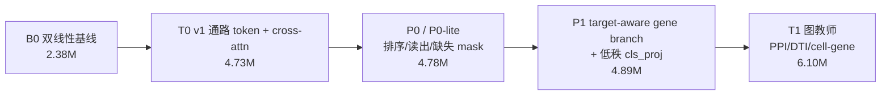
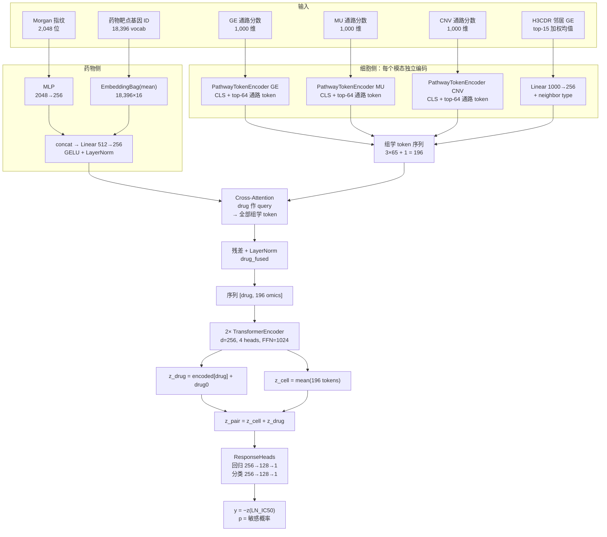
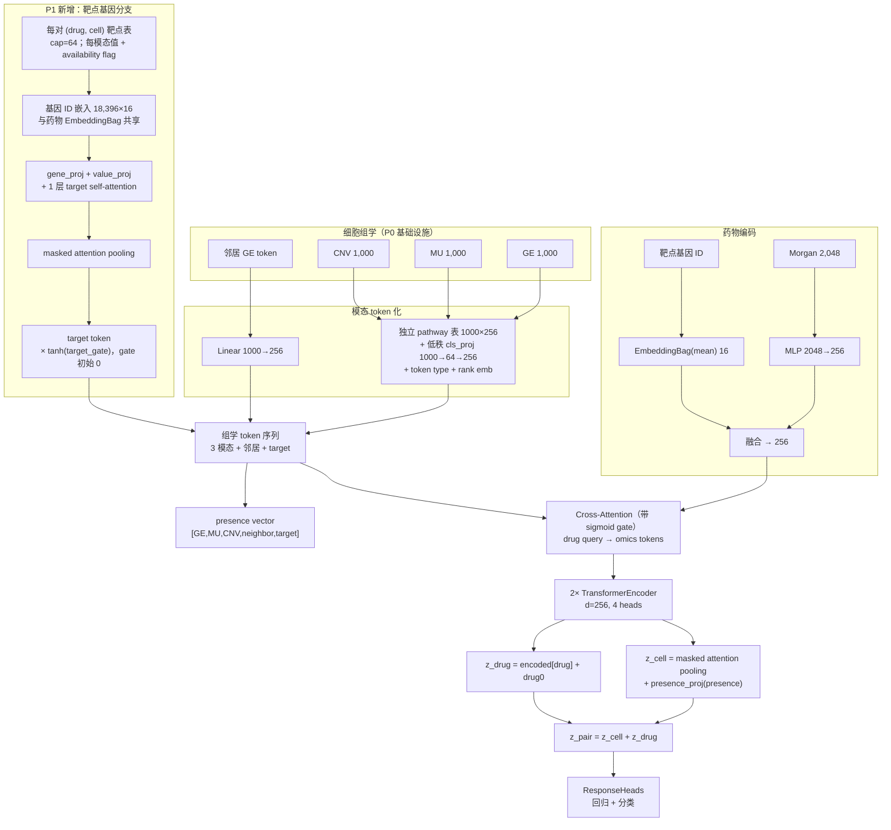
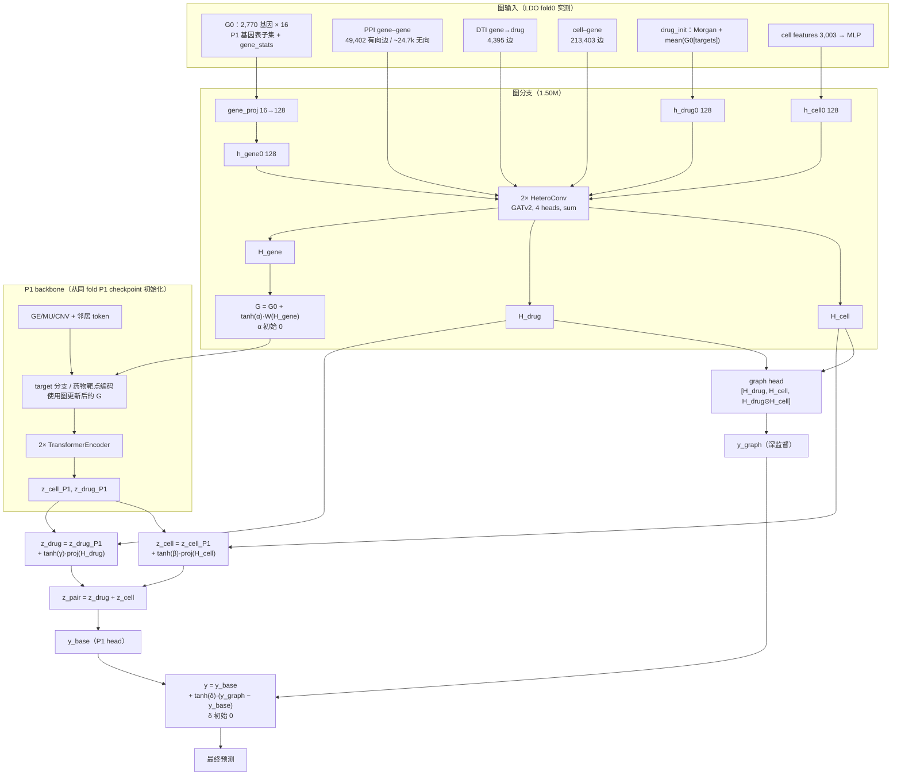

# 教师模型 T0–T1 工作总结：结构、消融与结论（2026-11-20）

- 状态：阶段性总结；**以快速筛选/单 seed 证据为主，不是最终论文结果**
- 范围：B0（参照）→ T0 v1 → P0/P0-lite → P1 → T1 v1/v2
- 依据：
  [`teacher-t0.md`](../docs/model_cards/teacher-t0.md)、
  [`teacher-t0-ablations.md`](../docs/model_cards/teacher-t0-ablations.md)、
  [`teacher-t1.md`](../docs/model_cards/teacher-t1.md)、
  [`2026-11-19_T0-P0快速验证.md`](2026-11-19_T0-P0快速验证.md)、
  [`2026-11-19_T0-P1快速验证.md`](2026-11-19_T0-P1快速验证.md)、
  [`2026-11-20_T1实施与快速筛选.md`](2026-11-20_T1实施与快速筛选.md)
- 实验目录（git 忽略）：`experiments/ablations/2026-11-19_*`、`experiments/*_ldo_quick/`

> **读数提醒**：本文的数字来自四类不同协议，不能直接横向比较：
> LCO 5 折（单 seed，20 epochs）、LCO 2 折 × 2 seeds × 5 epochs、
> LDO 3 折（1–2 seeds，20 epochs）、单折筛查（8 epochs）。
> 每张表都标注了协议与证据等级。

## 0. 结论先行

1. **T0 v1 是稳定的无图基线，但没有显著卖点**：GE 不可替代；MU 边际贡献不可测；
   CNV 可能小幅有用；交叉注意力未显著优于 B0；邻居 token 方向为正但不显著。
2. **P0 目标未达成**：排序损失没有稳定提升 SCC，hybrid readout 是主要负贡献；
   P0-lite 与 v1 打平，只适合作为更稳健的工程基线。
3. **P1 是当前最强无图候选，也是主教师**：target-aware 基因分支 + 低秩 `cls_proj`
   在快速验证中平均 +0.025 SCC（LCO）/+0.0125 per-drug SCC（LDO），
   但均未达显著/预注册门槛。
4. **T1 图先验 Go/No-Go 未通过**：+0.0125 被 random PPI/DTI/no-CG 复现；
   图分支不是独立强模型，降级为附录/负对照。
5. **下一步**：P1 正式 5 折 × 3 seeds / LDO / scaffold → VAE 补全 → 学生蒸馏/端侧；
   图方向若继续，需改为 cell-specific 子图 + 边级自监督。

---

## 1. 一张表看全貌

| 代号 | 定位 | 相对上一版的关键变化 | 参数量 | 证据等级 |
|---|---|---|---:|---|
| **B0** | 双线性基线 | Morgan + 靶点 + 组学 → 乘性交互 | 2,383,555 | LCO 5 折 × 1 seed |
| **T0 v1** | 无图默认基线/兜底教师 | 通路 token 化 + 药物→组学 cross-attention | 4,728,260 | LCO 5 折 × 1 seed |
| **P0 / P0-lite** | 训练目标与读出实验 | pairwise ranking、token type、attention pooling、缺失 mask、逐折 seed | 4,780,741 | LCO 2 折 × 2 seeds × 5 ep |
| **P1** | 当前最强无图候选（主教师） | target-aware 基因分支 + 低秩共享 `cls_proj` | 4,889,862 | LCO 2 折 × 2 seeds × 5 ep；LDO 3 折 × 2 seeds |
| **T1 v1/v2** | 图教师（附录/负对照） | P1 backbone + PPI/DTI/cell-gene 异构图 + 预测级 gate | 6,097,099 | LDO 3 折 × 1 seed；fold0 负对照 |

模型演化关系：



最终决策：**P1 继续做主教师**；T1 的图先验 Go/No-Go 未通过，降级为附录/负对照。

---

## 2. T0 v1：通路 token 化的无图交叉注意力教师

### 2.1 结构



### 2.2 关键实现口径

| 项 | T0 v1 设置 |
|---|---|
| 模态 token | 每个模态 `[CLS] + top-64 通路 token`；通路嵌入 1,000×256 + 分数投影 |
| 邻居 token | H3CDR 式 GE+MU 高斯核，top-15 加权平均 → `Linear(1000→256)`；sigmoid gate（初始 0.5） |
| 药物编码 | Morgan 2,048 → 256；靶点 `EmbeddingBag(mean)` 16 → 256；拼接融合 |
| 交互 | drug token 作 query 对组学 token 做单向 cross-attention，再与组学 token 一起过 self-attention |
| 读出 | `z_cell = mean(196 tokens)`；`z_pair = z_cell + z_drug` |
| 损失 | Huber + 0.5 × masked BCE；**无排序损失** |
| 训练 | AdamW lr=2e-4，wd=1e-3，dropout=0.1，modality dropout=0.05，batch=512，AMP，早停 val SCC |
| 未启用 | GIN（默认关闭）、token type、rank embedding、缺失模态 mask |

---

## 3. P1：target-aware 基因分支 + 低秩 `cls_proj`

P1 保留 T0 的整体骨架，但补上 T0 最根本的缺口：**药物侧是基因级，细胞侧只有通路级**。

### 3.1 结构



### 3.2 与 T0 v1 的差异

| 组件 | T0 v1 | P1 |
|---|---|---|
| 细胞表示 | 仅 1,000 维通路分数 | 通路 token + **逐基因 GE/MU/CNV**（18,396 基因） |
| 药物-细胞共享空间 | 无（药物基因 ID vs 细胞通路） | 靶点基因 token 与药物靶点嵌入**共享 18,396×16 基因表** |
| `cls_proj` | 每模态 `1000→256`（约 3×256k） | 三模态共享低秩 `1000→64→256`（约 80k） |
| token 类型 | 无 | CLS / pathway / drug token type |
| 读出 | mean pooling | masked attention pooling + presence vector |
| 缺失模态 | CNV 用常量 token；GE/MU 无 mask | 三模态 availability mask，缺失整段屏蔽 |
| cross-attention | 无 gate | sigmoid gate（初始 0.5） |
| 排序损失 | 无 | 关闭（P0 中不稳定） |
| 参数量 | 4,728,260 | 4,889,862 |

> P0 是 P1 的“训练/读出基础设施”前身：token type、rank embedding、attention pooling、缺失 mask、逐折 seed 都先在 P0 实现。P0-lite 取 `sum` readout、无 rank、8×64 sampler；P1 在此基础上加 target 分支和低秩 `cls_proj`。

---

## 4. T1：P1 + 异构图分支

T1 不是另起一套全图模型，而是 **P1 的图增强残差版**：初始化时 `T1 ≡ P1`，图分支必须“挣出”增益。

### 4.1 结构



### 4.2 图构建口径

| 项 | 设置 |
|---|---|
| 基因空间 | 药物靶点 ∪ 训练 fold HVG top1000 ∪ top500 突变基因，再与 `graph_inputs.npz` 的 16,197 基因取交集；LDO fold0 = **2,770 基因** |
| PPI | STRING combined_score ≥ 0.7 诱导子图；双向边；边特征 score |
| DTI | 仅保留与 286 个 GDSC 药物对齐的边；方向 gene → drug；边特征 score |
| cell-gene | 每个细胞取表达 top10% + 全部突变基因；方向 gene → cell；边特征 `[expr_z, mutation, cnv_z, cnv_observed]` |
| 图更新 | 2 层 `HeteroConv` + `GATv2Conv`，hidden=128，4 heads，sum 聚合；gene/drug/cell 分别残差 + LayerNorm |
| 初始化 | 同 split/fold P1 checkpoint；`G0` 从 P1 基因表拷贝；`α=β=γ=δ=0` |
| 损失 | Huber + 0.5×BCE + 0.3×graph-only Huber + 0.2×graph-only BCE |
| 参数 | 6,097,099（backbone 4,595,526 + graph 1,501,573） |

> `gene_stats_proj` 零初始化保证起点 `G0 == P1`；`gene_out_proj` **不能**零初始化，否则 `gene_gate=0` 处梯度恒为 0，PPI 知识永远进不了 target 分支。

### 4.3 T1 v1 → v2

| 版本 | 融合方式 | 结果（LDO seed0） |
|---|---|---|
| T1 v1 | embedding 残差：`z_cell/z_drug` 加图残差 | per-drug SCC 0.6414（Δ +0.0102 vs P1） |
| T1 v2 | **预测级 gate**：`y = y_P1 + tanh(δ)(y_graph − y_P1)` | per-drug SCC 0.6437（Δ +0.0125） |
| T1 v2 + blend | 后处理 graph-only 头加权 w≈0.3 | per-drug SCC 0.6444（Δ +0.0132） |

v2 学到的 `graph_pred_gate ≈ 0.35`，与后处理最优 0.3–0.4 一致；但后续负对照表明这不是图知识。

---

## 5. 消融实验结果

### 5.1 T0 E2：多组学消融（LCO 5 折 × 1 seed，主证据）

| 变体 | 模态 | 参数 | R² | PCC | SCC | AUROC | RMSE |
|---|---|---:|---:|---:|---:|---:|---:|
| **T0 full** | GE+MU+CNV | 4,728,260 | 0.178 ± 0.037 | 0.440 ± 0.033 | **0.427 ± 0.042** | 0.704 ± 0.020 | 0.914 ± 0.027 |
| T0 no-MU | GE+CNV | 4,214,468 | 0.176 ± 0.025 | 0.440 ± 0.027 | 0.425 ± 0.030 | 0.704 ± 0.018 | 0.915 ± 0.022 |
| T0 GE-only | GE | 3,700,676 | 0.176 ± 0.037 | 0.452 ± 0.032 | 0.438 ± 0.027 | 0.710 ± 0.015 | 0.915 ± 0.026 |
| B0（参照） | GE+MU+CNV | 2,383,555 | 0.180 ± 0.035 | 0.457 ± 0.036 | 0.440 ± 0.040 | 0.713 ± 0.022 | 0.913 ± 0.026 |

逐折配对差（vs T0 full，n=5）：

| 变体 | ΔR² | ΔSCC | 配对 t 检验 p（SCC） | 判定 |
|---|---:|---:|---:|---|
| no-MU | −0.002 ± 0.031 | −0.002 ± 0.026 | 0.85 | 无显著贡献 |
| GE-only | −0.002 ± 0.042 | +0.011 ± 0.035 | 0.53 | 与 full 等价 |
| no-neighbor（E-sim） | −0.008 ± 0.038 | −0.013 ± 0.028 | 0.37 | 方向为正但不显著 |

单折筛查（fold0，8 epochs）的极端对照：

| 变体 | R² | SCC | AUROC | 说明 |
|---|---:|---:|---:|---|
| full | 0.159 | 0.391 | 0.690 | 参照 |
| no-GE | **−0.010** | **0.203** | 0.601 | **崩塌** |
| no-MU | 0.118 | 0.391 | 0.683 | SCC 持平 |
| no-CNV | 0.123 | 0.374 | 0.674 | 小幅下降 |
| GE-only | 0.113 | 0.403 | 0.698 | SCC 略升、R² 降 |

**结论**

- **GE 不可替代**：去掉 GE 后 R² 接近 0，SCC 从 0.39 掉到 0.20。
- **MU 在 5 折上边际贡献不可测**：ΔSCC −0.002（p=0.85）。
- **CNV 可能小幅有用**：单折 no-CNV SCC −0.017，但 5 折未单独确认。
- **GE-only 在教师精度上与 full 等价**，参数少 1.0M；但按 D21，教师默认仍保留 MU/CNV——它们是学生拿不到的特权信息，价值应由蒸馏实验回答。

### 5.2 T0 E-drug：药物表示消融（fold0，8 epochs，仅筛查）

| 变体 | 药物输入 | 参数 | R² | SCC | AUROC |
|---|---|---:|---:|---:|---:|
| full | Morgan + targets | 4,728,260 | 0.159 | 0.391 | 0.690 |
| morgan-only | Morgan | 4,364,036 | 0.080 | 0.349 | 0.666 |
| targets-only | 靶点基因 | 4,072,388 | 0.085 | 0.348 | 0.668 |
| +GIN | Morgan + targets + 分子图 | 5,607,879 | 0.104 | 0.379 | 0.685 |

**结论**

- Morgan 与靶点基因**互补**：单独去掉任一路，SCC 下降约 0.04、R² 下降约 0.07。
- **GIN 在 T0 上没有收益**：+0.88M 参数，SCC 反而低 0.012、R² 低 0.055；默认 `use_gin=false`，留给 T1 再评估。

### 5.3 T0 E-sim：相似性消融

| 变体 | 设置 | fold0 SCC / R² | 2 折 SCC / R² | 5 折 SCC / R² |
|---|---|---|---:|---:|
| full | GE+MU 核，N=15，t=3 | 0.391 / 0.159 | 0.400 / 0.145 | **0.427 / 0.178** |
| no-neighbor | 去掉邻居 token | 0.388 / 0.113 | 0.413 / 0.148 | 0.415 / 0.170 |
| top5 | N=5 | 0.380 / 0.101 | – | – |
| top30 | N=30 | 0.384 / 0.137 | – | – |
| sigma2 | 固定 σ=2 | 0.400 / 0.130 | 0.418 / 0.165 | – |
| iter1 | 融合 t=1 | 0.396 / 0.114 | – | – |

5 折配对（no-neighbor vs full）：ΔSCC −0.013 ± 0.028（p=0.37），ΔR² −0.008 ± 0.038（p=0.66）。

**结论**

- 邻居 token 方向为正，但**5 折不显著**；单折“有邻居 0.424 vs 无邻居 0.390”不稳健，已作废。
- top-N=5 明显更差；N=30 与 N=15 接近；固定 σ=2、t=1 都在噪声内。
- 当前实现只是把邻居 GE 通路分数加权平均成一个 token，与细胞自身 GE CLS 高度冗余。
- **相似性更合理的用法是 T1 的细胞–细胞边/嵌入传播，而不是 T0 的单一上下文 token。**

### 5.4 T0 vs B0（LCO 5 折）

| 模型 | 参数 | R² | SCC | AUROC |
|---|---:|---:|---:|---:|
| B0 双线性 | 2,383,555 | 0.180 ± 0.035 | 0.440 ± 0.040 | 0.713 ± 0.022 |
| T0 交叉注意力 | 4,728,260 | 0.178 ± 0.037 | 0.427 ± 0.042 | 0.704 ± 0.020 |

逐折配对（T0 − B0）：ΔSCC −0.013 ± 0.022（p=0.27），ΔR² −0.002 ± 0.008（p=0.66）。

**结论：在 LCO 上，交叉注意力结构没有显著优于双线性基线。** 教师侧差异化不能靠“更多模态/更复杂注意力”，只能靠图结构（T1）或蒸馏。

### 5.5 P0：排序损失 / 读出 / sampler（LCO 2 折 × 2 seeds × 5 epochs）

主结果：

| 变体 | 参数 | R² | SCC | AUROC | per-drug SCC |
|---|---:|---:|---:|---:|---:|
| T0 v1 | 4,728,260 | 0.156 ± 0.049 | 0.415 ± 0.054 | 0.700 ± 0.024 | 0.411 ± 0.052 |
| P0-lite（sum, no-rank, 8×64） | 4,780,741 | **0.166 ± 0.045** | 0.410 ± 0.049 | 0.698 ± 0.022 | 0.405 ± 0.047 |
| P0-lite + rank 0.2 | 4,780,741 | 0.132 | 0.403 | 0.697 | 0.401 |

组件消融（seed0，2 折，5 epochs）：

| 变体 | SCC | 说明 |
|---|---:|---|
| T0 v1 | **0.428** | 参照 |
| 完整 P0（hybrid + rank 0.5 + 4×128） | 0.374 | 明显下降 |
| P0 sum readout（4×128） | 0.416 | **hybrid 是主要负贡献** |
| P0 no-rank（hybrid, 4×128） | 0.383 | rank 之外 hybrid 仍拖累 |
| P0 mean pooling（hybrid, 4×128） | 0.377 | attention pooling 不是主因 |
| P0 dropout 0.05（hybrid, 4×128） | 0.383 | dropout 0.15 不是主因 |
| v1 + grouped 4×128（无 rank） | 0.397 | 4 drugs × 128 cells 药物多样性不足 |
| v1 + grouped 8×64（无 rank） | 0.408 | 8×64 缓解，但仍低于 v1 |
| v1 + rank 0.2（4×128） | 0.416 | 排序损失小幅负贡献 |
| P0-lite std sampler | 0.420 | 与 8×64 接近 |

**结论**

- **完整 P0 不启用**：hybrid readout + 4×128 grouped sampler + rank 0.5 组合明显低于 v1。
- **hybrid readout 是最大问题**：当前实现下 `pair_proj + 直接双线性项` 在 5 epoch 内优化困难；sum readout 恢复约 +0.04 SCC。
- **排序损失没有稳定增益**：rank 0.5 约 −0.02；rank 0.2 跨 seed 不稳定。
- **P0-lite 是合理落点**：SCC 与 v1 打平，R² 略好，可作为“缺失模态更稳健”的基线，但不能宣称精度提升。

### 5.6 P1：target 分支 / 共享通路 / `cls_proj`（fold0，seed0，5 epochs）

| 变体 | SCC | R² | 说明 |
|---|---:|---:|---|
| T0 v1 | 0.381 | 0.116 | 参照 |
| **P1 推荐** | **0.430** | **0.177** | 独立 pathway + 低秩 cls + target |
| P1 去掉 target branch | 0.363 | 0.087 | target 贡献约 +0.065 SCC |
| P1 共享 pathway + 共享 cls | 0.386 | 0.142 | 共享 pathway 明显低于独立表 |
| P1 共享 pathway，去掉 target | 0.327 | 0.099 | 共享 pathway 本身也掉点 |
| P1 去掉 rank embedding | 0.428 | 0.176 | 影响可忽略 |
| P1 完全去掉 `cls_proj` | ~0.25–0.31 | — | 明显掉点 |

P1 主结果（LCO 2 折 × 2 seeds × 5 epochs）：

| 变体 | 参数 | R² | SCC | AUROC | per-drug SCC |
|---|---:|---:|---:|---:|---:|
| T0 v1 | 4,728,260 | 0.156 ± 0.049 | 0.415 ± 0.054 | 0.700 ± 0.024 | 0.411 ± 0.052 |
| **T0 P1** | 4,889,862 | **0.170 ± 0.054** | **0.440 ± 0.062** | **0.710 ± 0.031** | **0.436 ± 0.057** |
| P1 去掉 target branch | 4,092,677 | 0.114 ± 0.061 | 0.417 ± 0.051 | 0.702 ± 0.025 | 0.411 ± 0.046 |
| P0-lite | 4,780,741 | 0.166 ± 0.045 | 0.410 ± 0.049 | 0.698 ± 0.022 | 0.405 ± 0.047 |

逐 (seed, fold) ΔSCC（P1 − v1）：+0.044 / −0.002 / +0.004 / +0.055；均值 +0.025，SD 0.028，t≈1.79（n=4，双侧 p≈0.17）。

**结论**

- **target-aware gene branch 是 P1 的主要正贡献**（平均 +0.023 SCC），但跨 fold/seed 不稳定（t≈0.91），只能作为方向性证据。
- **共享 pathway embedding 假设不成立**：fold0 从 0.430 降到 0.386；三套独立模态表在 716 个细胞规模下提供了有用的模态特异性。
- **`cls_proj` 不能直接删**：完全去掉会掉到 ~0.25–0.31；低秩共享 `1000→64→256` 是合理折中，参数从 3×256k 降到 80k。
- **rank embedding 影响可忽略**（ΔSCC < 0.002）。

### 5.7 T1：LDO 快速筛选与负对照

P1 基线（LDO 3 折 × 2 seeds）：

| 指标 | P1 |
|---|---:|
| per-drug SCC | **0.6350 ± 0.0325** |
| global SCC | 0.3480 ± 0.0126 |
| AUROC | 0.6653 ± 0.0048 |

P1 seed0 逐折 per-drug SCC：0.606 / 0.621 / 0.667；seed1：0.611 / 0.621 / 0.684。

T1 主结果（LDO 3 折 × 1 seed）：

| 变体 | global SCC | per-drug SCC | AUROC | Δ per-drug vs P1 |
|---|---:|---:|---:|---:|
| P1（seed0，3 折） | 0.3482 | 0.6312 | 0.6633 | — |
| T1 v1（embedding 残差） | 0.3519 | 0.6414 | 0.6655 | +0.0102 |
| T1 v1 + graph-only blend w=0.3 | 0.3562* | 0.6444* | — | +0.0132 |
| **T1 v2（预测级 gate）** | **0.3614** | **0.6437** | **0.6681** | **+0.0125** |
| graph-only 头单独 | ~0.350 | 0.6325* | — | +0.0013 |

\* blend/graph-only 为 val 后处理诊断，不是独立训练结果；test 未评。

逐折 per-drug ΔSCC（T1 v2 − P1，seed0）：**+0.0176 / +0.0004 / +0.0196**；均值 +0.0125，低于预注册门槛 +0.02；相对 P1 两 seed 均值 0.6350 仅 +0.0087，小于 P1 的 run 间 SD 0.0325（3 折 × 2 seeds）。

**图结构负对照（fold0 × seed0）**：

| 变体 | global SCC | per-drug SCC | 结论 |
|---|---:|---:|---|
| T1 v2 real | 0.3538 | 0.6232 | 参照 |
| random PPI（度保持重连） | 0.3538 | **0.6233** | 与 real 几乎逐位相同 |
| random DTI（度保持重连） | 0.3500 | **0.6240** | per-drug 甚至略高 |
| 去掉 cell-gene 边 | 0.3453 | **0.6242** | 主指标不降反升 |

**结论：PPI/DTI/cell-gene 图结构对主指标没有可检测贡献；T1 的 +0.0125 更像“额外分支/集成/正则化”的容量效应，而不是图知识。**

可能原因：

- `gene_gate` 仅 ~−0.02，PPI 知识几乎进不了 target 分支；
- `cell_gate` 跨 fold 符号不稳定（−0.23 / +0.16 / +0.19），embedding 残差被当成正则项；
- 全局 gene 节点被所有细胞共享，PPI 信号被平均；
- DTI 仅 4,395 条，且 49/286 个药物无靶点；
- fold1 的 v2 在 epoch0（P1 初始化）即最佳，之后早停——单一学习率把 P1 推离最优点。

**Go/No-Go（预注册）**：主指标 LDO/scaffold 逐药 SCC；通过条件为 T1-full 相对 P1 的配对 ΔSCC ≥ 0.02 且 bootstrap 95% CI > 0。**判定：未通过。**

---

## 6. 总结论与决策

1. **T0 v1 是稳定的无图基线，但没有“多组学 + 注意力 + 相似性”的显著卖点**：
   GE 是主模态；MU 边际贡献不可测；CNV 可能小幅有用；交叉注意力未显著优于 B0；
   邻居 token 方向为正但不显著。
2. **P0 的目标没有达成**：排序损失没有稳定提升 SCC，hybrid readout 是主要负贡献；
   P0-lite 与 v1 打平，只适合作为更稳健的工程基线。
3. **P1 是当前最强无图候选，也是主教师**：target-aware 基因分支 + 低秩 `cls_proj`
   在快速验证中平均 +0.025 SCC（LCO）/+0.0125 per-drug SCC（LDO），
   但都未达显著/预注册门槛，需正式 5 折 × 3 seeds 确认。
4. **T1 图先验未通过**：相对 P1 的 +0.0125 被 random PPI/DTI/no-CG 复现；
   图分支不是独立强模型。按计划书 R4，**P1 继续做主教师，T1 降级为附录/负对照**。
5. **如果只是想要 T1 的集成增益**：优先用 **P1 + 第二个 MLP 预测头**，
   无图、参数和时间都更省，不必上 6.1M 的图分支。
6. **下一步优先级**：P1 正式 5 折 × 3 seeds / LDO / scaffold → VAE 组学补全 →
   学生蒸馏与端侧验证；图方向若继续，必须换设计（cell-specific target 2-hop 子图 +
   边级自监督 + graph-only 强基线）。

### 证据强度与限制

| 结论 | 证据强度 | 主要限制 |
|---|---|---|
| GE 是主模态 | 强（5 折 + no-GE 崩塌） | 仅 LCO、单 seed |
| MU/CNV 教师精度边际贡献小 | 中（5 折 no-MU；CNV 仅单折） | 未做蒸馏价值评估 |
| Morgan + targets 互补 | 中（单折筛查） | 需 5 折确认 |
| GIN 无收益 | 弱（单折筛查） | 仅当前 mean-pool 实现 |
| 邻居 token 不显著 | 中（5 折 p=0.37） | 实现较弱，不能否定图传播 |
| P0 排序损失无效 | 中（2 折 × 2 seeds × 5 ep） | 训练太短，超参未充分搜索 |
| P1 target 分支正贡献 | 弱–中（t≈1.79 / 0.91） | 未正式 5 折 × 3 seeds |
| T1 图先验不成立 | 较强（随机图/去边负对照） | 仅 fold0 负对照；no-DTI/no-PPI 未跑完 |

> 所有快速验证的早停与报告都用 val SCC，指标偏乐观；未评 test、未做多重比较校正。
> 正式论文结果需要逐折独立 RNG、≥3 seeds、5 折、LDO/scaffold，以及 test 单次评估。

---

## 7. 复现入口

```bash
# T0 v1：LCO 5 折
uv run python -m kite_drp.train.teacher_train teacher=t0 split=lco fold=all seed=0

# T0 消融：E2 模态 / E-drug / E-sim
uv run python scripts/run_ablations.py --suite all --folds 0,2 --epochs 10

# 5 折确认：no-MU / GE-only / no-neighbor
uv run python scripts/run_ablations.py \
  --only t0_no_mu --folds all --epochs 20 --patience 5 \
  --out experiments/ablations/2026-11-19_confirm5_no_mu
uv run python scripts/run_ablations.py \
  --only t0_ge_only,t0_no_neighbor --folds all --epochs 20 --patience 5 \
  --out experiments/ablations/2026-11-19_confirm5_ge_sim

# P1：LCO / LDO
uv run python -m kite_drp.train.teacher_train teacher=t0_p1 split=lco fold=all seed=0
uv run python -m kite_drp.train.teacher_train teacher=t0_p1 split=ldo fold=all seed=0

# T1：先用同 fold P1 checkpoint 初始化
uv run python -m kite_drp.train.teacher_train teacher=t1 split=ldo fold=0 \
  teacher.init_from=experiments/<p1_run>

# T1 快速筛选：P1 + T1 + 随机 PPI/DTI
uv run python scripts/run_t1_quick.py \
  --variants p1,t1,t1_random_ppi,t1_random_dti \
  --split ldo --folds 0,1,2 --seeds 0,1 --epochs 20 \
  --init-from experiments/p1_ldo_quick --out experiments/t1_ldo_quick
```
