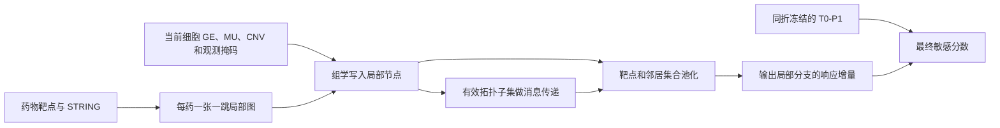

# KITE-DRP 教师模型复盘与图教师重构方案

2026-11-20 · 教师阶段（G1）· 仓库快照 `c988378` · 评审修订版

## 1. 本轮决策

**T0-P1 先作为已知药物的学生交接基线。图分支从低成本的邻居集合对照做起。** 旧 T1 v2 在留出药物（LDO）快筛中相对 P1 提升 +0.0125，低于原定 +0.02 门槛，首折随机连边的分数与真图相近。只读复算中，细胞系均值的逐药 SCC 为 0.6319，与旧 P1 单种子的 0.6312 接近。先修正药物实体分组，并在相同样本和训练口径下验证药物特异信号。学生端可并行用 P1 跑通留出细胞系（LCO）的已知药物任务。 [项目计划][local-plan] · [T1 决策记录][local-t1]

基因表达、突变和拷贝数变异分别记为 GE、MU、CNV。DTI 指药物–靶点互作，PPI 指蛋白质之间的互作或功能关联。仓库现有进展以已记录的实验为依据。局部图参数与筛选流程是本轮建议，需用新实验验证。

| 要回答的问题 | 对照 | 决策用途 |
|---|---|---|
| T0-P1 是否学到了药物特异的响应？ | 在同一批样本上比较细胞系均值、仅细胞组学模型、RF、B0 和 P1 | 确定教师性能及可报告的泛化范围 |
| PPI 选出的邻居是否提供增量？ | 同一池化头对比真实邻居与匹配伪邻居，以合规靶点分支和等容量第二头为参照 | 决定是否保留靶点邻域特征 |
| 给定节点时，真实连边及逐细胞消息是否提供增量？ | 同节点无传播、有效重连、固定聚合，必要时用训练折基因均值替换消息输入 | 确定局部图的收益来源 |
| 教师新增信息能否传到轻量学生？ | 固定学生输入，对比监督基线、组学补全、P1 蒸馏及真图与重连教师蒸馏 | 确定后续端侧主线用哪些信号 |

## 2. 主要文献与可采纳的设计

检索截至 2026-11-20。通过学术与网页检索定位 PubMed/PMC、出版方全文及 arXiv，按 DOI 去重。核心检索词覆盖 `cancer drug response prediction AND (leave-drug-out OR scaffold OR cross-study)`、`(drug-cell-gene OR pathway OR PPI) AND (graph OR drug response)`、`drug response AND drug target AND (network propagation OR neighborhood)`、`(multi-omics completion OR knowledge distillation) AND drug response`，并追查相关基准引用的原始研究。优先纳入单药细胞系药敏、有训练与留出协议的研究，补充与局部图、蒸馏直接相关的论文和基准。下表按与本项目决策的关系组织，文献分数沿用各自任务口径。

| 研究 | 直接证据及适用边界 | 对 KITE-DRP 的启发 |
|---|---|---|
| [Bernett 等，DrEval，Nat. Commun. 2026][ref-dreval] | 统一调参和比较后，复杂模型在多种设置下接近或落后于树模型。其留出药物（LDO）实验中，模型未显著超过均值效应基线，原尺度 $R^2$ 近零。 | 用细胞系与药物的训练期均值效应作为强制对照，结合逐药排序和按统一目标训练的绝对误差。不能凭总体相关系数推断新药泛化。 |
| [Partin 等，跨库基准，Brief. Bioinform. 2026][ref-partin] | 用统一数据和执行框架比较多个药筛库。在部分跨库任务中，LightGBM 的表现或性能保留率高于深度模型。各药筛库之间的迁移幅度不同。 | 以相同划分和特征训练一个树模型。外库同时报告标签方向、交集、新细胞及可使用的靶点覆盖。 |
| [Branson 等，药敏模型的性能来源，Bioinformatics 2025][ref-branson] | 在共同实验框架下比较药物/细胞表征和预测器，表明输入与结构的变化需要受控比较。 | 固定 Morgan 指纹、组学和训练预算后再测新分支。药物表示升级单独消融。 |
| [Liu 等，DeepCDR，Bioinformatics 2020][ref-deepcdr] | 用分子原子图编码药物并融合细胞多组学。论文用单位邻接矩阵消融原子连边。 | 可复用已有复现经验。药物分子图与蛋白关联图是两种不同先验，本轮只检验后者。 |
| [Pak 等，NetGP，Brief. Bioinform. 2023][ref-netgp] | 从药物靶点出发，经药物特异网络传播得到每药固定的基因扰动特征，再与细胞系表达和药物表征融合。论文包含留出药物评估，指标沿用原文口径。 | 将固定网络特征作为近邻方法。比较时固定靶点与预测头，检验读入当前细胞组学后的局部传播能否增加预测信息。 |
| [Pak 等，DGDRP，Front. Genet. 2024][ref-dgdrp] | 沿用 NetGP 得到药物特异候选基因，用 GNN 学到的基因与靶点表征相似度重排候选，再读取入选基因在当前细胞系的表达来预测药敏。 | 药物特异基因选点已有直接先例。固定候选节点后检验逐细胞组学参与消息传递的贡献。 |
| [Oskooei 等，NetBiTE，Sci. Rep. 2019][ref-netbite] | 从靶点在 PPI 上传播权重，作为逐药树集成的基因抽样先验。GDSC 上的优势集中于膜受体通路抑制剂，论文另在两个案例中用假靶点做对照。 | 预先记录作用机制和靶点类别，检查邻域收益是否集中在某些药物。匹配伪邻居对照保留同一靶点，检验邻居选点本身。 |
| [Zhu 等，TGSA，Bioinformatics 2022][ref-tgsa] 和 [Shin 等，DRPreter，IJMS 2022][ref-drpreter] | TGSA 用 STRING 图表征细胞，并与平均度数匹配的随机拓扑做对照。DRPreter 用通路拆分细胞图并对药物做注意力融合。 | 把细胞组学放在基因节点上再传播。用小图替换全局共享基因表示，保留每个药物–样本对的状态。 |
| [Gu 等，H³CDR，IEEE TCBB 2026][ref-h3cdr] | 将异构和同构图结合以利用药物、细胞系的关系。论文结构与仓库的邻居 token 有别。 | 相似性可作为候选辅助信号。首轮固定 P1 的相似性设置，保留仅连训练锚点的现有约束。 |
| [Inoue 等，drGT，BMC Bioinform. 2026][ref-drgt] | 正式发表版本使用统一异构图，留出药物时屏蔽响应边，保留药物–基因、细胞系–基因关系。该设置下回归 $R^2=0.022$，分类与回归的表现差异明显。 | 分别注明新药是否有靶点注释。用更清楚的归纳推理接口，图节点不存药敏读数。 |
| [Yoon 与 Lee，GCNPath，Commun. Biol. 2026][ref-gcnpath] | 用通路活性与由蛋白关联、基因调控或通路相关性派生的串扰图表示细胞，包含盲测和跨数据集实验。 | 若基因子图覆盖不足，可考虑通路级图。需要先与相同通路输入的无图模型对照。 |
| [Li、Hostallero 与 Emad，先验架构对照，Bioinformatics 2023][ref-li] | 在相同架构内用等大小随机基因集代替真实通路，并加入随机森林与 MLP。真实通路的预测优势依评测设置而变。 | 真实局部图要同时面对同节点无传播和同度重连。增加参数量带来的收益用等容量第二预测头检验。 |
| [Keyl 等，NeurixAI，NAR Cancer 2025][ref-keyl] 和 [Alfawaz 等，跨谱系多组学消融，Cancers 2026][ref-alfawaz] | 前者用细胞/肿瘤与药物潜向量交互建模，训练数据为离体肿瘤药筛。后者在 12 个药物上发现表达承载大部分预测信号，新增突变与拷贝数的逐药提升未通过多重比较。 | 保留 B0 双线性基线，把 GE-only 纳入现有教师对照。额外模态的价值可用学生端的增益检验。 |
| [Bhattacharjee 等，FORGE，Nat. Commun. 2026][ref-forge] | 用基因敲除测得的依赖表型与药敏做联合建模，为药物预测提供功能信息。 | 在局部图确有增量后，可探索训练期基因依赖监督。有一套可独立评估的功能数据时再增加该分支。 |
| [Li 等，MKDR，Front. Oncol. 2025][ref-mkdr] | 将变分自编码器补全与师生蒸馏用于宫颈癌药敏，包含细胞系与 TCGA-CESC 的分析。 | 把组学补全和教师知识做成可独立开关，并单测患者域补全。临床小样本与当前泛癌细胞系任务的终点各自报告。 |

另一个接近的方向是 2026 年预印本 PREDIKTOR。它在治疗结局分类中构造个体基因调控图，并引入扰动表征。KITE-DRP 聚焦两个可检验的问题。**给定相同候选节点和模型容量，逐细胞的局部消息能否改善药敏预测？在匹配的教师对照下，这部分增益能否传给只用表达与面板突变的学生？** [NetGP][ref-netgp] · [NetBiTE][ref-netbite] · [PREDIKTOR 原稿][ref-prediktor]

## 3. 既有实验与只读复核

### 3.1 主要结果

以下项目数值来自仓库记录。SCC 指 Spearman 相关系数。表中均为验证集结果。SCC 一栏注明整体或逐药平均，两种指标各自比较。

| 对比 | 协议 | 实测结果及判断 |
|---|---|---|
| B0 双线性 vs T0 v1 交叉注意力 | 留出细胞系（LCO），5 折 × 1 种子 | 整体 SCC **0.440 vs 0.427**，$R^2$ **0.180 vs 0.178**。B0 只有约 2.38M 参数，应作为强深度基线。 [多组学与结构消融][local-ablation] |
| T0 v1 的全三模态、仅表达、无相似性邻居 | LCO，5 折 × 1 种子 | GE/MU/CNV 整体 SCC 0.427，GE-only 0.438，无邻居 0.415。该轮未检出加入 MU/CNV 或邻居的稳定增益，效应区间仍需要多种子确认。去 GE 的单折大幅下降。 [多组学与结构消融][local-ablation] |
| P0 排序损失与复杂读出 | LCO，快速筛选 | 完整 P0 比 T0 v1 低，P0-lite 近似持平。排序损失、采样和读出同时改动会干扰归因，保留原默认损失。 [P0/P1 工作总结][local-p1] |
| T0-P1 vs T0 v1 | LCO，2 折 × 2 种子，5 epochs | 整体 SCC **0.440 vs 0.415**。四个配对差为 +0.044、−0.002、+0.004、+0.055。P1 用药物靶点读取对应的 GE/MU/CNV，方向值得复核。 [P0/P1 工作总结][local-p1] |
| T0-P1 | LDO，3 折 × 2 种子 | 逐药 SCC **0.6350 ± 0.0325**，其中 ± 为六个折–种子结果的标准差。统一口径下的药物特异增益仍待验证，基线复算见第 3.2 节。 [T1 实施记录][local-t1] |
| T1 v2 vs T0-P1 | LDO，3 折 × 1 种子，配对 | 逐药 SCC **0.6437 vs 0.6312**，差值 +0.0125。逐折差值 +0.0176、+0.0004、+0.0196。第二折 `best_epoch=0`，按训练循环对应首轮训练后的验证。首折的真实图 0.6232，随机 PPI 0.6233，随机 DTI 0.6240，去掉细胞–基因边 0.6242。原先的图先验推进门槛未通过。 [T1 模型卡][local-card] · [训练引擎][local-engine] |

P1 的靶点分支以药物为条件从样本读取基因值，这一交互应保留。E-drug 单折中，删除 Morgan 或靶点一路都会掉分，在 T0 上加分子 GIN 也未见改善。因此首轮沿用 Morgan 和 P1 靶点输入，单独改变蛋白关联的使用方式。 [T0 消融][local-ablation] · [P1 配置][local-p1-config]

### 3.2 细胞系均值的只读复算

按照现有 M-716 教师入口对齐细胞系与药物索引，得到 176,487 个有限标签配对。对 `p2_ldo_s0` 的验证折 0、1、2，仅用该折训练数据按每个训练药的均值和样本标准差标准化 `−LN_IC50`，再给每个细胞系取跨药均值。用这个固定的细胞系分数预测所有验证药，在每药至少 10 个有标签细胞且标签非常量的集合上计算逐药 SCC。三折各自的验证细胞系均在对应训练折出现。 [样本入口][local-dataset] · [配对标签][local-teacher-pairs] · [现有 LDO 划分][local-ldo]

| 诊断 | Fold 0 | Fold 1 | Fold 2 | 三折等权均值 |
|---|---:|---:|---:|---:|
| 可计分药物数 | 57 | 57 | 58 | — |
| 训练折细胞系均值，原始 `−LN_IC50` | 0.6048 | 0.6178 | 0.6600 | 0.6275 |
| 训练折细胞系均值，逐药标准化后 | 0.6039 | 0.6223 | 0.6694 | **0.6319** |

旧单种子 P1 为 0.6312，T1 v2 为 0.6437。两者沿用旧训练和计分口径。复算说明，仅凭细胞系跨药平均易感性就可得到同量级的逐药排序。正式增益用统一协议重训后，按同药、同样本比较。 [旧快筛][local-t1]

### 3.3 实现里要处理的四个问题

1. **全局 T1 的传播顺序。** T1 用一份跨细胞共享的基因状态做 PPI 传播。当前样本的表达、突变和 CNV 已出现在 gene→cell 边，P1 靶点 token 也有样本值。局部图要验证的改变是让这些值在 gene→gene 聚合之前进入节点，使同一路径上的消息随样本变化。 [T1 模型][local-t1-code] · [T1 图构建][local-t1-graph]
2. **旧随机化的作用范围。** 随机药物–靶点互作（DTI）只替换图中的边索引，P1 和药物节点初始化仍读取真实靶点表。重连时，旧边属性数组也未按新边组织，PPI 正反两向的分数配对可能改变。旧结果足以支持暂缓这个实现，拓扑与靶点先验的价值还需要单独识别。新主对照统一用等权边。 [T1 模型][local-t1-code] · [T1 图构建][local-t1-graph]
3. **早停与初始权重。** 旧训练默认用整体验证集 SCC 早停，快速表则比较逐药 SCC。正式 LDO 和化学骨架划分统一使用 `train.monitor=val_per_drug_scc`，先补齐共享的逐药指标规则。旧分数按原口径保留，新的对比使用相同监控指标重训。局部残差分支在首次参数更新前另外记录 P1 的分数，以检查初始预测一致性。 [训练配置][local-train-config] · [训练引擎][local-engine] · [快速筛选脚本][local-quick]
4. **输入、尺度和隔离。** 旧 `eval naive` 从 canonical 标签读取数据，未见药物的逐药 z 值填零。在现有 LDO fold 0，M-716 的公共训练样本为 105,873 对，旧逐药缩放的拟合记录为 141,321 对。未知药物的全局回退统计目前已从教师折内训练样本计算。正式比较也从同一公共训练索引重建逐药统计。验证药在另一折轮换为测试药，处理见第 4 节。 [旧均值基线][local-naive] · [折内数据集][local-dataset] · [Fold 0 拟合记录][local-fit-ldo-f0]

## 4. 先固定评估协议

### 4.1 样本与划分

1. **导出公共样本索引。** 以 `TeacherPairDataset` 的 M-716 为主，按 `cell_line_uid, compound_uid` 键保存每折 train/val/test、原始 `LN_IC50`、AUC、外推标记和观测掩码。均值基线、仅细胞组学模型、RF、B0、P1 和图分支共用样本资格及索引。逐药缩放和全局回退统计都从公共 train 索引重建，组学变换继续走 `FitScope`。另用 M-509 做完整三模态敏感性分析。 [数据范围][local-data-gaps] · [折内拟合][local-fit]
2. **按药物实体分组后冻结主协议。** 现有 `p2_ldo_s0` 用于旧结果复核和接口检查。本地核查发现 Bleomycin 与 Bleomycin (50 uM) 跨训练与验证，Morgan–Tanimoto 为 1.000。正式 LDO 先标准化去盐母体结构，并核对药物标识和冲突映射。将同一实体的别名、盐型和实验条件置于同一折，保留各自实验标签。辅助 P3 以 Bemis–Murcko 骨架留出，并复核同实体分组。现有三个 P3 JSON 标记 `degraded=false`，其中 9 个无骨架药走靶点或化合物 ID 回退。报告全 P3 和有骨架子集，并按最高训练药 Morgan–Tanimoto 相似度、是否共享训练药的靶点描述留出难度。LCO 延用 `p1_lco_s0` 的细胞系来源组。 [现有化合物表][local-compounds] · [划分实现][local-splits] · [P3 划分][local-scaffold] · [化学距离评估研究][ref-scaffold]
3. **固定划分种子，重复模型初始化。** 修正划分后先锁定快速比较的 3 个验证折及模型种子 0、1。入围模型的正式内部对照用固定划分的 5 折 × 3 个初始化种子（0、1、2）。各模型共用折内索引和标签规则。记录划分及输入哈希、停止轮次、初始化权重、实际参数、显存和耗时。 [训练入口][local-train]
4. **锁定选模与最终评估。** 现有轮转中 `val(k)` 与 `test(k+1 mod 5)` 由同一组药物组成。用于筛选架构的五折结果按内部交叉验证报告。各模型只在本折 train 拟合、val 早停，锁定比较矩阵后统一评估本折 test。新药增益的独立确认应在新一轮选型前锁定从未用于方案选择的外层药物或骨架，把调参与早停放在内层。外库复核预留此前未用于选型的药筛，药物与细胞映射及评价规则在打分前锁定。 [划分实现][local-splits] · [外部数据清单][local-external]

### 4.2 指标口径和强基线

| 要测什么 | 实施规则 |
|---|---|
| 同药的细胞系敏感性排序（主指标） | 对每种药在同一批真实标签上求 $\rho_d=\operatorname{Spearman}(\hat{s}_{c,d},-\mathrm{LN\_IC50}_{c,d})$，再对药物等权平均。预先锁定至少 10 个非缺失细胞且真实标签非常量的药物。常数预测按 0 计分并另报比例，非有限预测记为运行失败。按同一评价键配对，分母由真实标签确定。现有实现聚合时会跳过 NaN，统一规则后再用 `val_per_drug_scc` 早停。 |
| 增益来源 | 报相对细胞系均值和仅细胞组学模型的逐药差值、逐药样本数、有/无合规靶点及与训练药的化学距离。描述有靶点药物按预设 MoA 类别的表现和数量。全局 SCC、药内 Pearson 和按组织分层结果辅助描述。 |
| 对标签外推的敏感性 | 本地 M-716 有 72.75% 标签配对带 IC50 外推标记。现有标记表示至少一条原始记录的拟合 IC50 达到或超过该记录的最高实验浓度。保留 `LN_IC50` 主分析，用同一组模型预测在同时具有两个标签的样本上分别复算逐药 SCC 和配对增益，AUC 取该药筛定义的敏感性方向。结合逐药外推比例检查结果。 [标签标记规则][local-labels] |
| 绝对药敏（次终点） | 当前目标是训练折逐药 $-z(\mathrm{LN\_IC50})$，未见药的训练全局 fallback 保持药内排序。绝对 `LN_IC50` 回归比较另用同一个训练折全局变换来训练**各模型**，用该折训练统计反变换后报 RMSE、MAE、$R^2$。此实验可后置，禁止用目标药测试标签校准量纲。 |
| 敏感二分类（次终点） | 说明标签阈值。现有未见药的 fallback 为训练全局中位数，不能解释为各药临床阈值。报告 AUROC、AUPRC、正类比例和可计分药物数，保持组间同口径。 |
| 统计不确定性 | 对齐折外预测，先求同药、同种子的配对差，再对种子取等权均值。LDO 按药物实体、P3 按骨架组做配对 bootstrap，每次保留该组全部药物记录，建议 2,000 次。报告各 seed 的宏平均和配对 $\Delta$ 的 95% CI。区间针对固定细胞面板，可再按 `source_group` 重采样细胞做敏感性分析。涉及多药或多通路的推断时报告 FDR 校正。 |

[现有指标实现][local-metrics] · [标签变换][local-pairs] · [DrEval 指标及基线][ref-dreval]

**均值与组学基线。** 保留全局常数、逐药中位数和细胞系均值。DrEvalPy 的 `NaiveMeanEffectsPredictor` 组合训练期细胞系与药物效应，在 LDO 退化为细胞系均值，在 LCO 退化为药物均值。LCO 另比较训练折的组织×药物均值。按第 3.2 节在同一训练分数空间计算细胞系均值，未见细胞系用训练全局均值回退。用同一公共索引训练全输入 RF 和仅细胞组学 RF，二者使用相同的组学通路分数、掩码和选参预算。前者额外使用 Morgan 与多热靶点，后者只读取细胞侧输入。GE-only 是保留药物输入的组学消融，用来检验附加模态。 [DrEvalPy 均值效应定义][ref-drevalpy] · [旧基线][local-naive]

## 5. 用药物靶点局部图重做 T1

### 5.1 从每种药生成小图

- **靶点来源。** 从有明确作用机制（MoA）的 Open Targets/ChEMBL 记录和经过核实的独立药物注释构建靶点表。保留 `compound_uid`、HGNC 标识、作用类型、证据来源、版本和匹配规则。汇总药物无明确基因靶点时留空。旧图混合来源覆盖 237/286 药物，约 97.5% DTI 边含 DGIdb 来源标记。合并分数取跨源最大值，部分压缩产物只保留汇总来源，用原始来源或合并前记录生成高可信靶点表，再统计实际覆盖，有利于追查每条证据。允许使用在推理时可得且不含药敏标签的注释。若发现 GDSC 药敏推导的靶点或别名歧义，先修正再重建基线。 [旧先验说明][local-card] · [DTI 合并][local-priors] · [Open Targets MoA 数据说明][ref-ot]
- **节点与边。** 按药取可测的直接靶点作根节点。从版本固定的 STRING 图选一跳邻居，起点为 combined score ≥0.7。邻居按分数降序，同分按 HGNC 基因符号排序。建议每靶点至多 8 个邻居、每药至多 64 个总节点，根节点优先，超过上限的根按证据优先级和 HGNC ID 确定性裁剪，保存裁剪前后覆盖。保留入选节点间的无向关联，固定排序和局部索引。首轮 PPI 权重统一为 1，避免真实分数配对影响拓扑归因。STRING combined score 表示证据支持的关联，生物意义可包括功能关联与物理互作。 [STRING 原始论文][ref-string]
- **细胞状态。** 对每个药物–细胞系对，在同一组候选基因上读取按折变换的表达（GE）、突变（MU）和拷贝数（CNV）。编码时同时传入数值、观测掩码和根节点标记。缺失数值可填零并标明缺失。M-716 当前三模态覆盖不齐，另外检查“真实 CNV 为零”和“CNV 缺失”可区分。最小版本使用共享投影，避免为局部图额外引入可记忆药物身份的 ID 表。 [细胞特征实现][local-features] · [TeacherBatch 接口][local-batch]

**用实际覆盖解释晋级门槛。** 现有压缩 DTI 中，带 Open Targets 或 ChEMBL 来源标记的候选药为 108/286，占 M-716 有限标签配对的 40.4%。该复算使用合并后的来源标记，正式覆盖由原始作用机制记录、母体映射和根基因可测性决定。按每折报告合规靶点可用、存在可观测邻居和根消息可有效重连的药物数。在药物等权、无覆盖药物精确回退 P1 的条件下，全量增益等于有覆盖药占比乘以覆盖组增益。以 108/286 的候选覆盖举例，全量 +0.02 对应覆盖组平均约 +0.053。 [压缩图输入][local-graph-inputs] · [DTI 合并][local-priors]

### 5.2 先检验邻居选点，再检验消息传递

最小实现先用局部节点集合。进入拓扑对照后，同一个药物的邻接表跨样本复用，每个细胞系的基因状态在前向时读取。



1. **靶点与邻居集合。** 用同一共享投影和读出头，对根与非根分别做带掩码池化。合规根节点固定，比较只给根输入、加入真实一跳邻居和加入匹配伪邻居。伪邻居从根和真邻居以外抽取，匹配节点数、全局度数和组学可得性。此阶段使用 PPI 选点，池化直接读取集合内的组学。 [NetGP][ref-netgp] · [DGDRP][ref-dgdrp] · [NetBiTE][ref-netbite]
2. **固定传播对照。** 在可有效重连的子集上，对每个节点按实际邻接取逐模态邻居均值，使用观测掩码归一化，保留是否有可用邻居的标记。对真图和重连图做相同的根、非根池化和小 MLP 读出。 [Wu 等，ICML 2019][ref-sgc]
3. **一层可训练局部图。** 给定药物 $d$ 的节点集 $V_d$、邻接 $\mathcal N_d(g)$，设 $x_{c,g}$ 为当前细胞的带掩码基因输入。用宽度 64 的共享映射将其投影成节点状态，用等权邻域平均产生消息，再做残差更新。

   $$
   \begin{aligned}
   h^0_{c,d,g} &= f_{\mathrm{in}}(x_{c,g},\,\mathbf 1_{\{g\in T_d\}}), \\
   m_{c,d,g} &= \operatorname{mean}_{u\in\mathcal N_d(g)} h^0_{c,d,u}, \\
   h^1_{c,d,g} &= \operatorname{LayerNorm}\bigl(h^0_{c,d,g}+
   \operatorname{GELU}(W_m m_{c,d,g})\bigr).
   \end{aligned}
   $$

   $T_d$ 为保留下来的靶点。无邻居时以本节点状态作消息。对根节点和非根节点分别做掩码池化，并保留两者的有效标记。连接池化结果及冻结 P1 的成对表征，输入两层 MLP 产生标量残差 $r_{c,d}$。不同细胞即使面对相同邻接，也会产生不同的基因消息。例如根 A 的两个邻居在细胞 1 的标准化表达是 2 和 0，在细胞 2 是 0 和 0，则固定聚合的表达分量分别为 1 和 0。传播前写入样本状态，正是这一步改变了 T1 的信息流。
4. **预测与回退。** 令 $a_d$ 表示是否存在可映射的合规靶点。输出 $\hat{s}_{c,d}=\hat{s}^{\mathrm{P1}}_{c,d}+a_dr_{c,d}$。无覆盖样本直接输出 P1，并从增量损失中排除。残差末层权重、偏置置零使首次更新前的输出与 P1 一致。首轮仅训练增量回归头及其编码器，在相同覆盖样本上使用同一目标与 Huber 损失。冻结 P1 的参数，并在外层每次切换到 `train()` 后保证 P1 仍处于 `eval()` 和无梯度模式。分类沿用 P1。 [训练引擎][local-engine]
5. **限制计算量。** 缓存每药节点索引、邻接和根掩码。按批次的样本和药物索引读取节点特征。先在单折记录参数、峰值显存和每轮耗时。固定特征筛选可按折缓存冻结 P1 的分数与成对表征，验证缓存与在线输出一致。两跳、证据加权和联合微调留待一跳对照后决定。

### 5.3 训练接口和产物

| 改在哪里 | 最小改动与验收 |
|---|---|
| 图构建与数据索引 | 在 `train/` 下新增局部子图构建逻辑，复用 `CellFeatureSet` 和现有按索引组装批次的实现。保存 `compound_uid → genes/edges/root_mask`、覆盖和边来源审计。评估药物可在推理时从同版本外部先验构图。各药的静态拓扑不依赖同批其他测试样本。 |
| 教师与训练配置 | 在 `models/teacher/` 增加局部残差分支，保留 `TeacherBatch/TeacherOutput` 契约。配置组合拟采用 `teacher=t1_local`。冻结 P1 从匹配 split、fold、pool 和输入签名的 checkpoint 加载。对照采用相同的 train/val、随机种子、损失和优化预算。 |
| 验证与缓存 | 验证首次更新前及空靶点时与 P1 同键输出一致，并涵盖未知药、空邻域、全缺失模态和 AMP 前向。相同药物–样本对单独预测与混合批次的输出在数值容差内一致。改动测试标签时训练图及训练统计哈希保持一致。改动一条边或其属性时缓存键随之变化。训练、评估与蒸馏共用折内统计和局部图构造。 |
| 追溯 | 图缓存记录 PPI、DTI、processed、fold 中数据索引和拟合统计的**内容**哈希，加上裁剪参数、重连种子及构建代码版本。模型记录同折 P1 checkpoint SHA-256。每个变体导出相同键的预测和逐药指标。原 T1 的 `spec_hash` 主要依赖配置、计数和基因列表，用它不能区分上游内容替换。 |

[当前批次读取][local-loader] · [旧图缓存][local-t1-graph] · [教师加载与训练][local-train]

## 6. 对照矩阵与推进条件

所有增量分支均从同一折、同一初始化种子的冻结 P1 出发。共享同一合规靶点覆盖门控、梯度样本和优化预算。比较真实图与重连图时，根节点、候选节点、样本输入、边权、池化和参数量保持一致。第二 MLP 头对齐增量可训练参数量，并记录实际差值。

| 对照 | 输入和变化 | 结果怎么解释 |
|---|---|---|
| P1 | 现有多模态和 Morgan + 靶点输入 | 主教师参照 |
| P1 + 第二 MLP 头 | 成对表征加容量匹配的预测头，用相同的靶点覆盖门控 | 额外预测容量能解释多少增益 |
| P1 + 合规靶点 | 局部分支只读取合规根节点组学，使用集合池化及相同读出头 | 合规靶点本身带来多少增益 |
| P1 + 真实邻居集合 / 匹配伪邻居集合 | 同一组根与集合池化头，伪邻居匹配数量、全局度数和组学可得性 | PPI 选出的额外节点是否改善预测 |
| P1 + 同节点无传播 | 读取真图的同一候选节点。按节点用 $W_m h^0_g$ 自更新，保留活跃参数和相同池化 | 额外基因输入和读出本身能解释多少增益 |
| P1 + 固定真图 / 固定重连图 | 同一节点做等权均值传播，训练小预测头 | 固定传播是否足够 |
| P1 + 局部真图 / 局部重连图 | 同一训练分支。重连保留逐节点度和边数，真实与随机图都用等权边 | 给定候选节点，真实连边的贡献 |
| P1 + 真图的折内均值消息 | 同一真图和读出，保留逐细胞节点状态与掩码，只用训练折基因均值替换发往邻居的组学数值，按相同预算重训 | 真图取得增益后，检验组学状态前移的贡献 |

**判断重连是否改变了模型收到的消息。** 单根一跳图的根连接全部候选邻居，逐节点保度重连固定了根邻边。邻居间仍可能交换边，这检验的是邻居间拓扑。用本地压缩先验按一跳裁剪规则模拟，108 个候选药有 40 个单根，53 个存在能改变根邻边的合法双边交换。该统计用于估计验证范围，正式子集在重建靶点表后重新计算。以图结构和训练细胞上的实际消息差异锁定子集，保存成功交换数、边替换率、根邻边替换率和连通分量。正式配对至少使用 3 个独立重连实例，报告有效子集、覆盖及全量表现。 [压缩图输入][local-graph-inputs]

**药物先验可得性要在预测前声明。** 将新药带有靶点注释、以及仅有化学结构两种条件分别评测。仅用结构的条件在训练和测试都屏蔽 DTI，P1 同时关闭 `teacher.use_targets` 和 `teacher.target_branch` 后重训。自然缺靶点的药物单列，检验回退路径。若要评估局部靶点身份贡献，可固定 P1，给局部分支使用同靶点数、匹配证据条件的随机根，所得结论限于给定 P1 后的局部根节点选择。

### 6.1 实施顺序

| 顺序 | 做什么 | 交付与进入下一步的条件 |
|---|---|---|
| **第 1 步，重建基准** | 提取 M-716 公共样本，完成药物实体分组与折内标签重拟合。用相同验证折复核均值、仅细胞组学 RF、全输入 RF、B0 和 P1，LCO 并行建立已知药物锚点。 | 交付同键预测、合格药物数和逐药配对差。P1 与仅细胞组学模型持平时，把 LDO 作为探索结果。学生可先用 P1 完成已知药物流程。 |
| **第 2 步，检验邻居选点** | 清点合规 MoA 与有效重连覆盖。先跑一折单种子检查，再用 3 折 × 2 种子比较第二头、仅根、真实邻居集合和匹配伪邻居集合。 | 确认无覆盖时精确回退。真实邻居在两组种子验证均值上均优于仅根和伪邻居时，保留邻域特征并进入拓扑试验。 |
| **第 3 步，检验传播** | 在预先锁定的有效子集上比较同节点无传播、固定真图与固定重连图。先用一折评估一层真图和重连图的方向及耗时，再扩展有信号的变体。 | 进入正式比较的可学习真图应在 3 折 × 2 种子的两组验证均值上均优于同节点无传播与有效重连。固定聚合保留有信号的候选。真图有增益时再检验折内均值消息。 |
| **第 4 步，正式评估** | 锁定入围矩阵，运行 LDO 5 折 × 3 种子作为内部对照。入围模型复核骨架与 LCO，LCO 先按各折算逐药指标再汇总。新药主张用独立评估确认，跨药筛首选 CTRPv2。 | 主教师升级沿用全量 LDO 相对 P1 **Δ 点估计 ≥0.02 且配对 95% CI 下限 >0** 的工程门槛。分别报告覆盖组效果和覆盖率。归因于连边要求真图对同节点无传播、有效重连的两项配对区间下限均大于 0。相对第二头或固定聚合的区间包含 0 时，主线优先低成本候选。 |
| **第 5 步，冻结和交接** | 固定教师配置、输入版本和同折权重，导出蒸馏信号。记录全量部署候选及覆盖组适用范围。 | 图效果仅见于有合规靶点的药物时，相关结论限定于覆盖组。全量表现达到晋级门槛后再升级主教师，否则以 P1 交接并归档局部图对照。 |

现有 P1 在本机记录约 46–47 秒/epoch，旧 T1 空闲时约 100 秒/epoch。以 20 epochs 上限估算，单个变体的 3 折 × 2 种子约为 120 个 epoch。局部图的耗时和显存以第 2 步 profile 为准，用短轮筛选控制正式比较的成本。 [既有耗时][local-t1]

### 6.2 复核外部泛化与解释

- **外库先固定映射再打分。** 预先规定母体结构匹配、药名兜底复核及同键重复实验聚合规则。用 GDSC2 训练模型测试 CTRPv2，按外库定义的 AUC 方向做药内排序。GDSC1 可复核同类终点，PRISM 按所选 AUC 或 log-fold change 口径单列。报告可计分药物、细胞来源组和成对样本数，外库标签仅用于评估。现有 CTRPv2 的 84 个映射药均与 GDSC2 共有。常规跨库实验报告共享药物的药筛迁移。跨库新药验证只用对应药物实体未进入训练或选模的折权重，并按细胞来源组区分已见与新细胞。 [外部数据清单][local-external] · [跨库基准][ref-partin]
- **解释先检验预测依赖。** 在验证折预先选定遮蔽比例，如靶点邻域 top 10% 与同度随机节点/边。分别检查移除它们后分数怎么变、仅保留它们能维持多少预测，再比较跨种子一致性。可用积分梯度得到带正负号的节点归因。对只在某一种子或某一药物出现的高权重节点先做案例记录。DTI/PPI 命中用于描述模型与已知先验的重叠。生物学机制需由独立证据验证。 [GraphFramEx 原论文][ref-xai]

## 7. 与学生模型的接口

1. **冻结后再导出。** 复用现有 `train.cache_teacher`，仅为同一折的 train pairs 生成 `y_soft` 与 `z_pair`。训练、评估和缓存使用同一公共样本、标签统计及图构建配置。在元数据中绑定这些输入与权重，核对 `(cell_line_uid, compound_uid)` 与行索引，检查同键软标签在缓存精度容差内与评估前向一致。缓存的 `z_cell/z_drug` 是按细胞或药物平均的**成对潜向量**。若蒸馏需要原生单侧表征，另作接口验证。 [教师缓存实现][local-cache]
2. **先在 LCO 跑通已知药物蒸馏。** 学生输入固定为表达与面板突变。比较监督学生、监督 + 拷贝数补全、监督 + P1 蒸馏、补全 + P1 蒸馏。P1 蒸馏先接连续软标签，正式对照加入原计划的成对潜向量和关系对齐。逐药打乱教师输出保留药物内分数分布，用来检验教师的样本排序是否有贡献。可比较 GE-only 与三模态 P1 的同学生蒸馏。补全使用训练折可观测 CNV 和观测掩码。 [原蒸馏配置][local-kd] · [VAE 数据契约][local-processed] · [MKDR][ref-mkdr]
3. **用匹配教师检验图知识迁移。** 局部分支首版只改变回归分数，`z_pair` 仍来自 P1。通过图教师门槛后，在相同折、样本、学生初始化和损失权重下，比较 P1、真图教师与匹配重连教师的 `y_soft`，按相同评价键报告学生的配对差值及覆盖。若入围的是邻居集合，用真实与匹配伪邻居教师做同一对照。图潜向量蒸馏以显式导出可验证的图表征为前提。解释蒸馏由忠实度和稳定性结果决定。
4. **患者域验证和端侧结果随后接入。** TCGA-CESC 按原计划做掩码–补全验证，患者弱响应标签另列，TCGA 数据保留在评估端。冻结学生后再比较 ONNX 与量化输出、树莓派延迟和内存。 [项目计划][local-plan] · [泄漏审查表][local-leakage]

## 8. 接手后先跑什么

以下是基于现有 `p2_ldo_s0` 的单折接口检查，用于核对数据、监控指标和产物路径。在已配好训练依赖并拉取模型输入的仓库根目录运行。正式实验从第 4 节的母体分组、公共样本索引与标签重拟合开始，更新逐药计分规则后按第 6.1 节依次推进。

```powershell
uv run python -m kite_drp data preflight --target teacher

uv run python -m kite_drp.train.teacher_train teacher=t0_p1 split=ldo split.seed=0 fold=0 seed=0 pool=M-716 train.monitor=val_per_drug_scc train.eval_test=false hydra.run.dir=experiments/p1_ldo_s0_f0_smoke

uv run python -m kite_drp.train.cache_teacher --run experiments/p1_ldo_s0_f0_smoke --fold 0 --split p2_ldo_s0 --out data/interim/teacher_cache/p1_ldo_s0_f0_smoke
```

检查 `summary.json` 中的逐药指标、`fold0/best.pt`、`fold0/model_spec.json` 和缓存的 `meta.json`。这批 smoke 权重用于核验接口，主教师权重由正式评估阶段归档。交接材料应能定位到每组实验的代码、配置、划分、权重及逐药预测表。 [训练和数据入口][local-readme]

[ref-dreval]: https://doi.org/10.1038/s41467-026-72903-w
[ref-drevalpy]: https://drevalpy.readthedocs.io/en/latest/usage.html
[ref-partin]: https://doi.org/10.1093/bib/bbaf667
[ref-branson]: https://doi.org/10.1093/bioinformatics/btaf255
[ref-deepcdr]: https://doi.org/10.1093/bioinformatics/btaa822
[ref-netgp]: https://doi.org/10.1093/bib/bbad034
[ref-dgdrp]: https://doi.org/10.3389/fgene.2024.1441558
[ref-netbite]: https://doi.org/10.1038/s41598-019-52093-w
[ref-tgsa]: https://doi.org/10.1093/bioinformatics/btab650
[ref-drpreter]: https://doi.org/10.3390/ijms232213919
[ref-h3cdr]: https://doi.org/10.1109/TCBBIO.2025.3642615
[ref-drgt]: https://doi.org/10.1186/s12859-026-06417-z
[ref-gcnpath]: https://doi.org/10.1038/s42003-026-09957-5
[ref-li]: https://doi.org/10.1093/bioinformatics/btad390
[ref-keyl]: https://doi.org/10.1093/narcan/zcaf029
[ref-alfawaz]: https://doi.org/10.3390/cancers18213503
[ref-forge]: https://doi.org/10.1038/s41467-026-73977-2
[ref-mkdr]: https://doi.org/10.3389/fonc.2025.1622600
[ref-prediktor]: https://arxiv.org/abs/2607.04557
[ref-string]: https://doi.org/10.1093/nar/gkae1113
[ref-ot]: https://platform.opentargets.org/downloads/drug_mechanism_of_action/access
[ref-sgc]: https://proceedings.mlr.press/v97/wu19e.html
[ref-scaffold]: https://doi.org/10.1186/s13321-025-01039-8
[ref-xai]: https://proceedings.mlr.press/v198/amara22a.html

[local-plan]: <端侧肿瘤药敏师生模型_详细计划书.md>
[local-t1]: <2026-11-20_T1实施与快速筛选.md>
[local-p1]: <2026-11-19_T0-P0-P1工作总结.md>
[local-ablation]: ../docs/model_cards/teacher-t0-ablations.md
[local-card]: ../docs/model_cards/teacher-t1.md
[local-t1-code]: ../src/kite_drp/models/teacher/t1.py
[local-t1-graph]: ../src/kite_drp/train/t1_graph.py
[local-p1-config]: ../configs/teacher/t0_p1.yaml
[local-train-config]: ../configs/train/teacher.yaml
[local-kd]: ../configs/kd/default.yaml
[local-train]: ../src/kite_drp/train/teacher_train.py
[local-engine]: ../src/kite_drp/train/engine.py
[local-loader]: ../src/kite_drp/train/data.py
[local-quick]: ../scripts/run_t1_quick.py
[local-naive]: ../src/kite_drp/eval/naive.py
[local-metrics]: ../src/kite_drp/eval/metrics.py
[local-dataset]: ../src/kite_drp/data/dataset.py
[local-pairs]: ../src/kite_drp/data/pairs.py
[local-fit]: ../src/kite_drp/data/fit.py
[local-fit-ldo-f0]: ../data/processed/fit_stats/p2_ldo_s0/fold0/fit_scope.json
[local-labels]: ../src/kite_drp/data/labels.py
[local-priors]: ../src/kite_drp/data/priors.py
[local-compounds]: ../data/processed/compounds.parquet
[local-teacher-pairs]: ../data/processed/teacher_pairs.parquet
[local-graph-inputs]: ../data/processed/graph_inputs.npz
[local-ldo]: ../data/splits/p2_ldo_s0.json
[local-scaffold]: ../data/splits/p3_scaffold_s0.json
[local-splits]: ../src/kite_drp/data/splits.py
[local-data-gaps]: ../docs/data_gaps.md
[local-external]: ../data/splits/external_validation_manifest.json
[local-features]: ../src/kite_drp/train/features.py
[local-batch]: ../src/kite_drp/models/teacher/common.py
[local-cache]: ../src/kite_drp/train/cache_teacher.py
[local-processed]: ../data/processed/README.md
[local-readme]: ../README.md
[local-leakage]: ../docs/leakage_checklist.md
