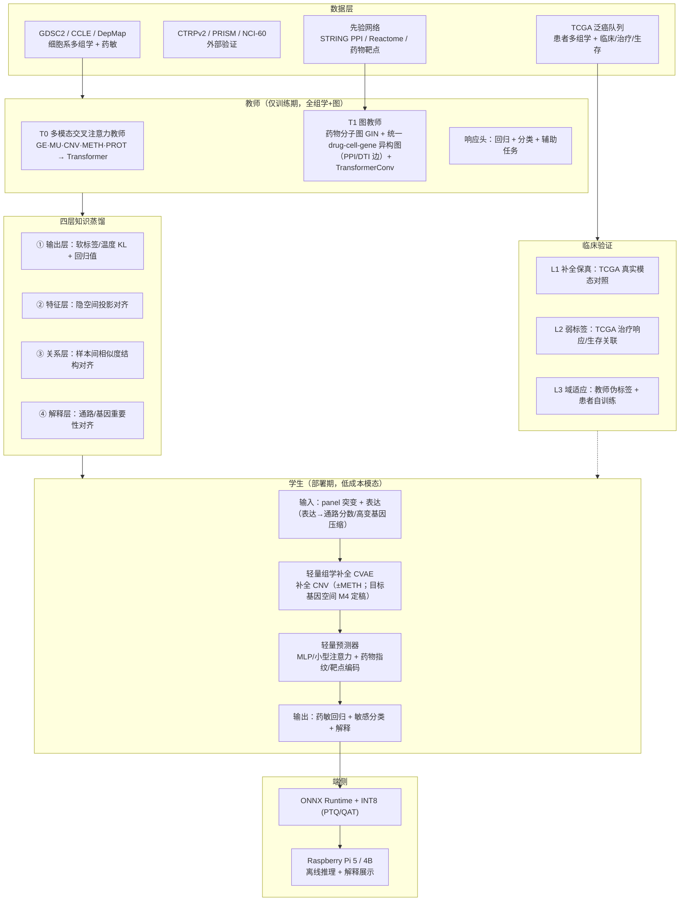

# 端侧肿瘤药物敏感性预测师生模型：详细研究计划书

**项目代号（工作代号，可改）**：**TRACE-DRP** —— *Teacher-guided Representation Alignment with omics Completion for Edge drug-response prediction*

> 中文简称：**端侧药敏·师生迁移模型**
> 文档状态：**v1.0 定稿**（2026-11-09；v0.9 经独立交叉审查后修订）｜项目周期：12 个月｜团队：4 名本科生 + 研究生指导 + 导师
> 算力：RTX 4060 Ti + RTX 3090 本地开发；正式教师训练可申请多卡服务器
> 研究范围：先泛癌种预训练，后聚焦单一癌种做临床案例
> 交付形式：本计划书（Markdown）；代码/数据/论文为项目过程产物

---

## 目录

0. [执行摘要与关键决策速览](#0-执行摘要与关键决策速览)
1. [项目背景与问题定义](#1-项目背景与问题定义)
2. [任务形式化与技术路线](#2-任务形式化与技术路线)
3. [数据方案](#3-数据方案)
4. [教师模型设计](#4-教师模型设计)
5. [学生模型设计](#5-学生模型设计)
6. [知识蒸馏方案](#6-知识蒸馏方案)
7. [实验与评估方案](#7-实验与评估方案)
8. [临床验证与案例研究](#8-临床验证与案例研究)
9. [端侧部署方案](#9-端侧部署方案)
10. [项目组织与时间计划](#10-项目组织与时间计划)
11. [风险登记表](#11-风险登记表)
12. [未定项决策日志（Decision Log）](#12-未定项决策日志decision-log)
13. [资源清单](#13-资源清单)
14. [参考文献](#14-参考文献)
- [附录 A 术语表](#附录-a-术语表)
- [附录 B 仓库结构与工程规范](#附录-b-仓库结构与工程规范)

---

## 0. 执行摘要与关键决策速览

### 0.1 一句话方案

**TRACE-DRP**：训练一个"吃全组学 + 药物-基因（蛋白）互作网络"的**图教师**（B0 双线性基线 / T0 多模态交叉注意力 / T1 统一 drug-cell-gene 异构图），把知识通过**四层蒸馏（潜向量、样本关系、输出软标签、解释）+ 组学补全（VAE）+ 药物编码器蒸馏**迁移给一个**只吃"临床可及的 panel 突变 + 表达"、无 GNN、部署 ≈0.4M 参数（训练含解码器 ≈0.9M）、INT8 后可在树莓派 5 上亚毫秒级推理**的学生模型；并用 **TCGA 分层验证**（L1 补全保真 / L2 临床关联含 L2' 生存 / L3 域适应 / L4 案例）补齐"贴近临床"的证据链。项目周期 12 个月，4 名本科生 + 研究生指导，先泛癌种、后聚焦单癌种案例。

### 0.2 项目参数（已锁定）

| 维度 | 设定 |
|---|---|
| 周期 | 12 个月（≈52 周；含 M12 缓冲） |
| 人力 | 本科生（数据/临床、教师/图、学生/蒸馏、平台/端侧）+ 研究生 + 导师 |
| 算力 | 本地 RTX 4060 Ti + RTX 3090；M3–M4、M7 申请多卡服务器 |
| 范围 | 先泛癌（GDSC2 主训练）→ 后聚焦单癌种临床案例（首选 CESC，扩展 BRCA） |
| 端侧 | Raspberry Pi 5 8GB 主平台 + Pi 4B 4GB 兼容下限 |
| 交付 | 本中文详细计划书 + 可运行代码/原型 + 中文结题报告 + 英文论文 + 树莓派 demo |

### 0.3 "尚未确定项"的最终决策（详见 §12 决策日志）

| # | 问题 | 决策 |
|---|---|---|
| D1 | 教师用不用图、用哪种图？ | 用；**T1 统一 drug-cell-gene 异构图为主教师**（drGT 式，药物 GIN + 细胞系 + 基因/PPI/DTI 边），B0/T0 作对照，T2/T3 选配 |
| D2 | 教师用哪些组学？ | **GE+MU+CNV+METH** 四模态为主，PROT 可选（覆盖小）；不押"模态数量"（多组学增益文献中很小） |
| D3 | 药物表示与先验数据库？ | GIN + Morgan FP + 靶点基因；先验优先 **Open Targets(CC0)+GO+STRING**，KEGG/DrugBank 仅学术使用不再分发 |
| D4 | 学生输入什么？ | **panel 突变（409/410/523）+ 表达（通路分数 500–1000）**；对照 HVG 2000，降级仅突变；**不使用 CNV/甲基化/蛋白真实值** |
| D5 | 补全什么、怎么补？ | **VAE 主补 CNV**（METH 条件性），补全目标暂用 **1,603 基因的 PPI 子集空间**（Edge 预印本同口径 STRING v11；M4 与教师图基因取交集后定最终维度）；必须对照 feature propagation |
| D6 | 学生架构与参数预算？ | **纯 MLP+VAE：A 档部署 ≈0.4M、训练含解码器 ≈0.9M，硬上限 5M**；S-latent（冻结药潜向量表）为端侧极限备选；不做 GNN |
| D7 | 蒸馏哪些信号？ | **P0 潜向量对齐 + 样本关系对齐**（主）；P1 输出软标签/药物编码器/特权信息/缺失一致性；P2 解释蒸馏（门控） |
| D8 | 训练流程？ | 五阶段：教师 → VAE → 学生预热 → 蒸馏（课程式）→ **QAT 量化+校准** |
| D9 | **TCGA 到底怎么用？** | **主模型/主结果不使用 TCGA 标签**。分层：L1 掩码-补全保真（主）+ L2 人工整理响应标签外验 + L2' 生存一致性 + L3 无标签域适应（声明半监督）+ L4 案例 |
| D10 | 聚焦哪个癌种？ | **首选 CESC**（可比 MKDR 顺铂案例），扩展 BRCA；M6 依审计报告可调整 |
| D11 | 主数据集与划分？ | **GDSC2 + CCLE/DepMap 组学**；复用 **DrEvalPy** 预处理 + **LCO/LDO/LTO splits** + 自建 scaffold；random 仅作上限参考 |
| D12 | 外部验证顺序？ | **CTRPv2 → GDSC1→GDSC2 零样本 → PRISM（LFC/AUC，非 IC50）→ TCGA 响应子集 →（可选）PDXE/I-SPY2** |
| D13 | 指标/统计/负对照？ | 回归六指标+分类+校准+per-drug+效率+解释；**≥3 seeds、FDR、bootstrap CI、naive 基线**；负对照四件套写进主实验 |
| D14 | 端侧平台与验收？ | **Pi5 8GB 主 + Pi4B 4GB 兼容**；ONNX + INT8；**INT8 ≤5MB、Pi5 E2E p50 ≤100ms、ΔAUROC ≤0.01、1000 次零失败** |
| D15 | 可解释性怎么做？ | 教师 attention+IG+GNNExplainer+GSEA（交叉验证），学生通路归因+轻量 IG；FAC/FIC/掩蔽+DGIdb 命中验收；**解释蒸馏默认关闭、过门槛才启用** |
| D16 | 师生接口？ | 教师冻结 + 软标签/潜向量**离线缓存** + 学生端到端训练；不做联合训练 |
| D17 | 是否加 PDX/I-SPY2？ | 可选（P1）；若 TCGA L2 太薄优先补 PDX/I-SPY2 |
| D18 | 开源/投稿？ | 中文结题 + 英文投稿（M9 定目标）+ GitHub 开源（不含受限数据） |
| D19 | 二期院内试点？ | ⏳ 一期不做；二期视导师医院资源与伦理审批 |

### 0.4 核心创新点（预期贡献）

1. **图知识 → 无图轻量学生的迁移**：把药物-基因（蛋白）互作网的边级注意力、通路表示等**四层蒸馏**进一个不含 GNN、可在树莓派部署的学生，并系统比较"知识 vs 正则化"（负对照）；
2. **患者域组学补全验证**：用 TCGA 真实患者多组学做"掩码-补全"评测（L1），回答"细胞系学到的跨模态补全能否迁移到患者"——现有补全工作（如 MKDR）只在细胞系域内评估；
3. **TCGA 分层临床使用协议**：把"TCGA 无药敏标签"这一现实转化为可执行的分层验证规范（L1 补全保真 / L2 临床关联 / L3 域适应 / L4 案例），对领域有复用价值；
4. **端侧可复现落地**：给出参数预算-延迟-量化精度的实测链条与 12 项验收标准，交付树莓派可运行原型（现有端侧药敏工作多为预印本或仅 Jetson）。

### 0.5 预期目标与验收（内部目标，非结果承诺）

| 维度 | 目标（验收时以数据为准） |
|---|---|
| 教师 | T0 在 LCO 上显著优于 naive/RF/MLP；T1 在 LDO/scaffold 上优于 T0（否则按 D1 降级） |
| 学生 | LCO 上显著优于 naive 基线；相对教师**保留率**作为核心指标报告（目标 ≥80–90%，以实际为准） |
| 补全 | 细胞系域内 CNV 补全 PCC 达到可用水平；**患者域（TCGA）补全保真度量化**（主贡献） |
| 蒸馏 | 正对照显著优于随机/打乱教师；四层信号贡献可分解 |
| 临床 | TCGA 逐药 AUROC 0.60–0.70 属"与文献同量级"；L1 补全指标 + L2' 生存关联如实报告 |
| 端侧 | INT8 ≤5MB、Pi5 纯推理 ≤2ms/端到端 p50 ≤100ms、RSS ≤300MB、ΔAUROC ≤0.01、1000 次零失败 |
| 解释 | FAC/FIC/掩蔽 Δp + 多 seed 稳定性 + DGIdb/PDB 命中率；随机对照通过 |
| 可复现 | 主表 ≥3 seeds mean±SD；split 公开；一键复现脚本；泄漏审查表 |

### 0.6 12 个月里程碑

| 门禁 | 时间 | 核心交付 |
|---|---|---|
| **G0 数据与预处理** | W4 | 数据管线 + split + naive 基线 |
| **G1 教师 v0** | W12 | T0 教师 + 多组学消融 + TCGA 审计报告（中期检查） |
| **G2 学生 v1** | W20 | VAE + 四层 KD v1 + 首次 ONNX/Pi5 部署 |
| **G2.5** | W24 | KD 负对照 + OOD 结果 + **聚焦癌种决策** |
| **G3 主结果** | W28 | 主实验矩阵（LCO/LDO/scaffold/外部）+ 论文骨架 |
| **G4 论文初稿** | W36 | TCGA L1/L2/L2' + 端侧验收 + 案例研究 + 初稿 |
| **G5 结题/投稿** | W48 | 结题报告 + 代码/模型 release + 投稿 + demo |

### 0.7 最大风险（Top 3，详见 §11）

1. **R2 多组学/图先验增益不显著**（文献中多组学增益可小到 RMSE 0.006）→ 故事重心放在"蒸馏+补全+端侧+临床验证"，并用随机图/随机通路对照把结论写扎实；
2. **R3 TCGA 响应标签太少**（TCGA 无药敏标签，人工整理集规模小）→ 主验证改为 L1 补全保真 + 生存一致性，L2 降级为探索性；
3. **R10 时间/人力** → 里程碑门禁 + 6 个月 MVP 裁剪方案（§10.5）。

### 0.8 本计划书的使用方式

- **§1–2**：背景、科学问题、任务形式化与技术总图；
- **§3、§7、§8**：可直接执行的**数据/实验/临床规范**（含防泄漏、统计、TCGA 红线）；
- **§4–6**：教师、学生、蒸馏的**具体架构与损失**（含默认超参与消融矩阵）；
- **§9**：端侧栈、实测数字与**12 项验收标准**；
- **§10–11**：12 个月甘特图、门禁、分工、风险；
- **§12**：**未定项决策日志**（本计划书的核心产出之一）；
- **§13–14 + 附录**：资源清单、文献、术语、仓库/工程规范。
- 本计划书为**活文档**：M3、M6、M9 各评审一次，变更写入 `docs/adr/` 并更新 §12。

**与原始需求的对照（逐条回应）**：

| 原始需求 | 本计划书回应位置 |
|---|---|
| 教师模型学习完整组学信息 | §4（T0/T1 的五模态编码与融合；教师用 GE/MU/CNV/METH(+PROT)） |
| 教师考虑构建药物-基因(蛋白)互作网络（图神经网络、交叉注意力等） | §4.2–4.4（T1 统一 drug-cell-gene 异构图 + GIN 药物图 + PPI/DTI 边 + 类型感知交叉注意力；T0 药物 query 交叉注意力）；§12-D1/D3 |
| 学生只输入突变、表达等临床测量成本较低的模态 | §5.1（临床可及性映射；panel 突变 + 表达；数据泄漏硬约束 R4）；§12-D4 |
| 学生通过自编码器（VAE 等）进行组学补全再预测 | §5.3（VAE/CVAE 补全 CNV，目标基因空间暂定 1,603 基因、M4 定稿，患者域 L1 保真评估）；§12-D5 |
| 学生使用更轻量架构（不使用大型图神经网络） | §5.4–5.5（纯 MLP+VAE：A 档部署 ≈0.4M、训练含解码器 ≈0.9M，硬上限 5M；S-latent 极限档）；§12-D6 |
| 学生可部署在轻量设备（树莓派） | §9（ONNX+INT8、Pi5/Pi4 实测与 12 项验收）；§12-D14 |
| 加入 TCGA 真实患者数据贴近临床 | §3.7 + §8（L1 补全保真 / L2 弱标签 / L2' 生存 / L3 域适应 / L4 案例；明确 TCGA 无药敏标签的使用红线）；§12-D9 |
| 制定详尽计划 | §2 技术路线、§10 甘特图/门禁/分工、§11 风险、§13 资源、附录 B 工程规范 |
| 确定尚未确定的内容 | §12 决策日志（D1–D19）+ §0.3 速览表 |


## 1. 项目背景与问题定义

### 1.1 临床与工程痛点

肿瘤药物敏感性预测（drug response prediction, DRP）目标是在用药前根据肿瘤分子特征预测患者对某药物的敏感性，是精准肿瘤学的核心环节之一。当前研究与落地之间存在三个断点：

1. **"全组学模型"与"临床可及数据"的错配**。性能最好的药敏模型（MOLI、DeepCDR、BANDRP、图神经网络类方法等）普遍以完整多组学（表达 GE、突变 MU、拷贝数 CNV、甲基化 METH、蛋白 RPPA、miRNA）为输入；但真实临床中完整多组学获取成本高、样本量小、缺失非随机（MNAR）。例如既有研究指出：TCGA 虽收录超过 1.1 万例肿瘤，但同时具备基因组、转录组、甲基化和蛋白组完整层的只是小部分；蛋白组学中最多约 50% 的肽段测量可能缺失（MKDR, *Front. Oncol.* 2025, Introduction）。实际能稳定获得的往往只有**靶向 panel 突变**与**RNA 表达**。
2. **"大模型"与"端侧/基层部署"的错配**。图神经网络（GNN）教师虽能利用药物-基因（蛋白）互作先验，但计算与存储开销大，难以部署到基层医院、床旁或资源受限设备；既有工作已在树莓派 4 上实测：GCN 教师模型单次预测约 1200 ms、内存约 800 MB，而压缩后的学生模型约 350 ms、150 MB（Saeed et al. 2025, *Enhancing Cancer DRP with GNN and Multi-Scale Knowledge Distillation*（Research Square **预印本**）, Results/Abstract）。这离"床头设备亚秒级、低内存"的目标仍有距离，也说明**仅靠模型压缩不够，必须从头设计轻量学生**。
3. **"细胞系训练"与"患者真实响应"的错配**。药敏标签几乎全部来自细胞系高通量筛选（GDSC/CCLE/PRISM/CTRP），细胞系无法完全代表患者肿瘤微环境、免疫浸润与给药暴露；而 TCGA 等真实患者队列**没有标准化的药敏标签**，如何用患者真实数据做贴近临床的验证，是领域公认难题，也是本项目最需要提前设计清楚的部分。

### 1.2 已有工作与本项目的空白

| 方向 | 代表工作（本项目文献库） | 关键结论 | 留下的空白 |
|---|---|---|---|
| 多模态 + 图先验教师 | DRPreter、H3CDR、TGSA、drGT、Neural interaction XAI | 药物分子图/PPI 图/药物-细胞系-基因异构图能提升精度并提供可解释性；GDSC 上 H3CDR AUC 0.8772/AUPRC 0.8819；drGT 随机 5 折 AUROC 最高 0.945、R² 最高 0.690 | 模型重、推理贵；**没有把图知识迁移到无图轻量学生**；对 unseen-drug 泛化仍差（drGT 在 unseen-drug 划分 R² 仅 0.022） |
| 组学补全（VAE/自编码器） | MKDR、MIDAS 类方法、多组学补全研究 | VAE 可从表达补全缺失 CNV/MU；40% 模态缺失下补全使误差降低约 15%；MKDR-Student 在宫颈癌细胞系上 MSE 0.0034、R² 0.8126、PCC 0.9033 | 补全质量多在细胞系上评估，**缺患者域（TCGA）真实补全保真度验证**；补全模块与轻量部署未联合优化 |
| 知识蒸馏（KD） | 多模态基因组知识蒸馏（Ge et al., ACM BCB 2024）、MKDR、多尺度图知识蒸馏（Saeed et al. 2025） | 输出层 KL/软标签蒸馏、样本间关系对齐、多深度教师图 KD 均可提升学生；学生可在 Raspberry Pi 4 上 350 ms/150 MB（预印本数据，仅作量级参照） | KD 信号多为 logit/单层特征；**未系统比较输出/特征/关系/解释四层信号**；教师图注意力知识未迁移 |
| 临床真实数据 | MKDR（TCGA-CESC 顺铂响应分类，n=99，AUROC 0.635；**标签来源待核实**）、metaDRP（preclinical→clinical 少样本迁移）、Edge GNN（TCGA-BRCA/LUAD 上 GNN 可行性） | 患者队列可用于响应分类弱标签验证与生存关联；细胞系→患者存在显著分布偏移 | **缺乏系统化的 TCGA 使用协议**（补全保真/弱标签/域适应三层）；临床验证常被当作"装饰"而非可检验假设 |

**本项目的定位**：据本课题组检索（截至 2026-11，检索式记录于 `docs/search_log.md`），尚未见把上述三条线**统一为一个可部署、可解释、可临床验证的师生框架**的公开工作；本项目主张的是组合创新与系统验证，并回答"图先验 + 组学补全能否被蒸馏进一个只吃突变+表达、能在树莓派上运行的学生模型"这一核心问题。创新点不在单个模块，而在于**四层知识蒸馏 + 患者域验证 + 端侧约束**的联合设计与严格实验。

### 1.3 科学问题（Research Questions）

- **RQ1（有效性）**：仅使用临床可及的突变（panel）+ 表达的学生模型，能否在药敏预测上接近甚至达到全组学教师（GE+MU+CNV+METH(+PROT) + 图先验）的水平？差距有多大、集中在哪些药物/癌种？
- **RQ2（增益分解）**：组学补全（VAE/CVAE）与知识蒸馏各自贡献多少？二者是否互补？补全哪些模态收益最大？补全在 **患者域（TCGA）** 是否仍保真？
- **RQ3（图知识迁移）**：教师中的药物-基因（蛋白）互作网络知识能否迁移进无 GNN 的学生？关系蒸馏/解释蒸馏（通路与基因重要性）是否优于纯输出蒸馏？换用随机图/无图教师做对照后，增益是否仍成立？
- **RQ4（临床泛化）**：细胞系→患者的跨域衰减有多大？TCGA 分层验证（L1 补全保真 / L2 临床关联含 L2' 生存 / L3 域适应 / L4 案例）能否提供可信的临床相关性证据？聚焦癌种案例能否复现已知药物-标志物关系（如顺铂在宫颈癌、内分泌治疗在乳腺癌）？
- **RQ5（端侧可行性）**：在树莓派 5（备选 4B）上，量化后的学生模型能否在端到端 ≤100 ms、峰值内存 ≤300 MB、INT8 模型 ≤5 MB（A 档 ≈1 MB）的预算内，保持与 FP32 相当的精度（ΔAUROC ≤0.01）？精度-效率的帕累托前沿在哪里？

**预期贡献**：
1. 提出 TRACE-DRP 框架：图教师 → 四层蒸馏 → 补全增强的轻量学生，给出可复现的完整管线；
2. 系统量化"全组学教师知识"迁移到"低成本模态学生"的可迁移性与上限（含患者域补全保真度）；
3. 建立 TCGA 分层临床使用协议（L1/L2/L3 + L4 案例）与一套防泄漏/OOD 评估规范（对领域有复用价值）；
4. 交付树莓派可运行的原型系统 + 开源代码，给出端侧部署的量化验收标准。

## 2. 任务形式化与技术路线

### 2.1 符号与任务定义

设细胞系/患者样本集合 $\mathcal{C}$（$|\mathcal{C}|\approx 10^3$ 量级），药物集合 $\mathcal{D}$（$|\mathcal{D}|\approx 2\times10^2$ 量级），观测到的药敏矩阵 $\mathbf{Y}\in\mathbb{R}^{|\mathcal{C}|\times|\mathcal{D}|}$，仅部分元素被观测（按 GDSC2 8.2 口径观测率约 84%=135,242/(809×198)、未测对约 16%；最终以下载文件实测为准）。

- 样本 $c$ 的多组学特征：$\mathbf{x}_c^{(m)}$，$m\in\{\mathrm{GE},\mathrm{MU},\mathrm{CNV},\mathrm{METH},\mathrm{PROT}\}$；
- 药物 $d$ 的特征：$\mathbf{z}_d$（分子图 $\mathcal{G}_d$、Morgan 指纹、靶点基因集合）；
- 先验网络：蛋白互作 $\mathcal{G}_{\mathrm{PPI}}$、通路 $\mathcal{G}_{\mathrm{PW}}$、药物-靶点二分图 $\mathcal{G}_{\mathrm{DTI}}$、细胞系/药物相似图。

**教师**（全组学 + 图）：
$$
\hat{y}_{c,d}^{T}=f_T\big(\{\mathbf{x}_c^{(m)}\}_{m\in\mathcal{M}_{\text{full}}},\ \mathcal{G}_d,\ \mathcal{G}_{\mathrm{PPI}},\mathcal{G}_{\mathrm{DTI}}\big)
$$

**学生**（低成本模态 + 补全）：
$$
\hat{\mathbf{x}}_c^{(m')} = g_{\mathrm{VAE}}\big(\mathbf{x}_c^{(\mathrm{MU})},\mathbf{x}_c^{(\mathrm{GE})}\big),\quad
\hat{y}_{c,d}^{S}=f_S\big(\mathbf{x}_c^{(\mathrm{MU})},\mathbf{x}_c^{(\mathrm{GE})},\hat{\mathbf{x}}_c^{(m')},\mathbf{z}_d^{(\text{轻量})}\big),\quad m'\in\{\mathrm{CNV}\}\ (\text{可选 }\mathrm{METH})
$$

**标签**：主任务为回归，主标签为经药物内标准化（z-score）的 $\mathrm{LN\_IC50}$（GDSC2）；CTRPv2 用 AUC；PRISM 用 LFC/剂量曲线参数（**不是 IC50**，需转为排序/二分类任务）。辅助任务为二分类敏感/耐药（按药物内中位数阈值，并在附录 C 给出阈值敏感性分析）。**方向约定：敏感分数 $s=-z(\mathrm{LN\_IC50})$（越大越敏感）；分类正类 = 敏感；GDSC 的 AUC 标签方向以官方定义为准，训练与报告前统一符号。****所有回归指标同时报告"药物内标准化后"与"原始尺度"两套**，避免被药物间量纲差异误导（见 §7.5）。

**重要约定**：报告主指标必须同时给出不同划分协议下的结果；随机划分只作为与文献对比的"上限参考"，不作为主要结论（§7.1）。

### 2.2 总体技术路线



**技术组件与依赖关系**（也是任务拆分依据）：

| 组件 | 内容 | 依赖 | 负责人建议 |
|---|---|---|---|
| C-A 数据管线 | 下载/统一 ID/组学预处理/药物特征/先验网络/划分文件 | — | 成员 A |
| C-B 教师 T0 | 多模态编码器 + 交叉注意力 + 辅助任务 | C-A | 成员 B |
| C-C 教师 T1 | 异构图 + PPI GNN + 类型感知注意力 | C-B | 成员 B + 研究生 |
| C-D 补全模块 | CVAE 补全 + 患者域保真评估 | C-A, C-B | 成员 C |
| C-E 学生 + KD | 轻量学生、四层蒸馏、三阶段训练 | C-B, C-D | 成员 C |
| C-F 实验平台 | 划分/基线/指标/统计/实验跟踪 | C-A | 成员 D |
| C-G 端侧 | ONNX 导出、量化、树莓派部署、延迟测量 | C-E | 成员 D |
| C-H 临床验证 | TCGA L1-L3、案例研究 | C-D, C-E, C-A | 成员 A + 研究生 |
| C-I 论文/结题 | 写作、图表、开源整理 | 全部 | 全体 + 导师 |

### 2.3 项目边界（做什么 / 不做什么）

**做**：泛癌种公开细胞系数据的建模；TCGA 公开患者数据的验证；端侧推理原型；可解释性方法与解释质量评估；论文与开源。

**不做（本期）**：湿实验验证；真实医院 HIS/LIS 系统对接与前瞻性临床试验；药物剂量/联合用药建模（仅单药敏感性）；非公开患者数据（若导师有合作医院数据，作为二期扩展，见 §12-D19）。

## 3. 数据方案

### 3.1 数据选择总原则

1. **主训练集必须与领域 benchmark 可比**：GDSC2 + CCLE/DepMap 组学是绝大多数深度药敏论文（DeepCDR、MOLI、TGSA、DRPreter、H3CDR 等）的主 benchmark，选它才能与文献对话；
2. **划分优先复用官方框架**：DrEvalPy（*Nat. Commun.* 2026）提供 GDSC1/GDSC2/CCLE/CTRPv1/v2/BeatAML2/PDX_Bruna 的标准化预处理 + LCO/LDO/LPO/LTO 预计算 splits（Zenodo v48）；**直接复用可省 1–2 周并保证可复现**；
3. **标签不可跨库混用**：GDSC（LN_IC50/AUC）≠ CTRP（AUC）≠ PRISM（LFC/AUC，**不是 IC50**）≠ NCI-60（GI50/TGI/LC50）；**不做"把多个库简单拼成一个大回归集"**，而是分层证据链；
4. **TCGA 只做外部验证/补全验证**（理由见 §3.6、§8）。

### 3.2 数据集清单与角色

| # | 数据集/资源 | 版本/规模（检索时点，标注待核实） | 标签 | 本项目角色 |
|---|---|---|---|---|
| 1 | **GDSC2** | 8.2 版 809 细胞系/198 药/135,242 IC50【论文转述，现版 8.5 以文件为准】 | LN_IC50、AUC、Z_SCORE | **主训练集（教师+学生，同 split）** |
| 2 | GDSC1 | 8.2 版 987 株/367 药/310,904 IC50【论文转述】 | 同上（旧 Resazurin/Syto60 平台） | 跨平台/跨库验证（GDSC1→GDSC2 零样本） |
| 3 | **CCLE / DepMap** | 现版季度发布；表达（RNA-seq TPM）、突变、CNV、甲基化、RPPA、蛋白组 | — | **教师组学来源 + 学生输入（同源同库）** |
| 4 | CTRPv2 | 860 细胞系 × 481 化合物【官方】 | AUC | 第二训练/跨库外部验证 |
| 5 | PRISM（Repurposing） | 初级 4,518 药×578 株；次级 1,448 药×499 株【官方】 | **LFC/剂量曲线参数（含 AUC），非 IC50** | 大规模外部验证/补充预训练（任务需转"相对 viability/排序"） |
| 6 | NCI-60 / CellMiner | 60 株/9 组织；~2 万化合物历史筛选 | GI50/TGI/LC50 | 辅助跨平台验证（不建议主训练） |
| 7 | **TCGA（GDC）多组学** | 33 癌种、>11,000 例；表达/突变/CNV/甲基化/RPPA（模态交集样本量先审计） | **无药敏标签** | **补全验证（L1）+ 域适应目标域（L3）；不参与训练** |
| 8 | **TCGA 临床 + TCGA-CDR** | >11,000 例；OS/PFI/DFI/DSS + 治疗记录（覆盖不均、无系统 RECIST） | 生存终点 | 生存一致性验证（L2'）、确定可验证药种/癌种 |
| 9 | **Ding et al. 2016 整理集** | 4 个化疗药各 >180 条响应记录、21 个核心数据集【论文】 | 人工整理 RECIST 二分响应 | **TCGA 真实响应外部验证（L2）的唯一可用标签级资源** |
| 10 | CCLE-TCGA 协议 / MOMLIN splits | 定义之一：689 细胞系 + 470 例 TCGA、6 种化疗药【论文】；MOMLIN 补充表给按药拆分 | 同上 | TCGA 外部验证的现成划分（复用前核对） |
| 11 | PDXE（Gao et al. 2015） | ~1,000 PDX、62 种治疗、6 适应证 | in vivo 响应 | 第二外部验证（比细胞系更接近患者，可选） |
| 12 | I-SPY2（GSE194040） | 987 例新辅助乳腺癌表达 + 10 治疗臂 + pCR | pCR | 乳腺癌方向真实患者外部验证（可选） |
| 13 | BeatAML2 | 672 标本/562 例 AML 患者 + ex vivo 药敏 | ex vivo 药敏 | 真实患者外部验证（血液肿瘤，域差大，可选） |
| 14 | **DrEvalPy 数据+split** | 标准化 GDSC/CCLE/CTRP/BeatAML2/PDX + LCO/LDO/LPO/LTO | — | **基准/划分/预处理首选起点** |
| 15 | MOLI Zenodo 和谐化数据 | GDSC 多组学 + PDX/TCGA 外部数据 | — | 工程起点/对照 |
| 16 | STRING | v12.5（2025） | — | 教师 PPI 先验 |
| 17 | Reactome / GO | Reactome v97（2,883 条人类通路）；GO 月度发布 | — | 通路先验/可解释性（GO 为 CC BY 4.0） |
| 18 | KEGG | 持续更新 | — | 通路先验（**学术免费、商用需购；不可打包再分发**） |
| 19 | DrugBank / ChEMBL / **Open Targets** | DrugBank 6.0；ChEMBL v36；Open Targets 持续更新 | — | 药物-靶点边（**优先 Open Targets CC0 便于开源**） |
| 20 | GDSC 药物靶点注释 | 随 release（`screened_compounds`） | — | 药物特征/靶点边 |
| 21 | TCPA / TCGA RPPA | ~500 marker、~8,000 TCGA 样本 | — | 教师蛋白模态 + 补全验证（覆盖小） |

> **【待核实】（M1 内解决）**：GDSC 现版（8.5）全量计数（下载页直连曾异常，上述 8.2 数字来自第三方转述）；DepMap 现版按模态的细胞系数；TCGA 各模态交集样本量；各癌种×药物的治疗记录覆盖；MKDR 的 TCGA-CESC 99 例顺铂标签来源；CTRP/TCPA/TDC 许可。**所有"待核实"数字在论文中必须替换为实测值。**

### 3.3 数据预处理规范（教师/学生统一管线）

1. **基因空间对齐**：取 GDSC/CCLE 表达与 TCGA 表达的交集基因（protein-coding，约 1–2 万维；教师用全基因集，学生用通路分数/panel 子集）；**统一 log 变换 + 基因级 z-score，且统计量只在训练 fold 内拟合**。
2. **突变**：MAF → 基因×样本 0/1 矩阵（非沉默、蛋白编码区；可加 REVEL/COSMIC 过滤）；学生侧再收敛到 409/410/523 基因 panel 交集。
3. **CNV**：GISTIC/ASCAT 阈值化（-2/-1/0/1/2）或连续 log2 ratio；VAE 补全目标基因空间暂用 1,603 基因的 PPI 子集（Edge 预印本同口径 STRING v11），M4 与教师图基因取交集后定稿（§5.3）。
4. **甲基化**：450K beta 值取启动子区均值或高变 CpG；logit 变换或 Beta 似然（VT 可选）。
5. **蛋白组**：RPPA（TCPA 派生）z-score；仅覆盖子集，作可选模态（modality dropout）。
6. **药物特征**：SMILES → 分子图（OGB 规范，供 GIN/Graphormer）+ Morgan FP（供学生轻量编码）+ 靶点基因 multi-hot（GDSC/ChEMBL/Open Targets）。
7. **标签**：GDSC2 用 `LN_IC50`（主回归目标）+ 按药分位数二分类（辅助）；**药物内 z-score 作为主训练标签**，原始尺度作报告之一；CTRPv2 用 AUC（方向统一为"越大越敏感"）；PRISM 用 LFC/AUC 转为排序/二分类任务。**敏感分数 $s=-z(\mathrm{LN\_IC50})$、正类=敏感；所有 AUROC 按此方向计算。**
8. **平台/批次校正**：GDSC 表达是**芯片**，CCLE/TCGA 是 **RNA-seq** → 合并前做 gene-level z-score/分位数归一/ComBat；**报告"校正 vs 未校正"两组结果**；ComBat 参数只在训练集拟合。
9. **数据泄漏检查（写进 CI）**：所有 fit 类操作（基因过滤、HVG、z-score、ComBat、VAE、标签归一化）只用训练 fold；split 文件先于建模生成并公开。

### 3.4 先验网络与药物-基因资源（教师"知识"的来源与许可约束）

- **PPI**：STRING v12.5（保留 combined score ≥700/900 的高可靠边；**学术需签许可、商用需付费**）；
- **通路**：Reactome（人工审编、开放许可）+ GO（CC BY 4.0）为主，KEGG 仅学术使用且**不得在开源代码/论文附件中打包原始数据**；
- **药物-靶点**：GDSC `screened_compounds` + DrugBank（学术申请/商用付费）+ ChEMBL（CC BY-SA 4.0）+ **Open Targets（CC0，最适合开源再分发）**；
- **开源策略**：代码仓库只存**派生特征/ID 映射**与下载脚本，不打包原始 STRING/KEGG/DrugBank 数据；论文明确数据许可与获取方式。

### 3.5 划分协议与数据泄漏

划分定义与证据见 §7.2（P0–P6）；执行要点：
- 复用 **DrEvalPy 预计算 LCO/LDO/LPO/LTO splits**（或按同口径自建），保证与 leaderboard 可比；
- 自定义 **scaffold split**（Bemis–Murcko，唯一化合物层级分组后展开细胞系对）；
- **教师、学生、基线使用完全相同的 split 与随机种子**；
- 生成 `split_*.json`（group id、seed、脚本 hash）并公开；**测试集只在最终报告接触一次**。

### 3.6 跨库/跨域合并规范

| 差异 | 证据 | 本项目处理 |
|---|---|---|
| 表达平台：GDSC 芯片 vs CCLE/TCGA RNA-seq | Haibe-Kains et al., *Nature* 2013 报道大规模药敏研究一致性有限 | gene-level z-score/分位数归一/ComBat + 校正消融 |
| 药敏平台：GDSC1（Resazurin/Syto60）vs GDSC2（CellTiter-Glo） | GDSC1→GDSC2 零样本 R² 0.475→0.334（drGT） | 不混训；只做跨平台验证 |
| 标签量纲：LN_IC50 vs AUC vs LFC vs GI50 | 官方定义 | 不同任务分开；排序/分位数归一后再比较 |
| 细胞系 vs 原发瘤 | 细胞系无微环境、存在遗传漂变（Ben-David et al. 2018）；肿瘤纯度影响 bulk 组学（Aran et al. 2015） | 预期 TCGA 性能下降；用量化落差 + 域适配缓解 |
| 数据泄漏 | 随机划分虚高；预处理泄漏 | §7.2 划分 + §7.1 原则 + CI 检查 |

**合并策略（分层证据链）**：主训练（GDSC2）→ 跨库外部（CTRPv2 / PRISM / GDSC1）→ 患者外部（TCGA 响应子集 / PDXE / I-SPY2）→ 真实多组学补全（TCGA）。不把多库混成一个大回归集；若必须混训，按药 z-score 并报告"混训 vs 单库"消融。

### 3.7 TCGA 使用方案（详见 §8）

- **结论先行：TCGA 没有 IC50/AUC 药敏标签。** TCGA-CDR 只提供 OS/PFI/DFI/DSS 四个生存终点；GDC 治疗字段只有用药/剂量/周期/起止时间等，**无系统 RECIST 字段**；文献中的"TCGA 药敏标签"全部来自**人工整理临床记录**（最常用 **Ding, Zu & Gu 2016**：4 个化疗药各 >180 条响应记录；另有 MOLI 66 例 cisplatin、metaDRP 655 样本/11 药、THERAPI 358 例/383 对/21 药）。
- **本项目定位（L1/L2/L3 + L4 案例层）**：L1 真实患者组学"掩码-补全"验证（无需药敏标签，**最适合本项目 VAE，也是可发表的增量评测贡献**）；L2 小样本响应标签外部验证（Ding 整理集，不做训练/调参）；L2' 生存一致性（TCGA-CDR）；L3 无标签域适应（ComBat/域适配，声明 transductive）。
- **红线**：①**主模型/主结果不使用 TCGA 标签**；TCGA 组学可用于**无标签**域对齐，但任何使用 TCGA 弱标签的训练（L3 few-shot / 含 TCGA 的混合 VAE）一律作为**独立标注的半监督/transductive 探索实验**，不进入主表、不参与选模与早停，并单列 inductive 结果；②不把生存终点当"药敏"；③不把 Ding 整理集称为"TCGA 官方药敏数据"；④先做《可得性审计》（§8.2）再谈模型。
- **重要待核实**：MKDR 报告的 TCGA-CESC 顺铂 99 例 AUROC 0.635，其标签来源论文未交代（线索指向 TREMSUCS 统计的 103 例顺铂治疗患者/Ding 整理集）——**引用该数字前必须查清，否则只作"文献量级参考"**。

### 3.8 数据目录、版本与许可管理

```
data/
├── raw/            # 下载原始文件（不提交 git；记录 URL/版本/日期/SHA256）
├── interim/        # 中间产物（基因对齐、去重、归一化）
├── processed/      # 模型输入（只读缓存，版本化）
├── splits/         # split_*.json（公开；含 group id/seed/脚本 hash）
└── licenses/       # 每个数据源的许可说明与引用要求
```
- **数据卡（datasheet）**：每个数据集记录来源、版本、许可、预处理脚本、已知缺陷（如 PRISM 非 IC50、MKDR 标签来源不明）；
- **禁止**把受控数据（TCGA 受控层、需授权的 DrugBank 等）提交到公开仓库；
- 公开 release 只含：下载脚本、预处理代码、split 文件、派生特征（不打包受限原始数据）。


## 4. 教师模型设计

### 4.1 设计原则与选型

教师模型承担两个职责：**（i）追求精度上限**（全组学 + 图先验 + 多任务）；**（ii）产生可被蒸馏的知识**（软标签、隐表示、样本关系、图/通路归因）。因此教师设计遵循：

1. **分两档 T0/T1，T0 必须有**：T0（无图）是消融对照与工程兜底；T1（图教师）是主教师。避免"一上来就搭异构图导致进度失控"。
2. **先验网络必须做随机对照**：文献警示——真实通路相对随机通路在某些设置下仅 −2%~+2%（Li et al. 2023, *Interpretable deep learning architectures for DRP: myth or reality*，本笔记 §2），黑盒 MLP/RF 常相当甚至更好。故 T1 必须报告"随机 PPI/随机通路"对照，否则不能声称图先验有效。
3. **可解释性作为独立验收维度**，不与精度混谈；attention 不能单独作为解释（须 IG/GNNExplainer 交叉验证）。
4. **教师只在训练期存在**：部署侧不依赖任何图或大模型；教师全部知识通过四层蒸馏 + 预计算解释卡传递（§6）。

### 4.2 教师候选谱系（B0 → T0 → T1，逐级消融）

为避免"堆模块"导致进度失控，教师按证据强度分三层实现，每一层都必须能独立跑通、独立报告：

| 档位 | 名称 | 是否用图 | 关键设计 | 证据/预期 | 成本 |
|---|---|---|---|---|---|
| **B0** | 双线性潜交互基线 | 否 | 表达/组学压到 ~10⁴→1000 维潜向量；药物侧 2659→1000 维潜向量（DLV）；$y=\mathbf{z}_{D}^{\top}\mathbf{z}_{T}$；Huber loss | NeurixAI：MSE 0.92（基线 0.93–1.2）；结构为肿瘤/药物两支 MLP + 点积（推算 ~2×10⁸ 参数），是"无图强基线"；本项目仅作精度参照，不部署 | 极低，CPU 可跑 |
| **T0** | 多模态交叉注意力教师 | 否 | 五模态编码器 + 类型感知 Transformer + 药物 query 交叉注意力（见 §4.3） | 复现 MKDR 式融合（MKDR 学生 R² 0.8126/PCC 0.9033，**仅同量级参照，不同数据不可横向比**） | 中 |
| **T1** | 统一 drug-cell-gene 异构图教师（**主教师**） | 是 | drGT 式统一异构图 + GIN 药物编码 + 边特征注入的 TransformerConv；可选叠加通路子图/相似性增广 | drGT：四个数据集回归 R² 全部第一（0.690/0.580/0.475/0.544），且是唯一 leave-drug-out 下正 R²（0.022）的模型；图仅 2,847–3,437 节点，单卡小时级 | 中（主成本在调参） |
| **T2（选配）** | 通路子图 GAT + type-aware Transformer | 是 | DRPreter 式 34 条 KEGG 通路子图；提供通路级注意力解释 | DRPreter：MSE 0.8251/PCC 0.9467（8:1:1），通路结构相对 COSMIC 降 4.4%，叠加 Transformer 后累计降 7.6%（相对通路的增量 3.3%） | 中 |
| **T3（选配）** | 细胞系相似性增广 | 是 | TGSA 式细胞 kNN(k=5) 图 + GraphSAGE；**只做细胞侧** | TGSA：RMSE −0.008（细胞侧最大贡献）；药物侧相似性"基本无用"（原文） | 极低 |

**关键证据（决定教师设计方向）**：
- **多组学本身带来的增益可能很小**：TGSA 单组学消融中"仅 EXP"RMSE 0.891、仅 CNV 0.889、仅 MU 0.900，三组学全用 0.885——仅提升 0.006；drGT 亦指出 MOFGCN 用多组学却打不过仅用表达的 NIHGCN。**因此教师的差异化必须来自"结构先验 + 药-基因交互 + 教师集成"，而不是"模态数量"**；计划书必须有"无图/单组学 vs 有图/多组学"的首个消融实验，并在结果中诚实报告多组学贡献。
- **图是可控成本**：drGT 的图在四个数据集上仅 2,847–3,437 节点；若扩到 1,000 细胞系 × 250 药 × 3,000 基因约 4,250 节点、边 ≲60 万，节点特征矩阵最大约 51 MB（float32），3 层 TransformerConv 单卡分钟级/epoch。**训练不是瓶颈，标签一致性与分布偏移才是。**

### 4.3 T0：多模态交叉注意力教师（必做，M1–M2）

**输入与编码**：
- 五个模态编码器（模态可缺失，用 modality dropout 训练）：
  - GE：**保留全转录组**（教师特权信息）：先做基因集通路打分（Reactome/KEGG/Hallmark，约 500–1000 维）得通路 token，并可保留 top 2,000–5,000 高变基因的基因级 token 作为可选分支 → 2 层 Transformer（d=256, 4 heads）；学生只用通路分数/panel，**信息差在 E2 中量化**；
  - MU：**保留全 WES 基因级 0/1（~19k，或裁剪到 ≥5,000 基因）** + 通路突变负荷 → MLP/token；学生只用 panel（~500 基因），**教师-学生突变信息差同样在 E2 量化**；
  - CNV：基因水平拷贝数（GISTIC2 离散化或连续 z-score）→ 通路水平聚合 → MLP；
  - METH：启动子/基因体甲基化 → 通路水平均值/前 k 主成分（约 500 维）→ MLP；
  - PROT：RPPA/蛋白组（约 200–300 蛋白，覆盖子集小）→ MLP；缺失时整模态丢 token，**不作为核心依赖**。
- **药物编码器**：GIN（77 维原子特征：原子类型 43 + 度 11 + 隐式价 7 + 形式电荷 1 + 自由基电子 1 + 杂化 5 + 芳香性 1 + 氢数 5 + 环 1 + 手性 2；4 类键型边特征；3 层，hidden 128）→ 图嵌入 + Morgan FP(2048) MLP + 药物靶点基因 multi-hot MLP（GDSC/ChEMBL/DGIdb）→ 药物 token（$d=256$）。
- **融合**：类型感知 Transformer（2 层）：token = [药物 token] + [5 个模态 CLS token] + [通路 token 序列]；交叉注意力中**药物为 query、组学为 key/value**（MKDR 式 cross-modality attention），再以自注意力建模模态间关系。
- **输出头**：回归头（药物内 z-score 的 LN_IC50 / AUC）＋ 分类头（敏感/耐药）＋ 辅助头（可选：通路活性预测、掩蔽重建）。

**损失**：
$$
\mathcal{L}_{T0}=\underbrace{\mathcal{L}_{\text{reg}}}_{\text{Huber/MSE}}+\lambda_{1}\mathcal{L}_{\text{cls}}^{\text{CE}}+\lambda_{2}\mathcal{L}_{\text{mask-recon}}+\lambda_{3}\mathcal{L}_{\text{contrast}}
$$
其中 $\mathcal{L}_{\text{mask-recon}}$ 为随机掩蔽基因/通路 token 的重建（自监督，提升缺失鲁棒性）；$\mathcal{L}_{\text{contrast}}$ 为同药物/同细胞系表示的 InfoNCE（可选）。初始超参 $\lambda_1=0.5,\lambda_2=0.1,\lambda_3=0.1$，以验证集搜索确定。

**规模与算力**：约 2–4M 参数；GDSC 全量药-细胞系对（量级见 §3.1，最终以数据笔记为准）在 3090/4060Ti 上可训练。

### 4.4 T1：统一药物-细胞系-基因异构图教师（主教师，M2–M4）

采用 **drGT 式统一异构图**（而不是"多个图分别跑再拼接"），因为：图规模小（千节点量级）、单卡小时级、边级注意力直接提供药物-基因互作解释、且已被证明是少数在 leave-drug-out 下仍有正 R² 的模型。

**图结构**：

| 要素 | 定义 | 规模（文献实测/推算） | 特征/边属性 |
|---|---|---|---|
| 节点：药物 $D$ | 170–265 药 | 每药分子图约 20–50 原子，总 <1.5 万原子 | GIN 图嵌入（77 维原子特征）或同类相似度向量 |
| 节点：细胞系 $C$ | 580–1,000 系 | 580（DRPreter/TGSA 口径）～962（H3CDR 口径） | 多组学潜向量 / 同类相似度向量（RBF，γ=1/len） |
| 节点：基因 $G$ | 2,106–2,369 基因（药物靶点 ∪ COSMIC CGC ∪ 通路基因 ∪ 高变基因，建议裁剪到 2,000–3,000） | drGT 实测 2,106 基因；DRPreter 通路版 2,369 基因/7,954 边 | 表达/突变状态 + 同类相似度 |
| 边 $A_{DC}$ | 药-细胞系响应边（带响应值） | 已知 ~8–17 万条（随数据版本） | **测试边必须遮蔽**（防泄漏） |
| 边 $A_{CG}$ | 细胞系-基因：表达 > 阈值（如 top 10%） | ~30 万条（1,000 细胞 × 300 基因） | 表达量/是否突变 |
| 边 $A_{DG}$ | 药物-靶点边 | 每药约 3–10 靶点 → 数千条 | DTI 来源/置信度 |
| 边 $A_{GG}$ | **基因-基因 PPI 边**（STRING v12.5，combined score ≥700/900） | 取 2,000–3,000 基因子图的 PPI 边，量级约 0.5–3 万条（以实际下载统计为准） | 互作置信度/来源分项（实验/数据库/文本挖掘） |

**模型**：2–4 层 `TransformerConv`（hidden 256、4 头、边特征注入 K/V，统一处理 $A_{DC}/A_{CG}/A_{DG}/A_{GG}$ 四种边）；药物侧 GIN（可选 ZINC 预训练，TGSA 报告仅节点级 DGI 优于叠加预训练）；细胞系/基因侧可用 GAT+Graclus 粗化（TGSA）或直接统一图。**PPI 边（$A_{GG}$）是"药物-基因（蛋白）互作网络"需求的核心载体**，必须有它，E6 的随机重连对照才成立。**避免 >4 层**：H3CDR 3 层最优、4 层过平滑；MSKD 3 层最优、教师集合加第 4 层反而变差。

**训练要点**：
1. **先跑 B0/T0 再上 T1**：以 B0/T0 权重初始化共享的组学/药物编码器，再加图分支微调（降低不稳定性）；
2. **冻结静态先验预训练**：基因侧编码器可用 PPI link prediction / 掩蔽重建预训练，再低学习率微调；
3. **图特征可缓存**：节点特征矩阵一次性构造（≤51 MB），训练时按 batch 取子图，避免每步重算；
4. **随机图对照**：把 **$A_{GG}$（PPI）与 $A_{DG}$（DTI）边**分别/一起随机重连（保持度分布）后重训 T1，作为"先验知识是否真有用"的硬判据（§7.4-E6）；
5. **选配 T2/T3**：若时间允许，T2 提供通路级可解释、T3 提供细胞侧相似性增广（预期 RMSE −0.008 量级，不写入核心创新）。

**T1 规模与算力**：约 2–5M 参数（fp32 约 8–20 MB）；单张 3090 上单次训练 10–60 min 量级（不含 Optuna 搜索）；正式调参可申请多卡服务器。**降级方案**：若 T1 在 M4 前未显著优于 T0，则以 T0 为主教师、把 T1 作为"图先验可行性"附录实验（见 §11-R4）。

### 4.5 教师训练配置与选型准则

- **数据划分**：教师与学生共用同一套 split 文件（LCO/LDO/scaffold，见 §3.5）；教师选择只看验证集，测试集只在最终报告时使用一次。
- **标签**：主用药物内 z-score 的 LN_IC50（或方向统一后的 AUC）；同时训练分类辅助头（药物内中位数阈值）。
- **调参**：Optuna ≤50 trials、早停 patience 10；超参搜索只在验证 fold 内（文献常用配置，避免模型选择泄漏）。
- **教师集成**：软标签可来自 T0+T1（或 T0+T1+T2）验证集加权平均；消融单教师 vs 多教师。若 T1 不可用，可用 MSKD 式"同架构不同深度（1/2/3 层）多教师自蒸馏"替代（其未见药 PCC 从 0.5151（单层）提升到 0.5362（1+2+3 层））。
- **教师选择门槛（Go/No-Go）**：T0 在 LCO 划分上必须显著优于 naive/RF/MLP 基线；T1 需在 unseen-drug 或 scaffold 划分上优于 T0，否则图分支降级为附录。

### 4.6 教师可解释性输出与质量门槛

教师需产出四类"解释卡"（供蒸馏与临床展示，离线预计算）：
1. **药物-基因/靶点归因**：异构图边注意力系数 + IG（IQR 基线）+ 靶点先验；与 DGIdb/PDB 已知互作做命中率校验（drGT 报告 36.9% 预测链接命中已知 DTI、63.7% 有文献/结构支持；其边注意力也有 34.4% 无外部支持——**说明解释必须交叉验证**）。
2. **通路归因**：GSEA/通路注意力排序 → top pathways（PI3K/AKT、EMT、DNA 修复等）。
3. **子结构归因**：GNNExplainer 输出关键官能团；用 FAC/FIC/top-k 掩蔽 Δp 作验收指标（§7.5）。
4. **样本层面解释**：该患者敏感/耐药的 top 基因（IG）+ 置信度。

**质量门槛**：仅当"attention 解释 + IG 解释"在 top-k 上一致性（Spearman/Kendall）超过阈值（初始 0.3，验证集校准）且通过随机标签对照时，才作为解释层蒸馏信号；否则只做展示、不做蒸馏（§12-D15）。

## 5. 学生模型设计

### 5.1 输入定义：从"临床可及性"出发

学生输入严格限定为**临床上成本较小、可常规获得的检测**，并给出对应的数据映射（避免训练/推理特征分布不一致）：

| 学生输入 | 临床检测 | 训练数据映射（GDSC/CCLE） | 维度（初步） |
|---|---|---|---|
| **突变谱** | 靶向 NGS panel（如 300–500 基因）或 WES 的子集 | WES/MAF 二值化后取 panel 基因交集 + TMB（肿瘤突变负荷） | ~500 + 1 |
| **表达谱** | RNA-seq（可及性中等） | log2(TPM+1) → 通路打分（主方案）/ top-HVG（对照） | 通路 ~500–1000；HVG 2000 |
| 药物特征 | 药物身份 | A 档：药物 ID 嵌入（已知药）；B 档：Morgan FP 2048 + 靶点基因 multi-hot | A: 32；B: 2048+500 |
| （可选）临床变量 | 年龄/性别/分期/组织类型 | GDSC 细胞系 metadata / TCGA 临床表 | 少量离散特征 |

**学生绝不使用**：CNV、甲基化、蛋白组、miRNA 的真实值（这些是教师特权信息），也不在推理时使用任何图结构。**防泄漏硬约束（Leak-4）**：测试时学生可见模态之外的组学一律不得进入学生前向计算，包括 VAE 的输入。

### 5.2 特征压缩：表达谱怎么"变小而不丢失信号"

对比两条路线（作为消融 E-input）：
- **路线 A（主方案）通路分数**：用与教师相同的基因集库（Hallmark/Reactome/KEGG，约 500–1000 通路）对表达做 ssGSEA/GSVA 或均值打分；优点：维度低、可解释、跨平台稳健（与教师共享"解释语言"）、端侧计算便宜；缺点：丢失基因级细节。
- **路线 B（对照）HVG/landmark 基因**：取训练集 top-2000 高变基因 + L1000 landmark 基因（约 978 个）；优点：信息全；缺点：维度高、对平台/批次敏感、端侧输入处理更重。
- 结论将写入论文；默认 A，若 A 显著差于 B 再切换。**关键约束**：HVG 选择、通路打分参数只在训练 fold 内 fit。**端侧口径**：若部署选路线 A，通路分数由院内 RNA-seq 分析流程按**冻结的 gene list 与通路权重矩阵**预计算（矩阵文件约 10–30MB，随部署包下发）；若要求端侧计算，其矩阵乘法（~500×15,000 ≈ 7.5M FLOPs/样本）在 Pi5 上 <5ms，端到端预算（§9.3）已含余量。

### 5.3 组学补全模块（VAE/CVAE，学生核心创新点之一）

**目标**：从 $(\text{MU},\text{GE})$ 推断被省略模态的表示，以"补全潜变量"增强预测。**模态优先级由证据决定：先补 CNV；甲基化仅在数据覆盖足够时加入；蛋白组（RPPA）不进入第一版**。依据：
- metaDRP 的缺失-模态消融：表达+CNV 优于仅表达（MAE 0.3498 vs 0.3567），而**继续堆甲基化/CRISPR 反而变差**（方法书与笔记来源见 §14.1 第 18 条）；MKDR 学生归因中 CNV 占 30–32%，说明补全的 CNV 信息确实被使用；
- 覆盖问题：TCGA RPPA 覆盖小（BRCA 887、LUAD 365，方法书 Ch1 Table 3），甲基化 450K 覆盖 BRCA 783/LUAD 458——**补全目标必须与可获得性匹配**，否则患者域无法评估。

**架构（两档，先简单后复杂）**：
$$
q_\phi(\mathbf{z}\mid \text{MU},\text{GE}),\quad p_\theta(\hat{\mathbf{x}}_{\text{CNV}}\mid \mathbf{z}),\quad \mathbf{z}\in\mathbb{R}^{64\text{–}128}
$$
- **S-A（默认）MLP-VAE**：编码器 $[\text{MU},\text{GE}]\to256\to128\to(\boldsymbol{\mu},\log\boldsymbol{\sigma}^2)$（~0.32–0.38M）；解码器 $\mathbf{z}\to256\to\mathbf{x}_{\text{CNV}}$，输出维度 = 补全目标基因空间（~1,600–2,200 维 → 解码器 ~0.43–0.56M），可选加 METH 输出头；
- **补全目标基因空间**：暂用 **1,603 基因的 PPI 子集**（来自 Edge 预印本同口径 STRING v11 高置信 PPI，仅作为"补全目标空间"的占位，**不是教师 T1 图本身**——教师图基因节点为 2,000–3,000 个）；M4 时与教师图基因节点取交集定稿。定稿维度直接决定解码器参数：若 ~1,600 基因则解码器 ~0.43M，若 ~2,200 基因则 ~0.56M。补全全转录组（~20,000 维）会使解码器单独达到 ~10M 参数（§5.5）。
- **S-B（备选）Res-VAE**：照 scATD 配方（residual block + spectral norm + BN + Swish + skip；β-VAE），β 在 {1,10,100,1000} 中搜索（scATD 用 β=1000，但其为单细胞场景，**不直接照搬**）；latent 维度用验证集搜索（64/128/256）；
- 损失：$\mathcal{L}_{\text{VAE}}=\mathbb{E}_q[\log p_\theta(\mathbf{x}_{\text{miss}}\mid\mathbf{z})]-\beta D_{\mathrm{KL}}(q_\phi\|\mathcal{N}(0,I))$，再加**教师特权信息对齐** $\mathcal{L}_{\text{priv}}=\|\mathbf{z}-\mathrm{sg}[\mathbf{h}_T^{\text{omics}}]\|^2$（教师看到真实组学后的表示作为 privileged information；**标注为拟验证**）；
- **推理时**：默认只用 $\mathbf{z}$（+编码器隐层 $\mathbf{h}_{enc}$）进入预测头，**不运行解码器**；解码器仅用于训练期重构损失与可选的"解释模式"（独立 ONNX 子图，单独计延迟与加载时间）。

**训练与评估协议**：
1. 两段式：①在完整组学细胞系上预训练 VAE（~100 epoch 内收敛，MKDR 经验）；②学生训练时冻结或用小学习率联合微调（两种都做消融）；
2. **补全质量**：PCC、R²、MSE、MAE；CNV 二值化（amp/del）加 AUROC；逐基因/逐通路 + 整体；**缺失模拟网格** {0, 20%, 40%, 60%, 80%}% × 3 seeds（MKDR 只给"40% 缺失下降 15%"的结论与数字，未给模拟协议，**我们的协议自定并写明**）；
3. **必须的廉价对照**：mean-fill / kNN 插补 / **feature propagation（metaDRP 式 40 次迭代、无参数）**；若 VAE 不显著优于 feature propagation，说明增益不来自"学习式补全"，须重新设计；
4. **下游评估**：完整组学 / 缺失未补全 / 补全 三档学生的 ΔMSE、ΔR²、ΔSCC，报 95% CI；
5. **补全被使用的证据**：IG/SHAP 归因占比（补全模态合计占学生归因的比例；MKDR 参考：学生 36.06/31.85/32.09 vs 教师 42.13/20.22/37.65——学生 CNV 归因反而更高，**仅作诊断量级参考，不复现其精确值**）；
6. **防泄漏铁律（Leak-4）**：VAE 的均值/方差、z-score 统计量只用**训练集细胞系**拟合；测试样本、TCGA 样本不得参与 VAE 训练。若为域对齐把 TCGA 纳入训练，必须声明为 **transductive/半监督** 设置并单列 inductive 版结果——这是审稿人最常抓的点。

**患者域补全保真（本项目相对 MKDR 的增量设计）**：在 TCGA（有真实 CNV/甲基化）上，用同一 VAE（仅用细胞系训练）从 TCGA 的 MU+GE 补全 CNV，与真实 CNV 对比，量化"细胞系→患者"补全质量衰减；另训练一个"细胞系+TCGA 混合"版本作对照——该版本明确属于**半监督/transductive 探索**（单列、不进主表），并同时报告只用细胞系的 inductive 版本。

### 5.4 轻量预测器：不含 GNN 的学生主体

**架构（参数预算见 §5.5；两档实现）**：

**A 档（默认；训练参数 ≈0.81–0.95M（含解码器），部署参数 ≈0.38–0.44M）——"输入直连 VAE + 药物身份嵌入"**：
```
[MU panel 523(+TMB) ‖ GE 表达 523 或 通路分数 768]  ← 直接拼接为 VAE 输入（1,046–1,291 维）
        ↓
VAE 编码器（输入→FC256→FC128→ μ/logσ² 各 64）      ~0.32–0.38M  [部署包含]
        ↓ z(64) + 编码器隐层 h(128)
预测头（[z 64 + h 128 + 药物ID嵌入 32] → FC192 → FC64 → 回归/分类）  ~0.06M  [部署包含]

训练期额外分支（不进入部署图）：
VAE 解码器（z→FC256→FC1,600–2,200，补全 PPI 基因 CNV 表示）  ~0.43–0.56M  [仅训练/解释模式]
药物 ID 嵌入表（198×32，6.3k）                                ~0.006M  [部署包含]
```
- **部署图 = 编码器 + 预测头 + 药嵌入（≈0.4M）**；解码器只在训练（重构损失）与解释模式（单独 ONNX 子图）用，**不进入常规推理路径**——这既避免"推理是否解码"的歧义，也让 A 档训练参数稳在 ≤1M；
- 药物特征在 A 档用**药物 ID 嵌入表**（198×32）：已知药查表、推理最省；**新药（LDO/scaffold）冷启动由 B 档药物 FP 编码器或 S-latent 承担**（§7.2-P2/P3 的学生结果分别报告）；
- 可选**小型跨模态注意力**（1 层，4 heads，d=128）替代拼接；若增益不显著（预期 <0.005 PCC）默认用 MLP（端侧更友好）；
- **不确定性头**：可选 evidential regression / MC-dropout，输出置信区间；低置信样本标记"建议复核"（临床友好，且是端侧解释/拒识的一部分）。

**B 档（≈2M 参数，用于新药泛化与更全输入）——增加两个分支**：
- **药物结构编码器**：Morgan FP 2048 → FC256（+ 靶点基因 500→128）≈0.55M，接受教师药物 GIN 嵌入的特征蒸馏（$\mathcal{L}_{drug}$），使**新药**也能从结构预测（drGT 显示 unseen-drug 是最大短板：unseen-drug R² 仅 0.022，而随机划分 0.690——必须专门优化，见 §7.4）；
- **可选的 HVG 表达编码分支**（若用 top-2000 HVG 输入）：2000→256 ≈0.51M；
- B 档仍远低于 5M 硬上限，作为"新药/全表达"变体，与 A 档在 E3/E9 中对比。

**S-latent 备选架构（端侧极限档）**：借鉴 NeurixAI 的双线性结构 $y=\mathbf{z}_{D}^{\top}\mathbf{z}_{T}$——教师药物侧冻结，预先算好**药物潜向量表**（如 GDSC2 198–250 药 × 256 维，int8 ≈50–64 KB；若扩展到 PRISM 药空间需声明额外预训练）；学生推理 = 廉价组学 MLP → 肿瘤潜向量（256 维）→ 与药表对应行点积。模型可压到 ~0.3–0.5M；缺点：已知药查表、新药冷启动需药物编码器。A 档 / B 档 / S-latent 三者在 E9（容量-效率）中对比。

### 5.5 参数与端侧预算推导

**参数预算（主目标 A 档：≤1M，硬上限 5M）**。约束来自两处：① 端侧收益递减（Pi5 上 1M/5M/10M 参数 MLP 纯推理约 0.5/2.3/4.6 ms FP32，算力远非瓶颈）；② **补全目标维度是分水岭**——若 VAE 解码器补全全转录组（~20,000 维），单层就约 10M 参数；**把补全目标限定在 ~1,600–2,200 个基因的 PPI 子集，解码器可压到 ~0.43–0.56M**。

| 模块 | 结构 | 训练参数 | 部署参数 |
|---|---|---|---|
| 输入 | MU 523(+TMB) ‖ GE 523 或 通路 768（拼接后 1,046–1,291 维） | 0 | 0 |
| VAE 编码器 | 输入 → FC 256 → GELU → FC 128 → (μ:64, logσ²:64) | ~0.32–0.38M | 同左 |
| 预测头 | [z 64 + h_enc 128 + 药物嵌入 32] → FC192 → FC64 → 回归/分类 | ~0.06M | 同左 |
| 药物 ID 嵌入 | 198 药 × 32 维 | ~0.006M | 同左 |
| **合计（A 档）** | 编码器 + 预测头 + 药嵌入 | — | **≈0.38–0.44M** |
| VAE 解码器（可选） | z(64) → FC 256 → GELU → FC **1,600–2,200** | ~0.43–0.56M | 仅解释模式加载 |
| **合计（A 档，训练含解码器）** | 满足「训练 ≤1M」主目标 | **≈0.81–0.95M（≤1M ✓）** | — |
| B 档：药物 FP 编码器 | Morgan 2048 → 256（+ 靶点 500→128） | +0.55M | +0.55M |
| B 档：HVG 表达编码器（可选） | 2000 → 256 | +0.51M | +0.51M |
| 合计（B 档上限） | A 档 + 上述两项 | ≈1.9–2.0M（仍 ≤5M 硬上限） | ≈1.4–1.5M |
| S-latent 极限档 | 肿瘤 MLP(1,046→256) + 药表 198–250×256（int8 ≈50–64 KB） | ≈0.3–0.5M | 同左 |

**预算目标（验收见 §9.3）**：部署 INT8 模型 A 档 ≤1 MB、B 档 ≤2 MB（硬上限 5 MB）；Pi 5 纯推理 p50 ≤2 ms（FP32）/≤0.5 ms（INT8），端到端 p50 ≤100 ms；峰值内存 RSS ≤300 MB。对照文献：Saeed et al. 2025 的学生 GNN 在树莓派 4 上 350 ms/150 MB（预印本），本设计为 MLP，**预期快 1–2 个数量级**（需实测验证）。

**A 档 ≤1M 的定稿约束**：M4 定稿时在两种组合中取一——(a) 输入 1,046（523 突变+523 表达）+ 补全 1,603 → 训练 ≈0.81M；(b) 输入 1,291（523 突变+768 通路）+ 补全 ≤1,600 → ≈0.86M。若同时用 1,291 输入与 2,200 补全维，训练参数 ≈1.02M 会超 1M——此时必须裁剪（编码器 FC192 或补全维取 1,600 上限）。

**若补全目标 >5,000 基因**：解码器参数量会升到 ~3–5M，需重新评估量化与内存（可只把解码器留云端/解释模式，部署图仍 ~0.4M）；若仍超限，采用"解码器留云端、端侧只部署编码器+预测头"的降级方案。

### 5.6 缺失模态鲁棒训练（临床现实）

- **随机模态丢弃**：训练时以概率 $p$ 整模态丢弃 GE（模拟"只有 panel 突变"）或 MU，p 从 0 递增到 0.3；
- **特征级掩蔽**：对通路分数随机置零（模拟低质量 RNA）；
- **一致性损失**：同一学生样本在"完整输入"与"丢弃输入"下的预测/隐表示应一致（$\mathcal{L}_{\text{cons}}$），该技巧在多模态缺失文献中被证明有效；
- **验收**：仅 MU 输入时性能下降不超过阈值（参考 MKDR "limited-input accuracy drops less than 5%" 的主张，但需在 LCO 划分下重新验证，不直接引用其数值为我们的结果）。

### 5.7 学生可解释性接口（端侧可呈现）

- **通路层（主）**：学生预测器对通路 token 的梯度×输入 / 线性头权重 → top 通路；与教师通路归因做 rank correlation，作为"解释一致性"指标（§7.5）。
- **基因层**：对 panel 突变与 top-HVG 表达做轻量 IG（少量基线，端侧可算）或 post-hoc 线性 surrogate。
- **补全层**：展示 CVAE 推断的高/低 CNV 与甲基化基因（解释"我为什么认为它耐药"）。
- **相似病例检索**：在学生隐空间做 kNN（端侧可内置压缩后的参考集），返回相似细胞系/TCGA 患者的用药结果，作为临床可读证据（设计建议）。
- **解释卡预计算**：教师解释（分子子结构、DTI、通路）离线算好，随模型下发；学生端只做本地轻量归因，保证断网可用。

## 6. 知识蒸馏方案

### 6.1 设计难点与总体策略

本项目蒸馏的难点与对策：

| 难点 | 具体表现 | 对策 |
|---|---|---|
| **师生异构** | 教师含异构图/多组学，学生无图、输入维度小 | 不做逐层同维对齐；以"潜向量 + 样本关系"为主要信号，特征对齐只对**同模态**做投影对齐 |
| **回归标签** | IC50 连续，没有天然 softmax 分布 | 输出层用"软标签 MSE"为主；若用温度 KL，则按训练集分位数把标签分 5–10 箱构造分布（T=2–4，需消融） |
| **知识类型多** | 药物结构/靶点、肿瘤全组学、药-基因交互、解释 | 分四层主信号（输出/特征/关系/解释）+ 三个辅助信号（药物编码器/特权信息/缺失一致性），逐层消融量化贡献（§6.4） |
| **"教师知识"真伪** | KD 增益可能来自正则化而非知识 | 必做负对照：随机初始化教师、打乱标签教师、打乱解释目标后蒸馏（§6.4） |
| **部署约束** | 学生越小越好 | 潜向量蒸馏 + S-latent 备选架构；QAT 阶段继续用 KD 恢复精度 |

**文献依据与取舍**：现有工作中 MKDR 只用输出层 KD（$\mathcal{L}_{KD}=\alpha\mathcal{L}_{task}+(1-\alpha)\mathrm{KL}(P_T\|P_S)$，$P_T/P_S$ 的分布构造未说明）；Ge et al.（ACM BCB 2024）主打"跨模态融合阶段的相关性建模 + inter-sample relation alignment"（仅摘要，无公式）；Saeed et al.（预印本）用温度 T=4 的 logits KL + 局部结构 KL；scATD 用 COD 余弦蒸馏 + MMD。**本项目主张：以潜向量对齐与样本关系对齐为主（不要求师生同构、不依赖输出分布构造），logit 级 KD 仅作消融**；解释层蒸馏为本项目探索项，须通过质量门槛与负对照。

### 6.2 蒸馏信号清单（四层主信号 + 三个辅助信号）

| 优先级 | 信号 | 对齐对象/公式 | 默认权重 | 依据与说明 |
|---|---|---|---|---|
| **P0** | **$\mathcal{L}_{lat}$ 潜向量对齐** | 教师融合表示 $\mathbf{z}_T$ → 线性投影头 → 与学生融合表示 $\mathbf{h}_S$（或 VAE 潜变量 $\mathbf{z}$）做 $\mathcal{L}=1-\cos(\cdot)$ 或 MSE；**同模态对齐**：学生补全的 CNV 表示 ↔ 教师 CNV 编码器输出（各自投影后） | 0.3 | NeurixAI 双线性 $y=\mathbf{z}_D^\top\mathbf{z}_T$ 证明潜空间可承载预测知识；避免强迫 64 维拟合 768 维 |
| **P0** | **$\mathcal{L}_{rel}$ 关系对齐** | batch 内相似度矩阵：$S_T=\mathrm{softmax}(\mathbf{z}_T\mathbf{z}_T^\top/\tau_r)$，$S_S$ 同理；$\mathcal{L}_{rel}=\mathrm{KL}(S_T\|S_S)$（或归一化 Frobenius）；$\tau_r\in\{0.5,1,2\}$，batch ≥64（不足时用记忆队列） | **1.0（主信号）** | Ge et al. inter-sample relation alignment；对异构师生最鲁棒；也可用"同细胞系跨药响应谱"构造关系 |
| **P1** | **$\mathcal{L}_{soft}$ 输出层** | 回归：$\mathrm{MSE}(\hat y_S,\mathrm{sg}[\hat y_T])$（对 z-score 标签）；分类：按 5–10 箱构造分布 + 温度 T=4 的 $\mathrm{KL}$ | 0.3（仅消融） | MKDR/Saeed 的做法；温度/分箱均为**本项目待消融确定** |
| **P1** | **$\mathcal{L}_{drug}$ 药物编码器对齐** | $\|\mathrm{proj}(\mathbf{h}_S^{drug})-\mathrm{sg}[\mathbf{h}_T^{drug}]\|^2$（教师药物 GIN 嵌入 → 学生 FP-MLP） | 0.2 | 使新药也能从结构泛化（drGT：unseen-drug 是最大短板）；metaDRP 亦证明药物编码器预训练迁移有效 |
| **P1** | **$\mathcal{L}_{priv}$ 特权信息（VAE）** | $\|\mathbf{z}-\mathrm{sg}[\mathbf{h}_T^{omics}]\|^2$：教师看到真实 CNV/甲基化后的组学表示作为特权信息 | 0.1 | 本项目设计（**拟验证**）；注意只在训练期可用 |
| **P1** | **$\mathcal{L}_{cons}$ 缺失一致性** | 同一样本"完整输入"与"随机丢弃输入"的预测/隐表示一致性（MSE/cosine） | 0.1 | 模态缺失鲁棒训练（§5.6） |
| **P2** | **$\mathcal{L}_{exp}$ 解释层（门控）** | 教师基因/通路重要性向量（attention+IG，经质量门槛）→ 学生通路 token 重要性（梯度×输入/线性权重）做 rank/cosine 对齐 | 0.1（通过门槛才启用） | 五篇文献均未做"教师解释迁移"，属本项目探索；必须有"打乱解释目标"负对照 |

**总损失**（学生）：
$$
\mathcal{L}_{S}=\mathcal{L}_{task}+\lambda_{1}\mathcal{L}_{rel}+\lambda_{2}\mathcal{L}_{lat}+\lambda_{3}\mathcal{L}_{soft}+\lambda_{4}\mathcal{L}_{drug}+\lambda_{5}\mathcal{L}_{priv}+\lambda_{6}\mathcal{L}_{exp}+\lambda_{7}\mathcal{L}_{cons}+\beta\mathcal{L}_{VAE}
$$
默认 $\lambda_1=1.0,\lambda_2=0.3,\lambda_3=0.3,\lambda_4=0.2,\lambda_5=0.1,\lambda_6=0.1,\lambda_7=0.1$，$\beta$ 由 VAE 消融定。**以上权重为设计起点**，须在验证集上做小网格搜索并在论文中报告搜索范围；不得把未调优的默认值当作最终结果。

### 6.3 训练流程（五个阶段）

| 阶段 | 内容 | 关键控制点 | 产出 |
|---|---|---|---|
| **S0 教师** | 依次训练 B0 → T0 → T1；固定 split；验证集选模 | 测试集隔离；图先验随机对照；保存融合表示接口 | 教师 checkpoint + 预计算软标签/潜向量缓存 |
| **S1 补全预训练** | 在完整组学细胞系上训练 VAE（S-A 或 S-B），目标 CNV（±METH） | 统计量只用训练集；重构指标 + 缺失网格 | VAE checkpoint + 补全质量报告 |
| **S2 学生预热** | 只用 $\mathcal{L}_{task}$ 训练学生（$p_{\text{drop}}=0$ 起步） | 学习率 warmup；监控过拟合 | 基线学生 |
| **S3 蒸馏主训练** | 冻结教师，加入 $\lambda_1$–$\lambda_7$；课程：先 $\mathcal{L}_{lat}+\mathcal{L}_{soft}$ → 加 $\mathcal{L}_{rel}$ → 加 $\mathcal{L}_{exp}$；模态丢弃 $p:0\to0.3$ | 教师软标签**离线缓存**（全部训练对预计算，避免重复前向）；每个信号单独消融 | 学生主模型 |
| **S4 量化与校准** | QAT（或 PTQ 后 QAT 微调）+ 温度校准/evidential 校准；KD 损失保留用于恢复 | INT8 精度损失门槛；校准曲线 | 可部署 ONNX 模型 + 验收报告 |

**为什么分阶段**：先监督预热让学生进入合理区域，再逐步加蒸馏信号可避免"多目标互相拉扯"导致的早期崩溃；课程式加解释层可先验证前两层稳定。**教师软标签缓存**是工程关键：教师前向成本高，KD 训练需要百万级样本-标签遍历，离线缓存可将训练时间降到可用范围（缓存规模：~10 万训练对 × 数个 float，磁盘占用很小）。

### 6.4 蒸馏消融矩阵与必做负对照

- **E-KD0**：无蒸馏（仅 $\mathcal{L}_{task}$）
- **E-KD1**：+$\mathcal{L}_{soft}$（仅输出层，对齐 MKDR 做法）
- **E-KD2**：+$\mathcal{L}_{soft}+\mathcal{L}_{lat}$
- **E-KD3**：+$\mathcal{L}_{rel}$（主信号）
- **E-KD4**：+$\mathcal{L}_{drug}$
- **E-KD5**：+$\mathcal{L}_{priv}$
- **E-KD6**：+$\mathcal{L}_{exp}$（门控）
- **E-KD-full**：全部信号
- **负对照（必做）**：① 随机初始化教师（能力同、知识无）蒸馏；② 打乱标签教师（容量同、知识错）蒸馏；③ **打乱解释目标**的 $\mathcal{L}_{exp}$；④ 无图教师 T0 vs 图教师 T1 分别蒸馏（量化"图知识"的贡献）。**判据**：若负对照上的增益与真实教师相当，则 KD 增益主要来自正则化而非知识，必须在论文中如实说明。
- **学生容量曲线**：0.3M / 1M / 2M / 5M 参数（训练参数口径；A 档 ≈0.9M、B 档 ≈2M 分别落入 1M/2M 档）× 上述信号，确定"容量-增益"拐点；若 1M 内无法达到目标，按 §11-R5 升级到 S-latent 或小型图学生。

### 6.5 蒸馏风险与缓解

| 风险 | 表现 | 缓解 |
|---|---|---|
| 教师过拟合/软标签噪声 | 学生在 LCO 上不升反降 | 教师早停 + 集成 + 温度/权重调低；只在验证集可信教师上蒸馏 |
| 关系信号 batch 小噪声大 | $\mathcal{L}_{rel}$ 抖动 | batch ≥64 或跨 batch 记忆队列；$\tau_r$ 网格搜索 |
| 特征维度不匹配 | 投影对齐学不动 | 投影头 +  cosine loss；只对齐同模态 |
| 解释蒸馏引入噪声 | 解释一致性升、预测精度降 | 质量门槛 + 打乱目标负对照；默认关闭 |
| 学生容量不足 | 增益很快饱和 | 容量曲线；S-latent 极限档；最后手段小型图学生（Saeed 2025 的 350 ms/150 MB 是性能上限参照，非目标） |
| 蒸馏增益本身很小 | 与仅 VAE/仅监督差异不显著 | 提前设计统计检验（≥3 seeds、配对检验、FDR）；把"KD 无显著增益"也作为可发表结论如实报告 |

## 7. 实验与评估方案

### 7.1 评估原则（写死，不可事后妥协）

1. **三档口径并列报告，禁止混报**：随机划分（仅作"文献可比上限"）、leave-drug-out、leave-cell-line-out（主）；补充 scaffold、leave-tissue-out、跨数据集、TCGA 临床关联。所有划分文件在建模前生成并公开 commit。
2. **每个结果都配强基线**：naive predictor（逐药中位数 / 逐样本中位数）是必报基线——文献明确指出 naive 基线是"该领域最常缺失的基线"，且其 leave-cell-line-out 的 SCC 可高达 0.871；必须在相同划分下报告"相对 naive 的 Δ"。
3. **负对照写进主实验**：随机图/随机通路教师（检验图先验真实性）；随机初始化教师/打乱标签教师蒸馏（检验 KD 是否真传递知识）；打乱解释目标（检验解释蒸馏）；随机划分（展示虚高量级）。
4. **测试集只碰一次**：模型选择、早停、阈值、解释方法超参全部在验证集内确定；测试集结果由至少两人独立复跑确认。
5. **所有 fit 类预处理只在训练 fold 内 fit**：基因过滤、HVG 选择、z-score、批次校正（ComBat）、VAE 训练/统计量、标签归一化统计量——测试与 TCGA 样本不得参与（Leak-4）。
6. **诚实报告退化**：跨库/跨域性能下降、TCGA 低 AUROC、KD 无显著增益，全部如实报告，不做选择性呈现。

### 7.2 数据划分协议（P0–P6）

| ID | 划分 | 定义 | 用途/优先级 | 已知风险（文献证据） |
|---|---|---|---|---|
| **P0** | random pair split | 药-细胞系对随机 8:1:1 | **仅作上限参考**，附表 | 同药同系跨集，严重虚高（同模型 R² 0.851 vs drug-blind 0.164；随机 vs scaffold AUROC 0.781 vs 0.701） |
| **P1** | **leave-cell-line-out（LCO）** | 按细胞系分组，测试细胞系完全未见 | **主实验 1**（学生泛化核心） | 药物身份仍可抬升指标（naive LCO SCC 0.871）→ 必须配 naive 与 per-drug 标准化 |
| **P2** | leave-drug-out（LDO） | 按药物分组，测试药完全未见 | **主实验 2**（教师/学生冷启动；**学生侧由 B 档 FP 编码器或 S-latent 承担**） | 最难：drGT unseen-drug R² 仅 0.022；TGSA leave-drug-out r=0.527；MSKD unseen-drug PCC 0.5354（预印本） |
| **P3** | **scaffold split（Bemis–Murcko）** | 按化学骨架分组，唯一化合物层级分组后再展开细胞系对 | **药物侧主划分**（与 P2 互补；学生侧同 P2，用 B 档/S-latent） | 随机药划分因骨架重叠膨胀（+0.08 AUROC；Nath et al. 2026, Table 9） |
| **P4** | leave-tissue-out | 按组织类型分组（如泛癌训练→乳腺测试） | 鲁棒性检查（**必做**） | 文献均未做；同源细胞系跨组织近缘可能泄漏 |
| **P5** | 跨数据集外部验证 | GDSC→CTRPv2 / PRISM / GDSC1→GDSC2 零样本 | 主实验 3（跨库分布偏移） | 跨库全部模型退化（文献：drop 显著）；GDSC1→GDSC2 零样本 R² 0.475→0.334 |
| **P6** | TCGA 临床验证 | 患者队列（见 §8）：L1 补全保真、L2 弱标签/生存、L3 域适应、L4 案例 | 临床关联层（**不宣称药敏精度**） | TCGA 无直接药敏标签；IC50→RECIST 跨域 AUC 0.42–0.76（scATD 表 4） |
| LPO | leave-pairs-out | 随机留出药-细胞系对 | 仅用于补全/插补任务的 transductive 评估 | 强转导性，不可用于泛化结论 |

**划分实现规范**：每个划分生成 `split_*.json`（含 group id、seed、生成脚本 hash）；同一划分同时用于教师、学生、基线，**不允许教师用更宽松划分而学生用更严格划分**；对 LCO/LDO/P3 各保留一个内部验证 fold 用于调参。

### 7.3 基线与对照

| 类别 | 方法 | 作用 |
|---|---|---|
| **naive** | 逐药中位数、逐样本中位数、全局均值 | 必报下限；文献明确警告其缺失 |
| 经典 ML | ElasticNet、Random Forest、SVM、XGBoost（多组学拼接） | 验证"深度学习是否真的必要"（文献：RF/MLP 常不劣于复杂知识模型） |
| 深度基线 | MOLI、DeepCDR、BANDRP、GADRP（若代码可用）；TGSA、DRPreter（官方代码）；**B0 双线性基线** | 与领域 SOTA 同包对比 |
| 教师档 | B0 / T0 / T1（±T2/T3 选配） | 教师内部消融 |
| 学生档 | S-MLP（无 VAE 无 KD）/ S+VAE / S+KD / S-latent / S-small-GNN（兜底） | 学生内部消融 |
| 负对照 | 随机图教师、随机通路教师、随机初始化教师、打乱标签教师、随机划分 | 抗质疑的核心 |

**代码与数据版本核对（M1 完成）**：MOLI、DeepCDR、BANDRP、GADRP、TGSA、DRPreter、drGT、scATD 等的开源状态需逐个核实并记录 commit hash（§13 资源清单由 data-scout 提供；若某基线不可复现，用论文报告值做"同划分重跑"不可比时，改为在相同数据/划分下重实现简化版并注明）。**注意文献缺陷**：H3CDR 表格为图片、数值不可提取；Saeed 预印本表 1 的 RMSE 自相矛盾（0.2210 vs 0.0284/0.0273）——**这些方法只作定性/量级参照，不进入严格数值对比**。

### 7.4 实验矩阵

| ID | RQ | 研究问题 | 设置 | 主要指标 | 决策/产出 |
|---|---|---|---|---|---|
| **E1** | RQ3 | 哪种教师最好？图是否必要？ | B0 / T0 / T1（±T2/T3），P1+P2 划分 | R²/PCC/SCC + AUROC | 确定主教师；若 T1≈T0，图分支降级附录 |
| **E2** | RQ1/RQ2 | 多组学是否值得？ | T0 单模态 vs 多模态；T1 去组学边 | ΔR²/ΔSCC | 诚实报告多组学边际贡献（文献预期很小） |
| **E3** | RQ1 | 学生输入怎么选？ | MU / GE / MU+GE；GE=通路分数 vs HVG；panel 大小敏感性 | 全指标 + 端侧输入维度 | 确定学生输入规范（默认 MU+GE、通路分数） |
| **E4** | RQ2 | VAE 补全是否有效？ | 无补全 / mean-fill / kNN / feature-propagation / VAE(S-A/S-B)；缺失率 {0,20,40,60,80}% | 补全 PCC/R²/AUROC + 下游 ΔMSE/R² | 确定补全方案；若 VAE ≤ feature propagation，须重新设计 |
| **E5** | RQ1/RQ2/RQ3 | 蒸馏哪层有用？ | E-KD0…E-KD-full + 4 类负对照（§6.4） | ΔR²/SCC/AUROC + 统计检验 | 确定 KD 信号组合；报告"知识 vs 正则化"归因 |
| **E6** | RQ3 | 图先验是真的吗？ | 真实 $A_{GG}$(PPI)/$A_{DG}$(DTI) vs 随机重连图 vs 随机通路 | ΔR²/ΔSCC | 若随机图同样好，删除"图先验"卖点 |
| **E7** | RQ3/RQ4 | 分布外泛化？ | P1/P2/P3/P4 四档 + 零样本 GDSC1→GDSC2 | R²/PCC/AUROC + 退化幅度 | 报告 OOD 曲线；确定主结论的适用范围 |
| **E8** | RQ4 | 跨库外部验证？ | P5：CTRPv2 / PRISM / GDSC2 互换 | 全指标 + 置信区间 | 外部鲁棒性结论 |
| **E9** | RQ5 | 端侧可行？ | FP32 / PTQ / QAT；1M/2M/5M 参数；RPi5(8GB) + RPi4B(4GB) | 延迟、峰值内存、模型大小、ΔPCC/ΔAUROC | 确定最终部署档（§9.3 验收） |
| **E10** | RQ2/RQ4 | 临床关联？ | P6：L1 补全保真 / L2 RECIST 弱标签 / L2' 生存 / L3 域适应 | AUROC、effect size、HR/log-rank、补全 PCC | 临床验证章节（§8） |
| **E11** | RQ3 | 解释靠谱吗？ | FAC/FIC/top-k 掩蔽、IG/GNNExplainer 一致性、DGIdb/PDB 命中、seed 稳定性、随机对照 | 解释质量指标（§7.5） | 可解释性章节；决定解释层蒸馏是否启用 |
| **E12** | RQ1–RQ5 | 结论稳健吗？ | 3–5 seeds、bootstrap CI、换 split seed | 均值±SD、CI、FDR | 最终论文主表 |

### 7.5 指标与统计规范

**回归（主）**：MSE、RMSE、MAE、R²、PCC、SCC——**同时报告"药物内 z-score 标签"与"原始尺度"两套**（避免药物间量纲差异误导；文献明确不同药物 log IC50 范围差异大）。**分类（辅）**：AUROC、AUPRC、F1、ACC、Brier、ECE（校准）。**逐药指标**：per-drug PCC/SCC 与"显著优于 naive 的药物比例"（防止被少数药主导）。**临床**：逐药 AUROC + effect size + Mann–Whitney p；生存用 log-rank、HR（多变量 Cox 调整年龄/性别/分期等）。**效率**：参数量、FLOPs、单样本延迟（中位数/P95，≥100 次重复）、峰值内存、模型文件大小。**解释**：FAC/FIC/top-k 掩蔽 Δp、教师-学生归因 rank 相关、多 seed top-k Jaccard、DGIdb/PDB 命中率。

**统计规范**：
- 每个配置 **≥3 seeds**（主结果 5 seeds），报告 mean ± SD；
- 对比检验：配对 Wilcoxon 符号秩 / paired t（按分布选择）+ **FDR 校正**（Benjamini–Hochberg）；回归相关比较用 bootstrap 95% CI；
- 多重比较：同一实验矩阵内所有对比统一校正，论文主表标注校正后显著性；
- 效应量：报告 Δ 的绝对值与相对值（如 ΔSCC=0.02），不以 p 值单独下结论；
- 样本量：TCGA 小队列（n<100）必须报告 95% CI 与检验功效说明，**不承诺 >0.8 的 AUROC**。

**主要终点与统计功效（预设，防止事后挑指标）**：
- **主要终点**：LCO 上的 ΔR²（学生 vs "无蒸馏/无 VAE"消融）与 ΔSCC；次要终点：LDO/scaffold 退化幅度、端侧 ΔAUROC、TCGA L1 补全 PCC。
- **seeds**：E1/E4/E5 主对比用 **5 seeds**；其余 3 seeds（主表标注 seed 数）。
- **MDE（最小可检测效应）**：M5 前用 pilot 实验估计 seed 间方差 $\sigma$，按配对检验 $\mathrm{MDE}\approx 2.8\sigma/\sqrt{n_{\text{seed}}}$ 估算；若 MDE > 预期效应（约 0.005–0.02），则增加 seeds 或把结论改为"方向性/非劣"并如实报告 95% CI。
- **多重比较族**：教师组（E1/E2/E6）、蒸馏组（E5）、输入组（E3/E4）、端侧组（E9）分别成族，组内 BH-FDR；跨族只报效应量与 CI。
- **保留率（retention）**：$\mathrm{Ret}=\dfrac{m_S-m_{\text{naive}}}{m_T-m_{\text{naive}}}$（$m$ 为 R² 或 SCC），主表同时报绝对 Δ 与 Ret；**Ret>1 表示学生超过教师**，Ret<0 表示不如 naive——专用于回答 RQ1。

### 7.6 实验管理与可复现

- **配置管理**：Hydra/OmegaConf 管理所有超参；每个实验一个 `config.yaml` + seed + git commit hash；
- **实验跟踪**：W&B（离线模式）或 MLflow；记录 loss 曲线、指标、硬件耗时；
- **数据版本**：数据下载脚本 + 版本号 + 校验和；预处理输出只读缓存（DVC 或 hash 清单）；
- **代码规范**：`src/` 模块化（见附录 B）、单元测试（数据管线/指标/泄漏检查）、pre-commit、CI（GitHub Actions 跑轻量测试）；
- **防泄漏审查**：提交论文前用 §7.1/附录 B 的泄漏清单逐条打勾，形成《数据泄漏审查表》作为验收材料；
- **实验记录**：每周组会更新"实验台账"（假设-设置-结果-结论-下一步），防止重复劳动与结论漂移。

### 7.7 验收标准（硬指标）

| 维度 | 验收标准 | 说明 |
|---|---|---|
| 教师 | T0 在 LCO 上显著优于 naive/RF/MLP；T1 在 LDO/scaffold 上显著优于 T0（或明确降级） | 若不达标，按 §11 风险预案处理 |
| 学生 | LCO 上学生 ≥ naive + 显著；与无 KD/无 VAE 消融相比有明确增益（或如实报告无增益） | 主结论必须含 naive 基线 |
| 蒸馏 | 正对照显著优于负对照（随机/打乱教师）；否则判定 KD 增益来自正则化 | §6.4 |
| 图先验 | 真实图显著优于随机图（否则不宣称图先验贡献） | E6 |
| 外部验证 | 跨库退化幅度如实报告；不隐藏负结果 | E8 |
| 临床 | TCGA L2 达到"与文献同量级"（逐药 AUROC 0.60–0.70 可接受）；L1 补全保真度量化 | 不承诺 >0.8 |
| 端侧 | 学生 INT8 ≤5 MB（A 档 ≤1 MB）、Pi5 端到端 p50 ≤100 ms（纯推理 ≤2 ms）、峰值内存 RSS ≤300 MB、量化 ΔAUROC ≤0.01/ΔAUPRC ≤0.02、ΔPearson ≤0.03 | 详见 §9.3 |
| 可解释 | 解释质量 ≥ 三项验收指标（FAC/FIC/掩蔽 Δp、稳定性、外部命中率） | §4.6/§7.5/§12-D15 |
| 可复现 | 随机种子固定；主表 3 seeds mean±SD；一键复现脚本可用 | 附录 B |

## 8. 临床验证与案例研究

### 8.1 验证框架与证据分级

**核心事实：TCGA 没有直接药敏标签。** 因此临床验证不宣称"药敏精度"，而是按 **L1/L2/L3 + L4 案例层** 分层报告（借鉴本领域证据分级惯例）：

| 层级 | 内容 | 数据 | 可报指标 | 证据等级 |
|---|---|---|---|---|
| **L1 补全保真** | 学生 VAE（仅用细胞系训练）对 TCGA 患者 `MU+GE → CNV/甲基化` 的补全，与 TCGA 真实模态对照 | TCGA 有多组学的队列 | per-gene/per-pathway PCC、R²、AUROC（CNV amp/del） | ① 计算证据（最硬，但只证明补全像不像） |
| **L2 弱标签临床关联** | 治疗响应二分类（RECIST：PD/SD vs PR/CR）与生存关联 | TCGA 有用药/随访记录的子集 | per-drug AUROC、effect size、MWU p、HR/log-rank、FDR | ② 关联证据（非因果，适应证混杂） |
| **L3 域适应/半监督** | 细胞系→患者分布对齐 + 少量患者弱标签微调（few-shot/AdaIN/MMD） | TCGA 弱标签子集 | 零样本 vs 适应后 ΔAUROC；对齐前后分布差异 | ② 关联证据（必须声明 transductive 设置） |
| **L4 案例/机制一致性** | 解释命中已知靶点/通路、与临床亚型一致（实现见 §8.6） | TCGA + 文献 | 命中率、案例描述 | ② 生物学合理性 |
| （不做的） | 前瞻性临床验证、器械注册临床 | — | — | 本期不涉及，明确写入限制 |

**红线（写入计划书与论文 Limitations）**：① **主模型/主结果不用 TCGA 标签**；若在 L3 中用 TCGA 弱标签微调，须作为独立标注的半监督/transductive 探索实验（单列结果、不进主表、不参与选模/早停）；② 不把 IC50 预测值直接当临床疗效（MKDR 亦明确指出 IC50 不能完全代表 in vivo 疗效，缺免疫-肿瘤互作、间质、患者异质性）；③ 不把随机划分结果当临床泛化；④ 不隐瞒 TCGA 样本量小。

### 8.2 第一步：TCGA 数据可得性审计（M1 内完成，1–2 周）

**先证明标签可得，再谈模型。** 具体动作：
1. **组学交集审计**：用 `curatedTCGAData`（2.1.1）/`TCGAutils` 建 `MultiAssayExperiment`，统计候选癌种（**CESC / BRCA / LUAD**，备选 LUSC/HNSC）的表达/突变/CNV/甲基化/RPPA **两两与全部交集样本数**——这直接决定 L1 补全验证与 L3 域适应能覆盖多少患者。
2. **临床标签审计**：从 GDC clinical 提取 `treatments`（药名/剂量/周期/起止时间）、随访与 **TCGA-CDR 四终点（OS/PFI/DFI/DSS）**；统计每个癌种×药物的：(a) 有治疗记录的 n；(b) 能从人工整理集（Ding et al. 2016 等）匹配到响应标签的 n。**注意：治疗记录 ≠ 响应标签**（TREMSUCS-TCGA 示例统计：CESC 顺铂治疗 103 例、HNSC 64 例、LUSC 1 例——治疗记录可识别，但响应仍需 Ding 整理集等其他来源）。
3. **药物可预测性审计**：把 TCGA/Ding 药名标准化（ChEMBL ID/ATC）后，统计与 GDSC2 训练药集合的**重叠矩阵（逐药 n）**；只有训练集内药物才允许报 AUROC，集合外药物只做方向性/机制描述。
4. **多组学完整性口径**：TCGA 虽 >1.1 万例，但完整多组学层齐备的只是小部分；某些癌种临床字段缺失率高。**不要先假设 RECIST/响应标签能覆盖足够样本。**
5. **输出《TCGA 标签可得性报告》**：每癌种×药物的可用 n、标签定义、来源（Ding/THERAPI/MOLI/CCLE-TCGA 协议）、模态交集数；**若某癌种-药物 n<30，只做生存关联或机制案例，不做 AUROC 结论**；若全部 n 都小，则 L2 降级为"探索性"，主验证放 L1 补全保真。
6. **约定与合规**：GDC 开放层可直接用；受控层需 dbGaP 授权（一期不使用）；与 §13 资源清单交叉核对版本/URL。

### 8.3 L1：患者域组学补全保真（M4–M5）

**设计**：把"仅在细胞系训练"的学生 VAE 直接迁移到 TCGA：输入 TCGA 患者真实 `MU + GE`（不偷看 CNV/甲基化），输出补全的 CNV/甲基化表示，与 TCGA 真实值比较。

- **指标**：逐基因 PCC/R²、整体均值、通路层聚合相关；CNV 二值化（amp/del）AUROC；分癌种报告。
- **对照**：① cell-line 域内补全（同 VAE 在留出细胞系上）；② mean-fill / feature propagation；③ "细胞系+TCGA 混合训练"版本（transductive，单列报告）。
- **预期**：患者域补全质量显著低于细胞系域内（域偏移），这个**衰减量本身就是有价值的结论**（可指导后续域适应）。
- **产出**：图（域内 vs 患者域补全 PCC 分布）、表（各模态/各癌种）、结论（"细胞系学到的跨模态补全能否迁移到患者"）。

### 8.4 L2：弱标签临床关联（M6–M7，主验证）

**（a）治疗响应二分类（人工整理的 RECIST 标签）**：
- **标签来源先说清**：TCGA 无官方响应标签；用 **Ding, Zu & Gu 2016** 整理集（4 个化疗药各 >180 条响应记录、21 个核心数据集）为第一来源，可选 **THERAPI（358 例有标签患者、21 种药、383 个 patient-drug 对）**、**MOLI**（cisplatin 66 例等）、**CCLE-TCGA 协议**（689 细胞系 + 470 例 TCGA、6 种化疗药；MOMLIN 补充表给按药拆分）为补充/对照；
- 标签：PD/SD = non-responder，PR/CR = responder；只保留有明确治疗记录且有响应的样本；
- 预测：学生输出该药的敏感分数 s=−z(LN_IC50)（或分类概率，正类=敏感），**按药物分别**算 AUROC、effect size、Mann–Whitney U p；报 n、95% CI（bootstrap）、FDR 校正；
- **可预测性前提**：L2 只对训练药集合内的药物报 AUROC（§8.2 审计）；训练外药物仅作方向性/机制描述，不报 AUROC；
- **文献锚点（预期量级，非本数据集结论）**：metaDRP：TCGA 655 样本/11 药/12 组织，7/11 药 ROC_AUC>0.5、sorafenib 0.846；MKDR 报告 TCGA-CESC 顺铂 n=99 AUROC 0.635（**其标签来源未交代，引用前须核实，仅作量级参考**）；Edge 预印本 BRCA/LUAD 化疗响应 balanced acc 0.71/0.66（预印本慎用）。
- **预期管理**：**逐药 AUROC 0.60–0.70 即"与文献同量级"**；不承诺 >0.8；n 小的药物只报描述性统计。

**（b）生存一致性（支持性证据）**：
- 用 **TCGA-CDR 四终点**（OS/PFI/DFI/DSS）：预测药敏分数二分 high/low（或按药物敏感性排名），做 **KM + log-rank**；多变量 **Cox** 调整年龄/性别/分期/治疗线等可得协变量；报 HR、95% CI、log-rank p、FDR；按癌种/药物分层。
- 定位：**"预测分数与临床结局相关"的支持性证据，不是药敏验证**；治疗适应证是混杂，必须写明。

**（c）生物标志物方向性检验（方法学最干净，必做小的预注册检验）**：
- 预先登记 3–5 个"药物-标志物"对（如 EGFR 突变 LUAD→EGFR-TKI、BRAF V600E→BRAF 抑制剂、ER+ BRCA→内分泌治疗、ERBB2 扩增→HER2 靶向），用 TCGA 患者组学喂模型，检查预测敏感性方向是否与文献一致；**报"方向一致性"而非 AUROC**，并预先声明检验清单（防"挑好看的标志物"）。

**（d）补充真实患者队列（可选，若时间允许）**：PDXE（~1,000 PDX in vivo 药敏）、I-SPY2（987 例新辅助乳腺癌 + pCR）、BeatAML2（562 例 AML ex vivo 药敏）——用于补强"TCGA 单薄"；无则列为未来工作。

### 8.5 L3：域适应/半监督（M7，可降级）

- **对齐方法**：ComBat / 分位数归一化（训练集细胞系拟合、转换 TCGA 表达；文献支持 ComBat 可 homogenize GDSC 与 TCGA 表达）；tissue-informed normalization 作为备选。**必须报"未校正 vs 已校正"两组结果。**
- **少量弱标签微调（独立探索实验）**：在 TCGA L2 子集上做 few-shot 微调（或 AdaIN/MMD 类域适应），报"零样本 → 适应后"的 ΔAUROC；**该实验单列为半监督/transductive 探索，不进主表、不参与选模/早停，并同时报告 inductive（不用 TCGA 标签）版本**。
- **PDX 桥接（可选，若时间与数据允许）**：文献中 PDX 上 5-shot SCCt 0.5397 vs 0-shot 0.3828（metaDRP），可作为"细胞系→体内"中间层证据；无 PDX 数据则列为未来工作。
- **不做**：把 L3 结果包装成"临床验证成功"。

### 8.6 聚焦癌种的案例研究（M7–M8）

按用户方案"先泛癌后聚焦单癌种"，**决策点定在 M6（TCGA 审计与 L2 初步结果之后）**，候选与建议：

| 候选 | 优势 | 风险 | 建议 |
|---|---|---|---|
| **CESC（宫颈癌）** | 有可比的 MKDR 锚点（顺铂 n=99 AUROC 0.635）；治疗相对标准化 | 队列较小，RECIST 覆盖可能不足 | **首选**（可比性最强） |
| **BRCA（乳腺癌）** | 队列大（RNA-seq 约 1,093）；治疗与亚型（ER/HER2）信息丰富；生存数据成熟 | 治疗异质（内分泌/化疗/靶向混杂） | **次选/扩展**（适合生存关联与亚型案例） |
| **LUAD（肺癌）** | 含铂化疗/靶向/免疫治疗记录；metaDRP 有 pemetrexed 案例 | 治疗线数与分子分型混杂 | 备选 |

**案例研究内容**（不论选哪个癌种，统一模板）：
1. **人群层面**：预测敏感 vs 耐药的生存分层（KM，已校正）、与临床分期的关系；
2. **药物层面**：重点药物的预测分布与已知疗效方向一致性；
3. **个体层面**：2–3 个典型病例的完整"解释卡"（预测值+置信度+通路归因+补全组学展示+教师机制解释+相似病例检索）；
4. **失败案例**：1–2 个预测错误/低置信案例的复盘（诚实报告，答辩加分）。

### 8.7 临床可用性评估（轻量，定性）

- **工作流**：从"拿到 panel+RNA 结果"到"输出预测+解释"的端到端时间（目标 ≤1 天，不含测序）；
- **可读性**：找 1–2 位临床医生/研究生做小样本可用性访谈（5–10 个案例），记录"解释卡是否可理解、是否愿意参考"（定性，不宣称临床效用）；
- **不确定性呈现**：低置信样本必须显示"建议复核"；不提供自动治疗建议；
- **免责声明**：研究原型，非注册医疗器械，不用于临床决策（写入 UI 与文档）。

## 9. 端侧部署方案

### 9.1 硬件选型与预算

| 项目 | Raspberry Pi 5（8GB，主） | Raspberry Pi 4B（4GB，兼容下限） |
|---|---|---|
| SoC / 主频 | BCM2712，4×Cortex-A76 @2.4GHz | BCM2711，4×Cortex-A72 @1.5–1.8GHz |
| 内存/带宽 | LPDDR4X-4267；memcpy ~5.2 GB/s | LPDDR4-3200；memcpy ~2.49 GB/s |
| 满负载功耗 | 8.6–8.8 W（实测转引）；超频约 10 W | 6.4 W（7-zip 实测） |
| 热管理 | 官方推荐主动散热；80–85℃ 降频、85℃ 硬限 | 被动散热可行（低频推理） |
| 推理栈 | ONNX Runtime CPU EP（aarch64 wheel 直接 pip） | 同左 |
| 结论 | **主目标平台**；冷启动 ≤5s、端到端 p50 ≤100ms | **兼容下限**；端到端 p50 ≤300ms |

**不需要 NPU 加速棒**：Pi 5 上 ≤5M 参数 MLP/VAE 纯 CPU 已毫秒级；Coral（仅 TFLite、算子白名单、静态 shape）、Hailo-8L（需 x86 专用编译器生成 HEF、面向 CNN）均不适用于本模型，且引入额外成本与编译链路。

### 9.2 推理栈与量化流程

**栈**：PyTorch（训练）→ **ONNX（opset 17，固定 batch=1、固定输入维度）** → **onnxruntime CPU EP**（aarch64 官方 wheel；装置侧不装 PyTorch，省 ~1GB 依赖）→ **动态 INT8**（首选，无需校准集）；需要更稳精度时用静态 PTQ（100–500 条真实分布校准样本）或 QAT。

**关键工程点**：
1. **VAE 采样层必须确定性化**：部署时取均值 `μ`（不采样 `randn`），否则 ONNX 导出/量化会遇到随机算子；训练期仍用重参数化保证 VAE 性质；
2. **部署图拆分**：常规推理图 = VAE 编码器 + 预测头（+药嵌入，≈0.4M，不含解码器）；**解码器单独导出为"解释模式" ONNX 子图**，仅在需要展示补全组学时加载（其延迟/内存单列）；
3. **输入固定 shape**：端侧 batch=1、基因顺序由部署包内置 gene list 对齐，缺失基因用显式 mask（**不能用 0 冒充缺失**，0 表示"未突变"）；
4. **INT8 在 Pi 4 上收益待实测**：Cortex-A72 无 SDOT 指令，动态 INT8 可能不变快甚至变慢 → **Pi 4 默认 FP32，Pi 5 用 INT8**；以实测为准；
5. **导出/量化在 x86 训练机完成**，产物（ONNX + 配置 + gene list + SHA256）拷贝到装置；整个部署包 ≤50MB；
6. **量化保护层**：**VAE 解码器（解释模式）与回归/分类头输出层保持 FP32**，只量化编码器/预测头主体；若 QAT 后 ΔAUROC 超限，按 §9.3 #6 回退部分层为 FP32。

### 9.3 性能预算与验收标准

**A 档部署模型（≈0.4M 参数；训练含解码器 ≈0.9M）实测/估算参照**（Pi 5，ONNX Runtime CPU EP，batch=1）：按 1.2M 参数 MLP 实测（FP32 0.542 ms / INT8 0.088 ms）线性外推，**纯推理约 0.2 ms（FP32）/0.04 ms（INT8）**；即使含解码器的解释模式（≈0.9M）也在 0.5 ms 量级。下表 1M/5M/10M 是**外部参照标定**（1M≈0.5 ms、5M≈2.3 ms、10M≈4.6 ms FP32），不是本项目的交付档位。**端侧算力不是瓶颈**，瓶颈在"模型是否值得部署"（统计过拟合、量化精度、补全维度）。

**端到端延迟拆解（Pi 5，A 档）**：冷启动 session 初始化 ≤5s（仅一次）＋ 输入解析 5–20ms ＋ 归一化/基因对齐 1–5ms ＋ 推理 ≤2ms ＋ 后处理/日志 1–10ms → **p50 ≤30–100ms**（Pi 4 约 ≤300ms）。

**验收标准（12 项；**一阶段 SRTP 结题至少达成 #1–#3、#5、#6、#10**，二阶段补齐其余）**：

| # | 指标 | 目标 |
|---|---|---|
| 1 | 纯推理延迟（ONNX batch=1） | Pi5 p50 ≤20ms（目标 FP32 ≤2ms/INT8 ≤0.5ms）；Pi4 p50 ≤60ms |
| 2 | 端到端延迟 | Pi5 p50 ≤100ms、p95 ≤200ms；Pi4 p50 ≤300ms、p95 ≤500ms |
| 3 | 冷启动 | Pi5 ≤5s；Pi4 ≤10s |
| 4 | 峰值内存 RSS | ≤300MB（进程），系统剩余 ≥1.5GB |
| 5 | 模型/部署包大小 | 单模型 INT8 ≤5MB（A 档 ≤1MB）；部署包 ≤50MB |
| 6 | 量化精度损失 | ΔAUROC ≤0.01、ΔAUPRC ≤0.02、ΔRMSE ≤3%（相对）、ΔPearson ≤0.03；**量化指标在有标签的 GDSC/CTRPv2 测试集上算（≥3 seeds）；TCGA 无药敏标签，只做 FP32 vs INT8 预测一致性（ΔPCC/最大绝对差）** |
| 7 | 确定性/可复现 | INT8(QDQ) 重复推理逐位相同；FP32 同机差异 ≤1e-6 |
| 8 | 稳定性 | 连续 1,000 次推理 0 失败、RSS 漂移 <5% |
| 9 | 功耗/温度 | Pi5 整机 ≤9W；连续压测 SoC ≤75℃ 且无降频位（主动散热） |
| 10 | 离线合规 | 运行期 0 次网络请求；模型 SHA256 校验通过才加载 |
| 11 | 更新/回滚 | 签名验签失败拒绝加载；升级后 ≤2 分钟回滚 |
| 12 | 输入分布漂移 | 内置 batch 校正/平台适配参数版本；**监控预测分布漂移（KS 统计量阈值如 <0.1、均值偏移）**；前瞻小样本 n≥10 人工复核流程文档化 |

（二阶段院内试点再做 #4、#7–#9、#11–#12 的完整演练。）

### 9.4 工程与合规约束

- **输入形态**：单样本 JSON（主）/CSV（批量），schema 含 `schema_version/sample_id/assay/mutation/expression/drug/meta`；输出含 `response/ci/model_version/model_sha256`。
- **离线与隐私**：装置全离线、数据不出院；患者 ID 伪名化；日志不含 PHI 与原始基因值；磁盘加密；端侧只保留部署所需的输入特征（523 突变 + 523 基因表达或预计算通路分数），不落 FASTQ/BAM。
- **版本管理**：语义化版本 + 模型卡（训练数据版本、超参、量化配置、验证指标、适用癌种）；离线签名包 + 双目录原子替换 + 一键回滚。
- **工作流集成**：CLI（科研/验收）→ 本机 Web UI/FastAPI（医生站浏览器，仅 127.0.0.1）→ 平板/触屏终端；院内 HIS/LIS 对接列为二期。
- **合规**：一期定位"科研/辅助决策原型"，**不宣称诊断用途**；进入临床决策需按 NMPA/CE-MDR 路径注册与前瞻验证；遵守《个人信息保护法》《人类遗传资源管理条例》与伦理审查。

### 9.5 临床测量成本对齐（学生输入端的现实约束）

| 检测 | 成本量级（公开来源） | 说明 |
|---|---|---|
| DNA 突变 panel（523 基因，如 TSO 500） | 挪威微观成本 **$2,944/样本**（$2,366–4,307，2025）；国内 500+ panel **¥8,000–15,000/样本**；MSK-IMPACT v2 410 基因 | 临床最普及的模态，学生突变侧应严格限制在 panel 内（409/410/523），不依赖 WES/WGS |
| 表达谱（RNA-seq） | 国内科研级中标价低至 **¥235–500/例**；临床级 WTS 更贵（欧洲现实化 ≈€7,600/样本含 WGS） | **TSO 500 只含 523 基因 DNA + 55 基因 RNA（融合），不能替代表达谱**——表达需另行 RNA-seq/WTS；这是学生模型"突变+表达"成本叠加的关键 |
| 多组学（CNV/甲基化/蛋白） | 显著更高，且临床常规不可及 | 正是教师特权模态；师生蒸馏的临床价值主张所在 |

**输入端降级方案（必须做消融/fallback）**：首选 523 突变 + 表达（523 基因直接表达或预计算通路分数，E3 定；需单独 RNA-seq/WTS）；降级 1 = 仅 523 突变（panel 即可，成本最低）；降级 2 = 突变 + 100–300 个关键通路基因的 targeted expression panel（成本/性能折中）。**平台异质性**（TCGA RNA-seq vs 医院平台/批次）是端侧落地主要精度风险，部署包需内置基因对齐、log 变换与 batch 校正方案，并做前瞻性小样本验证。

## 10. 项目组织与时间计划

### 10.1 团队分工（4 名本科生 + 研究生 + 导师）

| 角色 | 代号 | 核心职责 | 主要交付物 | 论文负责章节 |
|---|---|---|---|---|
| 本科生 A | **数据/临床** | 数据下载与预处理、split 生成、TCGA 审计、L1/L2/L2' 验证、案例研究数据 | 数据卡 + split 文件 + 临床验证表 | 数据、临床验证 |
| 本科生 B | **教师/图** | B0/T0/T1 教师、图构建、先验网络、教师可解释性 | 教师 checkpoint + 图消融 + 解释卡 | 教师模型、可解释性 |
| 本科生 C | **学生/蒸馏** | VAE 补全、学生模型、四层蒸馏、训练管线 | 学生模型 + KD 消融 + 补全质量报告 | 学生模型、蒸馏 |
| 本科生 D | **平台/实验/端侧** | 基线复现、评估框架、实验跟踪、统计检验、ONNX/量化/树莓派 | 实验平台 + 端侧验收报告 + 统计表 | 实验评估、端侧部署 |
| 研究生 G | **方法把关** | 每周技术 review、图/蒸馏设计建议、论文修改、风险预警 | review 记录 + 论文批注 | 通讯/共同作者 |
| 导师 P | **方向与资源** | 选题把关、算力/经费、临床合作与伦理、投稿决策 | — | 通讯作者 |

**分工原则**：每人"一主一辅"（主业 + 交叉 review）；关键路径（教师/学生/数据）各有备份人；任何实验必须两人可复现（操作者 + review 者）。**论文/结题按章节认领**，避免最后集中写作。

### 10.2 12 个月甘特图（按月/周，含并行轨道）

| 月份（周） | 里程碑 | A 数据/临床 | B 教师/图 | C 学生/蒸馏/量化 | D 平台/实验/端侧/写作 |
|---|---|---|---|---|---|
| **M1（W1–4）** | **G0 开题** | 环境搭建；GDSC2/CCLE/DrEvalPy 下载；split 生成；TCGA 审计启动 | 文献复现计划；B0 基线环境 | 学生/VAE 代码骨架 | 评估框架/naive 基线；Git/CI；实验台账模板；树莓派 5/4B 采购与环境 |
| **M2（W5–8）** | | 预处理管线 v1（基因空间、平台校正、药物特征） | **B0 + T0 教师**首轮训练 | VAE 原型（细胞系 CNV 补全） | 复现 DRPreter/TGSA 基线；实验跟踪接入 |
| **M3（W9–12）** | **G1 中期检查** | TCGA 审计报告 v1；特征压缩对比数据 | T0 消融（多组学/单组学；交叉注意力） | VAE 缺失网格 {0–80%}；特征传播对照 | 基线表 v1；统计脚本；中期报告 |
| **M4（W13–16）** | | TCGA L1 补全数据准备 | **T1 异构图教师** + 随机图对照 | 补全方案定版（S-A/S-B） | 实验矩阵与 split 冻结；算力申请（多卡） |
| **M5（W17–20）** | **G2 学生 v1 + 端侧首测** | TCGA L2 标签审计（Ding/THERAPI 等） | 教师集成 + 解释卡 v1 | 学生监督训练 + **KD v1**（latent/relation/soft） | ONNX 导出首测 + 首轮端侧延迟/内存测量（Pi5） |
| **M6（W21–24）** | **决策点：聚焦癌种** | 候选癌种（CESC/BRCA/LUAD）标签可得性对比 | 解释质量评估（FAC/FIC/掩蔽/DTI 命中） | KD 全消融 + 负对照；容量曲线 | OOD 实验（LCO/LDO/scaffold/tissue） |
| **M7（W25–28）** | **G3 主结果 + 初稿骨架** | L2 响应验证（真实患者） | 教师/解释最终版 | 量化（PTQ/QAT）+ 端侧部署 v1 | 外部验证（CTRPv2/PRISM/GDSC1→GDSC2） |
| **M8（W29–32）** | | L2' 生存一致性 + 生物标志物方向检验 | 案例研究机制卡 | 量化最终版 + 模型冻结 | 端侧验收全项（1000 次稳定性等）+ 统计检验 + 主表；论文数据、临床章节初稿 |
| **M9（W33–36）** | **G4 论文初稿 + 演示** | 案例研究（2–3 病例 + 失败案例） | 可解释性章节定稿 | 最终模型冻结 + 模型卡 | 论文初稿整合（教师/学生/蒸馏章节） |
| **M10（W37–40）** | | 数据/代码整理 | 补充实验 | 部署包/演示视频 | 论文修改、开源仓库整理 |
| **M11（W41–44）** | | 结题材料数据部分 | 结题材料方法部分 | 演示系统打磨 | 结题报告统稿、答辩 PPT |
| **M12（W45–52）** | **G5 结题/投稿** | 数据 release | 审稿意见响应 | 模型 release | 投稿/答辩/结题归档（含缓冲） |

**周级细化**：M1–M2 每周末有明确"可运行产物"（数据→管线→基线）；M3 起每两周一次"实验批次冻结 + 台账更新"；M6 之后进入"写作为主、实验补充"模式，避免论文期从零补实验。

### 10.3 里程碑门禁（Go/No-Go）

| 门禁 | 时间 | 通过标准（硬） | 未通过时的降级 |
|---|---|---|---|
| **G0** | W4 | 数据管线可一键重建；split 文件公开；naive 基线复现；环境/CI 可用 | 顺延 1–2 周；砍掉 T2/T3 |
| **G1** | W12 | T0 在 LCO 上显著优于 naive/RF/MLP；多组学消融完成；TCGA 审计报告出 | 教师缩为 B0+T0；T1 延期但不超过 M5 |
| **G2** | W20 | 学生（含 KD）优于"无 KD/无 VAE"消融（或差异明确可解释）；ONNX INT8 导出成功；Pi5 端到端 <100ms | 启用 MVP 范围（§10.5）；S-latent 备选 |
| **G2.5** | W24 | KD 负对照完成（随机/打乱教师不显著优于真教师则结论改写）；OOD 结果出 | 把"KD 增益主要来自正则化"作为结论如实报告 |
| **G3** | W28 | 主实验矩阵（LCO/LDO/scaffold/外部）全部完成并如实报告；论文初稿骨架 | 削减外部验证数量（保 CTRPv2） |
| **G4** | W36 | TCGA L1/L2/L2' 出报告（含 CI）；端侧 6 项验收；论文初稿 v1 | 临床部分降级为 L1 + 案例；论文定位调整 |
| **G5** | W48 | 结题报告 + 代码/模型 release + 投稿 | 用 M12 缓冲；延期答辩需研究生/导师评估 |

### 10.5 6 个月 MVP（最小可行版本）与降级方案

若进度滞后或需要中期交付，按以下范围裁剪（**保证仍能讲完整故事**）：

| 保留（必做） | 裁剪（可延到 M7 后） |
|---|---|
| GDSC2 + CCLE + DrEvalPy LCO splits | T1 图教师（先用 B0+T0）；T2/T3 |
| B0 + T0 教师；多组学消融 | PRISM/GDSC1 跨库验证（保 CTRPv2） |
| VAE 补全（CNV only）+ 通路分数输入 | 解释层蒸馏（$\mathcal{L}_{exp}$）、S-latent 全量对比 |
| 学生 MLP + latent/relation KD | TCGA L3 域适应、生存分析（保 L1 补全） |
| naive/MLP/RF/DRPreter 基线 | Pi4 兼容性测试（保 Pi5） |
| ONNX INT8 + Pi5 延迟/内存 | PDX/I-SPY2 外部验证 |

MVP 交付：中期报告 + 可运行 demo + LCO 主结果 + TCGA L1 补全验证。

### 10.6 算力与实验排程

| 资源 | 用途 | 时间安排 |
|---|---|---|
| RTX 3090（24GB） | 教师 B0/T0/T1 训练、超参搜索 | M2–M7 主力 |
| RTX 4060 Ti（16GB，以实际显存为准） | 学生/VAE 训练、消融、ONNX 导出 | M2–M10 主力 |
| 多卡服务器（申请） | T1 超参搜索、最终教师重训、大批量消融 | **M3–M4（第一轮）与 M7（最终轮）各申请 1–2 周** |
| 树莓派 5 8GB + 4B 4GB | 端侧验收 | M5 起常驻；M8 完成全项 |
| 存储 | 数据 ~100–500GB + checkpoint | NAS/1TB SSD；按周备份 |

**GPU 时间估算（数量级）**：B0/T0 约 20–60 GPU·h；T1 约 40–100 GPU·h；超参搜索约 50 GPU·h；学生/VAE 以 4060Ti 为主（CPU 也能跑）。总计本地 ≲300 GPU·h，主要压力在 M3–M4 与 M7 的调参与重跑——**提前申请多卡可避免排队阻塞关键路径**。

### 10.7 经费、工时与合规启动清单

**经费估算（不含已有 GPU，人民币，量级参考）**：

| 项目 | 估算 | 说明 |
|---|---|---|
| 树莓派 5 8GB + Pi4B 4GB 套装（电源/散热/外壳） | ¥2,000–3,500 | 主平台 + 兼容性测试机 |
| 屏幕/键鼠/存储卡/杂项 | ¥500–1,000 | 演示与现场部署 |
| 数据存储（1TB SSD/NAS 分摊） | ¥500–1,000 | 数据 100–500GB + checkpoints |
| 多卡机时/云 GPU 备用 | ¥0–8,000 | 优先申请校内资源；若租用按 100–200 GPU·h × ¥20–40/h 估算 |
| 论文版面费/会议注册/打印 | ¥5,000–15,000 | 视投稿去向（M9 定） |
| **合计** | **约 ¥1–2.5 万** | 不含已有 GPU；全用校内资源可压到 ¥1 万内 |

**工时投入（人均）**：本科生 8–12 h/周（考试周 2–4 h、寒暑假各 2–3 周集中冲刺）；研究生 3–5 h/周；导师 1 h/周 + 月度评审。**排班原则**：每学期初按课表排"不可用周"，甘特图对应缓冲；关键路径（教师/学生/数据）各有备份人（§10.1）。

**G0 合规启动清单（有审批周期，M1 必须启动）**：
- [ ] STRING 学术许可签署（商用需另申请；本项目学术用途）
- [ ] DrugBank 学术使用申请（若用其靶点；否则用 Open Targets/ChEMBL 替代）
- [ ] KEGG 使用范围确认（论文/代码**不打包** KEGG 原始数据）
- [ ] TCGA/GDC 开放层使用声明与数据使用协议归档（受控层一期不用）
- [ ] GDSC/CCLE/PRISM 许可与引用要求记录进 `data/licenses/`
- [ ] 若后续涉及合作医院数据：伦理审查与《个人信息保护法》《人类遗传资源管理条例》合规评估（二期）

## 11. 风险登记表

| ID | 风险 | 概率 | 影响 | 触发信号 | 缓解/应对 | 负责人 |
|---|---|---|---|---|---|---|
| **R1** | 数据/标签问题（GDSC 下载、版本计数不符、跨库量纲） | 中 | 高 | 下载失败/计数与文献不符 | 用 DrEvalPy 复用 + 官方文件为准；数据卡记录版本；§3.2 标注待核实 | A |
| **R2** | **多组学/图先验增益不显著**（"创新点站不住"） | **高** | 高 | E2/E6 中多模态/真图 ≈ 单模态/随机图 | 提前把故事重心放到"KD + 补全 + 端侧 + 临床验证"；如实报告；用随机图/随机通路对照把结论写扎实 | B |
| **R3** | TCGA 响应标签样本太少（逐药 n<30） | **高** | 中 | 审计报告显示可用样本不足 | 主验证改为 L1 补全保真 + 生存一致性；L2 降级为探索性；补充 PDX/I-SPY2（可选） | A |
| **R4** | T1 图教师不达预期/训练不稳定 | 中 | 中 | M4 时 T1 未显著优于 T0 | 按 §10.3 降级：T0 主教师，T1 转为可行性附录；保留图先验负对照结论 | B |
| **R5** | 学生容量不足/蒸馏无效 | 中 | 高 | KD 消融增益 <0.005 且不显著 | 容量曲线；升到 2M/5M；S-latent；兜底小型图学生（Saeed 预印本 350ms/150MB 为上限参照） | C |
| **R6** | 分布外泛化差（新药 R²≈0） | **高** | 中 | LDO/scaffold 结果大幅下降（文献预期如此） | 不作为"失败"而是按 OOD 如实报告；用药物编码器蒸馏/靶点特征改善；报告正 R² 药物占比 | B/C |
| **R7** | 算力不足/排队阻塞 | 中 | 中 | 关键实验等待 >1 周 | 预计算图/特征缓存；混合精度；租云 GPU；M3/M7 提前申请多卡 | D |
| **R8** | 量化精度损失超限 / Pi4 INT8 无效 | 中 | 中 | ΔAUROC>0.01；Pi4 INT8 更慢 | QAT、部分层保持 FP32、静态 PTQ；Pi4 默认 FP32；验收按 §9.3 调整 | D |
| **R9** | 数据泄漏/可复现质疑 | 中 | 高 | 审稿人/导师质疑随机划分或预处理泄漏 | §7.1 原则 + split 公开 + CI 检查 + 泄漏清单（附录 B）作为验收材料 | D |
| **R10** | 时间/人力风险（课业冲突、4 人协调） | **高** | 中 | 连续两周门禁未达成 | MVP 裁剪（§10.5）；任务板透明化；研究生接管关键路径 | 全员 |
| **R11** | 数据许可合规（STRING/KEGG/DrugBank 商用限制） | 中 | 中 | 开源代码包含受限数据 | 只开源派生特征/下载脚本；优先 Open Targets(CC0)/GO；论文标注许可 | A |
| **R12** | 论文/结题时间冲突 | 中 | 中 | G4 未达 | 写作前置（M6 起写章节）；M12 缓冲；导师提前定投稿目标 | 全员 |
| **R13** | 训练不稳定（VAE collapse / KD 崩溃） | 中 | 中 | loss 异常、后验坍缩 | β warm-up/kl annealing；梯度裁剪；分阶段训练（§6.3）；每阶段小规模预跑 | C |
| **R14** | 临床合作/伦理（若做院内试点） | 低 | 高 | 涉及真实患者数据 | **一期只做公开数据+离线原型**；院内试点需伦理审批，列入二期 | P/A |

## 12. 未定项决策日志（Decision Log）

> 本节回答"哪些关键设计尚未确定、最终怎么定"。**决策状态**：✅=已定（本计划书生效）；🟡=已定但含"验证后可能调整"的条件项（如 D1/D2/D5/D10/D11/D17）；⏳=依赖外部条件（数据/合作/时间）。

| # | 未定项 | 主要选项 | **最终决策** | 理由（证据） | 验证方式/调整条件 | 决策点/负责人 |
|---|---|---|---|---|---|---|
| **D1** | 教师是否用图？用哪种图？ | ①无图多模态；②PPI 基因图；③药物分子图；④统一 drug-cell-gene 异构图；⑤通路子图 | 🟡 **三档都做**：B0 双线性（对照）、T0 多模态交叉注意力（无图）、**T1 统一异构图为主教师**（drGT 式：药物 GIN + 细胞系 + 基因节点，边含响应/表达/DTI）；T2 通路子图（选配）、T3 细胞相似性（选配）仅时间允许时加 | drGT：图仅 2,847–3,437 节点、单卡小时级、四数据集回归 R² 第一、唯一 leave-drug-out 正 R²（0.022）；H3CDR/MSKD 均显示 3 层最优、更深过平滑；DRPreter 通路结构有增益但成本更高 | E1/E6：若 T1 未显著优于 T0（LDO/scaffold），则 T0 为主教师、T1 降为附录 | M4（G1 后）/B |
| **D2** | 教师用哪些组学模态？ | ①仅表达；②表达+突变；③表达+突变+CNV；④再加甲基化；⑤再加蛋白组 | 🟡 **核心四模态：GE+MU+CNV+METH**；PROT（RPPA）作可选第五模态（覆盖子集小，modality dropout） | TGSA 单组学 vs 三组学 RMSE 0.891 vs 0.885（增益仅 0.006）→ 不押"模态数量"；但 CNV/METH 是低成本端拿不到的"特权信息"，是蒸馏价值所在；TCGA 蛋白覆盖小 | E2：多组学相对单组学增益；若 <0.005 则论文明确"教师价值主要来自结构与交互" | M3/B |
| **D3** | 教师药物表示与先验数据库 | ①Morgan FP；②分子图 GIN；③Graphormer/预训练；④靶点基因 | ✅ **GIN（77 维原子特征）+ Morgan FP + 靶点基因 multi-hot** 三路融合；先验优先 **Open Targets(CC0) + GO(CC BY 4.0) + STRING（学术许可）**，KEGG/DrugBank 仅学术使用且不再分发 | 三篇独立采用 GIN（DRPreter/TGSA/NASMDR）；metaDRP 证明药物编码器预训练可迁移；许可约束见 §3.4 | E5（药物编码器蒸馏）；新药泛化（LDO/零样本） | M2/B |
| **D4** | 学生输入用哪些模态、什么形式？ | ①仅突变；②仅表达；③突变+表达；形式：panel/全转录组/通路分数/HVG | ✅ **主方案：panel 突变（409/410/523）+ 表达（通路分数 500–1000 维）**；对照：HVG 2000、仅突变、仅表达；降级：仅 523 突变（panel-only） | 突变 panel 是临床最普及模态（国内 ¥8k–15k/样本）；RNA-seq 可及但 TSO 500 不能提供 523 基因表达（需单独 RNA-seq/WTS）；通路分数维度低、可解释、与教师共享解释语言 | E3/E-input：通路分数 vs HVG；仅突变时性能降幅必须报告 | M2–M3/C |
| **D5** | 组学补全补什么、用什么架构？ | ①补 CNV；②补 CNV+METH；③补全转录组；④VAE vs 确定性 AE vs 特征传播 | 🟡 **主补 CNV**（覆盖足、文献证据最强）；METH 仅在覆盖足够时加入；**补全目标基因空间暂用 1,603 基因 PPI 子集（Edge 预印本 STRING v11 口径，非教师图本身），M4 与教师图基因取交集定稿（~1,600–2,200 维）**；架构默认 **MLP-VAE（S-A）**，Res-VAE（S-B）作对照；**必须对比 feature propagation（无参数）** | MKDR：40% 缺失下 VAE 降误差 ~15%；metaDRP：表达+CNV 优于仅表达，堆甲基化反而变差；端侧：补全全转录组→解码器 ~10M 参数，1,603 基因→~0.43M | E4：VAE vs feature propagation（若不如则重设计）；L1 患者域补全保真；缺失网格 | M4/C |
| **D6** | 学生主体架构与参数预算 | ①MLP；②小型注意力；③小型 GNN；④S-latent 查表；预算：部署 0.4M/训练 1M/硬上限 5M | ✅ **纯 MLP+VAE：A 档部署 ≈0.4M、训练含解码器 ≈0.9M（硬上限 5M）**；可选 1 层 cross-attention 仅在显著增益时保留；**S-latent（冻结药潜向量表）作为端侧极限备选**；不做 GNN | edge-scout：Pi5 上 1M/5M/10M MLP 纯推理 ~0.5/2.3/4.6ms；1.2M MLP 实测 FP32 0.542ms/INT8 0.088ms；补全目标维度是参数分水岭；TCGA 小样本下 >10M 过拟合风险高 | E9：容量曲线（0.3/1/2/5M）；端侧验收 §9.3 | M5/C |
| **D7** | 蒸馏用哪些信号、优先级？ | ①仅 logit/输出；②+特征；③+关系；④+解释；⑤+药物编码器/特权信息 | ✅ **四层 + 两辅助**：P0 **latent 对齐 + 关系对齐**（主信号，λ=0.3/1.0）；P1 soft 输出（0.3，仅消融）+ 药物编码器（0.2）+ 特权信息（0.1）+ 缺失一致性（0.1）；P2 **解释蒸馏（0.1，门控）** | 现有工作只有输出 KD（MKDR）或关系对齐（Ge 摘要）；回归任务用关系/潜向量对齐不依赖分布构造；异构建模师→学生需要"不必同构"的信号 | E5 + 负对照（随机/打乱教师）；打乱解释目标；若负对照同样好→改结论 | M6/C |
| **D8** | 训练与量化流程顺序 | ①端到端一次训完；②分阶段（教师→VAE→学生→KD→QAT）；③先量化再蒸馏 | ✅ **五阶段**：S0 教师 → S1 VAE 预训练 → S2 学生预热 → S3 蒸馏（课程式加信号）→ S4 QAT+校准 | 稳定性；教师软标签可离线缓存；QAT 阶段保留 KD 恢复精度（文献常用） | G2/G4 门禁；各阶段 loss 监控 | M5/C |
| **D9** | **TCGA 究竟怎么用**（最大未定项） | ①当药敏训练集；②仅补全验证；③外部响应验证；④生存一致性；⑤域适应 | ✅ **分层分工（L1/L2/L2'/L3 + L4 案例）**：**L1 掩码-补全保真（主，无标签、最干净）** + L2 人工整理响应标签外部验证（不做训练/调参）+ L2' 生存一致性 + L3 无标签域适应（声明半监督）；**主模型/主结果不使用 TCGA 标签**（无标签域对齐可用 TCGA 组学；任何使用弱标签的训练为独立半监督探索，单列、不进主表、不参与选模/早停） | data-scout：TCGA 无 IC50/AUC 标签；TCGA-CDR 仅 OS/PFI/DFI/DSS；GDC 无系统 RECIST；标签只能来自 Ding 2016 等人工整理集（4 药各 >180 条/21 数据集；THERAPI 383 对；metaDRP 655/11 药）；文献中 IC50→RECIST 跨域 AUC 仅 0.42–0.76（scATD 表 4） | M1 审计报告决定 L2 药种/癌种；L1 无论标签如何都做；L2 若 n<30 降级为探索性 | M1/M6/A |
| **D10** | 聚焦哪个癌种做临床案例？ | ①CESC；②BRCA；③LUAD；④LUSC/HNSC | 🟡 **首选 CESC**（与 MKDR 顺铂案例可比：n=99、AUROC 0.635，**标签来源待核实**）；**扩展 BRCA**（队列大、亚型/生存数据好）；LUAD 备选；**决策点 M6 依审计报告可调整** | 可比性 > 队列大小；BRCA 治疗异质性大但生存数据成熟；CESC 顺铂治疗记录相对可识别（TREMSUCS 统计 103 例） | M6 审计结果；若 CESC 标签不足则切 BRCA | M6/A |
| **D11** | 主数据集/版本/划分协议 | ①GDSC1；②GDSC2；③CCLE/PRISM；④混训；划分：random/LCO/LDO/scaffold/LTO | 🟡 **主训练 = GDSC2（最新可用 release）+ CCLE/DepMap 组学**；**优先复用 DrEvalPy 预处理与 LCO/LDO/LTO splits** + 自建 scaffold split；**主结果报 LCO + LDO + scaffold，random 仅上限参考**；GDSC1 只做跨平台验证 | GDSC2 是事实 benchmark（DeepCDR/MOLI/TGSA/DRPreter 都用）；random 划分虚高（同模型 R² 0.851 vs 0.164；AUROC 0.781 vs 0.701）；DrEvalPy 官方 splits 保证可比 | G0/G1；若 GDSC 下载异常用 MOLI Zenodo/DrEvalPy 备份 | M1/D |
| **D12** | 外部验证用哪些数据集/顺序？ | CTRPv2 / PRISM / GDSC1 / NCI-60 / PDX / 患者队列 | ✅ **顺序：CTRPv2（第二训练/跨库）→ GDSC1→GDSC2 零样本 → PRISM（大规模外验，指标为 LFC/AUC 非 IC50，任务转换后使用）→ TCGA 响应子集 → （可选）PDXE/I-SPY2**；NCI-60 辅助 | PRISM 非 IC50（官方口径 1,448 药×499 株、LFC）；跨库全退化是已知现象需如实报告；DrEvalPy 已含 BeatAML2/PDX_Bruna 便于扩展 | E8/E10；时间不足时保 CTRPv2 + TCGA | M7/A |
| **D13** | 评估指标、统计与负对照 | 回归/分类/校准/临床/效率/解释指标组合；随机划分是否报 | ✅ **回归六指标 + 分类 AUROC/AUPRC/Brier/ECE + per-drug 指标 + naive Δ + 临床 C-index/HR + 效率四项 + 解释四项**；**≥3 seeds + FDR + bootstrap CI**；**负对照四件套写进主实验**（随机图/随机通路/随机教师/随机划分） | Eval 笔记 A5 规范；文献：naive LCO SCC 0.871、随机通路增益 −2%~+2%；只报随机划分会被审稿人攻击 | G3/G4 验收；若指标计算口径有争议以公开脚本为准 | M3/D |
| **D14** | 端侧主平台与验收标准 | ①Pi5；②Pi4；③Jetson；④手机；验收指标取舍 | ✅ **Pi5 8GB 主平台 + Pi4B 4GB 兼容下限**；**ONNX Runtime + 动态 INT8**（VAE 用 μ 确定性抽取）；验收：INT8 ≤5MB、Pi5 E2E p50 ≤100ms、RSS ≤300MB、ΔAUROC ≤0.01、1000 次零失败；**Pi4 INT8 收益待实测（A72 无 SDOT）** | edge-scout 实测/官方数据；Coral/Hailo 不适用；GGUF 不适用；4GB 内存是硬约束（Jetson 同级参照 15ms/5–10W） | E9；M5 首测、M8 全项验收 | M5/M8/D |
| **D15** | 可解释性方法、验收与是否解释蒸馏 | ①attention；②IG/SHAP；③GNNExplainer；④GSEA；⑤解释蒸馏 | ✅ 教师：**attention（交叉验证）+ IG（IQR 基线）+ GNNExplainer + GSEA**；学生：**通路归因 + 轻量 IG + 补全展示 + 相似病例**；验收：FAC/FIC/top-k 掩蔽 Δp + 多 seed 稳定性 + DGIdb/PDB 命中率；**解释蒸馏默认关闭，通过质量门槛+负对照才启用** | eval 笔记：attention 不能单独当解释（drGT 34.4% 边无外部支持）；五篇均未做教师解释迁移（本项目探索）；随机对照必需 | E11；M6 判定是否启用 $\mathcal{L}_{exp}$ | M6/B/C |
| **D16** | 师生知识接口：潜向量 vs 端到端？ | ①端到端联合训练；②冻结教师潜向量/软标签缓存；③S-latent 查表 | ✅ **主方案：教师冻结 + 软标签/潜向量离线缓存 + 学生端到端训练（四层 KD）**；S-latent 仅端侧极限档；不做师生联合训练 | 简单、稳定、可缓存；NeurixAI 双线性证明潜空间可承载知识；联合训练成本高且易相互拉扯 | E5/E9；M6 | M5/C |
| **D17** | 是否加入 PDX/I-SPY2/BeatAML2 等真实患者队列？ | ①否；②仅 PDX；③多队列 | 🟡 **可选（P1 优先级）**：M7 前评估时间；若 TCGA L2 太薄，优先补 PDX 或 I-SPY2 作第二外部验证；BeatAML2 因血液肿瘤域差大仅作探索 | data-scout：PDXE ~1,000 PDX/62 治疗；I-SPY2 987 例乳腺癌+pCR；可补强"TCGA 单薄" | M6 决策；若数据获取/许可受阻则取消 | M6/A |
| **D18** | 开源与发表策略 | ①仅结题报告；②中文期刊；③英文会议/期刊；④代码开源 | ✅ **中文结题报告 + 英文论文投稿（M9 定目标：BIBM/CIBB/ISMB 类会议或 Frontiers in Oncology/Briefings in Bioinformatics 类期刊，视结果而定）+ GitHub 开源（代码/split/模型卡；不含受限数据）** | SRTP 需要结题材料与可展示成果；论文提升项目价值 | G4 定投稿目标；导师把关 | M9/P |
| **D19** | 二期院内试点/真实临床数据 | ①不做；②合作医院回顾数据；③前瞻试点 | ⏳ **一期不做**；若导师有合作医院资源，二期（SRTP 结束后）按伦理审批+回顾性数据评估；计划书只写"科研原型" | 合规/伦理成本高；一期数据已够完成方法学 | 视导师资源；M10 评估 | M10/P |

> **决策与科学问题的对应**：D1/D3→RQ3（图/先验知识）；D2→RQ1/RQ2（教师-学生信息差）；D4/D5/D6→RQ1/RQ2（低成本模态+补全）；D7/D16→RQ1/RQ3（蒸馏）；D9/D10→RQ4（临床）；D14→RQ5（端侧）；D8/D11/D12/D13/D15→支撑 RQ1–RQ5 的全流程规范。

## 13. 资源清单

### 13.1 数据资源（详见 §3.2；调研原始记录见 `work/notes/data_benchmarks.md`）

| 类型 | 资源 | 关键链接/入口 |
|---|---|---|
| 主药敏 | GDSC2/GDSC1（cancerrxgene + Sanger FTP） | https://www.cancerrxgene.org/ ; ftp://ftp.sanger.ac.uk/pub/project/cancerrxgene/releases/ |
| 组学 | CCLE/DepMap（表达/突变/CNV/甲基化/RPPA） | https://depmap.org/portal/ ; https://sites.broadinstitute.org/ccle |
| 第二药敏 | CTRPv2（Broad CTD2） | https://portals.broadinstitute.org/ctrp/ |
| 大规模外部验证 | PRISM（DepMap Repurposing） | https://depmap.org/repurposing/ |
| 辅助 | NCI-60 / CellMinerCDB | https://discover.nci.nih.gov/cellminer/ |
| 基准框架 | DrEvalPy（数据+splits+leaderboard） | https://github.com/daisybio/drevalpy ; Zenodo records/23159774 |
| 患者组学 | TCGA/GDC + PanCanAtlas | https://portal.gdc.cancer.gov/ ; https://gdc.cancer.gov/about-data/publications/pancanatlas |
| 患者临床 | TCGA-CDR（OS/PFI/DFI/DSS） | https://gdc.cancer.gov/about-data/publications/PanCan-Clinical-2018 |
| 患者响应标签 | Ding et al. 2016 整理集（补充表） | https://academic.oup.com/bioinformatics/article/32/19/2891/2196464 |
| 可选真实队列 | PDXE；I-SPY2 (GSE194040)；BeatAML2 | https://pubmed.ncbi.nlm.nih.gov/26479923/ ; https://www.ncbi.nlm.nih.gov/geo/query/acc.cgi?acc=GSE194040 |
| 先验网络 | STRING v12.5；Reactome；GO；KEGG（学术） | https://string-db.org/ ; https://reactome.org/download-data ; https://geneontology.org/ |
| 药物-靶点 | GDSC compounds；ChEMBL；Open Targets；DrugBank | https://www.ebi.ac.uk/chembl/ ; https://platform.opentargets.org/ ; https://go.drugbank.com/ |
| 蛋白组 | TCPA / RPPA | http://tcpaportal.org/tcpa/ |

### 13.2 代码与可复现资源

| 用途 | 仓库 | 说明 |
|---|---|---|
| 基准框架/划分 | https://github.com/daisybio/drevalpy | **首选起点**：标准预处理 + LCO/LDO/LPO/LTO splits |
| 教师 baseline（含权重） | https://github.com/networkbiology-graphml/DRPreter | 知识引导 GNN + Transformer；GDSC2 580×170 |
| 教师 baseline（PPI） | https://github.com/violet-sto/TGSA | STRING 图 + 相似性增广 |
| 教师 baseline（异构图） | https://github.com/sciluna/drGT | 统一 drug-cell-gene 图 |
| 教师 baseline（多组学） | https://github.com/hosseinshn/MOLI ; Zenodo 4036592 | 多组学 late fusion + 数据 |
| 教师 baseline（深度） | https://github.com/kimmo1019/DeepCDR | 混合 GCN（TF1 老代码，需重写） |
| 最接近的补全+KD 工作 | https://github.com/bowei-color/MKDR | 代码结构与数据编译可借鉴（其 PRISM/TCGA 细节需核实） |
| 临床迁移评测流程 | https://github.com/cicGuoH/metaDRP | 少样本 GNN + PDTX/TCGA 外验 |
| VAE+蒸馏参考 | https://github.com/doriszmr/scATD | Res-VAE + COD 蒸馏 + 效率报告 |
| 药物图预训练 | DGL-LifeSci（GIN 预训练权重） | 可选，节点级 DGI |
| 其他对照 | PaccMann、GraphCDR 等 | 视复现成本选用 |

### 13.3 软件工具链

PyTorch 2.x + PyTorch Geometric（图）；RDKit（分子图/指纹）；scikit-learn / XGBoost（基线）；Optuna（调参）；Hydra/OmegaConf（配置）；W&B（离线）或 MLflow（跟踪）；NumPy/Pandas/SciPy；lifelines / scikit-survival（生存分析）；gseapy（GSEA/ssGSEA）；Captum（IG）、SHAP、PyG Explainer（GNNExplainer）；neuroCombat/combat（批次校正）；ONNX + onnxruntime + onnxruntime.quantization（导出与量化）；lifelines/matplotlib/seaborn（图表）；pytest/pre-commit/GitHub Actions（工程）。

### 13.4 硬件与人力

- 现有：RTX 4060 Ti + RTX 3090（本地开发/训练）；可申请多卡服务器（M3–M4、M7）。
- 端侧：Raspberry Pi 5 8GB（主）+ Pi 4B 4GB（兼容）；电源/散热/外壳/屏幕（千元级）。
- 存储：NAS 或 1TB SSD（数据 100–500GB + checkpoints）。
- 人力：4 名本科生 + 1 名研究生 + 导师（§10.1）。
- 文献：本地 18 篇论文全文（`work/papers_text/`）与 5 份结构化笔记（`work/notes/`）。

## 14. 参考文献

### 14.1 本项目文献库（`work/papers_text/`，带 * 为已精读并写入 `work/notes/`）

1. *Shin J, Piao Y, Bang D, Kim S, Jo K. DRPreter: Interpretable Anticancer Drug Response Prediction Using Knowledge-Guided Graph Neural Networks and Transformer. *Int. J. Mol. Sci.* 2022;23:13919.
2. *Gu G, Han H, Wu H, et al. H3CDR: An Anti-Cancer Drug Response Prediction Model Driven by Heterogeneous and Homogeneous Hybrid Graph Neural Network. *IEEE/ACM Trans. Comput. Biol. Bioinform.* 2026;23(1):284–296.
3. *Inoue et al. drGT: Attention-Guided Gene Assessment of Drug Response Utilizing a Drug-Cell-Gene Heterogeneous Network. arXiv:2405.08979v4 (2026). 代码：https://github.com/sciluna/drGT
4. *Zhu Y, et al. TGSA: protein–protein association-based twin graph neural networks for drug response prediction with similarity augmentation. *Bioinformatics* 2022;38(2):461–468. 代码：https://github.com/violet-sto/TGSA
5. *Zheng K, et al. NASMDR: a framework for miRNA-drug resistance prediction using efficient neural architecture search and graph isomorphism networks. *Brief. Bioinform.* 2022;23(5):bbac338.
6. *Zhou et al. scATD: a high-throughput and interpretable framework for single-cell cancer drug resistance prediction and biomarker identification. *Brief. Bioinform.* 2025;26(3):bbaf268.
7. *Keyl et al. Neural interaction explainable AI predicts drug response across cancers (NeurixAI). *NAR Cancer* 2025;7:zcaf029.
8. *Saeed D, Xing H, Feng L. Enhancing Cancer Drug Response Prediction with Graph Neural Networks and Multi-Scale Knowledge Distillation. Research Square preprint, 2025-07-09. DOI:10.21203/rs.3.rs-6363552/v1（**预印本，数值引用须谨慎**）.
9. *Li D, Yan B, Liao K, et al. Multi-omics modality completion and knowledge distillation for drug response prediction in cervical cancer (MKDR). *Front. Oncol.* 2025;15:1622600.
10. *Guo H, Lv X, Li S, et al. Fast-adapting graph neural network with prior knowledge for drug response prediction across preclinical and clinical data (metaDRP). *J. Pharm. Anal.* 2025;15:101386.
11. *Vidya S. Edge-Based Execution of Graph Neural Networks for Protein Interaction Network Analysis in Clinical Oncology. Research Square preprint, 2026. DOI:10.21203/rs.3.rs-8645211/v1（**预印本**）.
12. *Ge S, Sun S, Xu H, Ren Z. Distilling Multi-Modal Genomic Knowledge for Drug Response Prediction. *ACM BCB 2024*. DOI:10.1145/3698587.3701430（扩展摘要）.
13. *Nath et al. Interpretable graph neural networks for predicting drug activity in triple-negative breast cancer using scaffold-based splits. *Sci. Rep.* 2026;16:29420（本地文献；引用前核对卷期）.
14. *Li, Hostallero, Emad. Interpretable deep learning architectures for improving drug response prediction performance: myth or reality? *Bioinformatics* 2023;39(6):btad390（本地文献）.
15. *Wang et al. XGDP / Drug discovery and mechanism prediction with explainable graph neural networks. *Sci. Rep.* 2025;15:179（本地文献；引用前核对卷期）.
16. *Zhang et al. Graph neural network approaches for drug-target interactions. *Curr. Opin. Struct. Biol.* 2022;73:102327（本地文献）.
17. *Das et al. Graph neural networks for multi-scale gene-drug interaction modeling in cancer: applications, challenges, and therapeutic opportunities for breast cancer drug resistance. *Front. Oncol.* 2026;16:1929697（本地综述；引用前核对卷期）.
18. *Krasnitz A, Belleau P (eds). *Cancer Bioinformatics*, 2nd ed. Methods in Molecular Biology 2932. Springer/Humana, 2025.

### 14.2 数据、基准与方法学参考文献

19. Ding Z, Zu S, Gu J. Evaluating the molecule-based prediction of clinical drug responses in cancer. *Bioinformatics* 2016;32(19):2891–2895.（TCGA 响应标签整理集）
20. Critical evaluation of drug response prediction models with DrEval. *Nat. Commun.* 2026;17:4238. DOI:10.1038/s41467-026-72903-w（DrEvalPy）
21. Liu J, et al. An Integrated TCGA Pan-Cancer Clinical Data Resource (TCGA-CDR). *Cell* 2018.
22. Yang W, et al. Genomics of Drug Sensitivity in Cancer (GDSC). *Nucleic Acids Res.* 2013.
23. Barretina J, et al. The Cancer Cell Line Encyclopedia. *Nature* 2012;483:603–607.
24. Ghandi M, et al. Next-generation characterization of the Cancer Cell Line Encyclopedia. *Nature* 2019;569:503–508.
25. Corsello SM, et al. Discovering the anti-cancer potential of non-oncology drugs by systematic viability profiling (PRISM). *Nat. Cancer* 2020.
26. Seashore-Ludlow B, et al. Harnessing connectivity in a large-scale small-molecule sensitivity dataset (CTRP). *Cancer Discov.* 2015.
27. Szklarczyk D, et al. The STRING database in 2025. *Nucleic Acids Res.* 2025.
28. Gillespie M, et al. The Reactome pathway knowledgebase 2022. *Nucleic Acids Res.* 2022.
29. Wishart DS, et al. DrugBank 6.0. *Nucleic Acids Res.* 2024.
30. Zdrazil B, et al. The ChEMBL Database in 2025 (v36). *Nucleic Acids Res.* 2025.
31. Ochoa D, et al. The Open Targets Platform. *Nucleic Acids Res.* 2023.
32. Sharifi-Noghabi H, Zolotareva O, Collins CC, Ester M. MOLI: multi-omics late integration with deep neural networks for drug response prediction. *Bioinformatics* 2019;35(14):i501–i509.
33. Liu Q, et al. DeepCDR: a hybrid graph convolutional network for predicting cancer drug response. *Bioinformatics* 2020;36(Suppl 2):i911–i918.
34. Haibe-Kains B, et al. Inconsistency in large pharmacogenomic studies. *Nature* 2013;504:389–393.
35. Ben-David U, et al. Genetic and transcriptional evolution alters cancer cell line drug response. *Nature* 2018;560:325–330.
36. Aran D, Sirota M, Butte AJ. Systematic pan-cancer analysis of tumour purity. *Nat. Commun.* 2015;6:8971.
37. Johnson WE, Li C, Rabinovic A. Adjusting batch effects in microarray expression data using empirical Bayes methods (ComBat). *Biostatistics* 2007;8(1):118–127.
38. Hinton G, Vinyals O, Dean J. Distilling the knowledge in a neural network. arXiv:1503.02531, 2015.
39. Kingma DP, Welling M. Auto-Encoding Variational Bayes. *ICLR* 2014.
40. Park W, et al. Relational Knowledge Distillation. *CVPR* 2019（relation KD 参考）.
41. Vapnik V, Izmailov R. Learning using privileged information. *JMLR* 2015（$\mathcal{L}_{priv}$ 概念来源）.
42. Sundararajan M, Taly A, Yan Q. Axiomatic attribution for deep networks (Integrated Gradients). *ICML* 2017.
43. Ying Z, Bourgeois D, You J, Zitnik M, Leskovec J. GNNExplainer. *NeurIPS* 2019.
44. Lundberg SM, Lee SI. A unified approach to interpreting model predictions (SHAP). *NeurIPS* 2017.
45. Bemis GW, Murcko MA. The properties of known drugs. 1. Molecular frameworks. *J. Med. Chem.* 1996（scaffold split 依据）.
46. Gao H, et al. High-throughput screening using patient-derived tumor xenografts to predict clinical trial drug response (PDXE). *Nat. Med.* 2015.
47. Tyner JW, et al. Functional genomic landscape of acute myeloid leukaemia (Beat AML). *Nature* 2018.
48. Wolf DM, et al. Redefining breast cancer subtypes to guide treatment prioritization and maximize response: predictive biomarkers across 10 cancer therapies (I-SPY2). *Cancer Cell* 2022;40(6):609–623（数据：GEO GSE194040）.
49. MIDAS: multimodal data integration for single-cell genomics（跨模态补全参考；MKDR 引用）. *Nat. Biotechnol.* 2023（作者/卷期待核实）.
（参考文献止于第 49 条；新增文献须核对原文后补充。）

> **引用规范提醒**：预印本（Saeed 2025；Vidya 2026）必须标注"preprint"；MKDR 的 TCGA-CESC 99 例顺铂标签来源待核实；H3CDR 的表格数值为图片、Saeed 表 1 的 RMSE 自相矛盾——这些只作定性/量级引用。

---

## 附录 A 术语表

| 术语 | 含义 |
|---|---|
| **DRP** | Drug Response Prediction，药物响应/敏感性预测 |
| **IC50 / LN_IC50** | 半数抑制浓度 / 自然对数变换后的 IC50（GDSC 主标签） |
| **AUC（药敏）** | 剂量-响应曲线下面积（与分类 AUROC 区分） |
| **LCO / LDO / LPO / LTO** | Leave-Cell-line-out / Leave-Drug-out / Leave-Pair-out / Leave-Tissue-out |
| **scaffold split** | 按 Bemis–Murcko 化学骨架分组划分（测试新化学型） |
| **teacher/student** | 教师（全组学+图，仅训练期）/ 学生（低成本模态，部署期） |
| **KD** | Knowledge Distillation 知识蒸馏 |
| **VAE / CVAE** | 变分自编码器 / 条件变分自编码器 |
| **privileged information** | 特权信息（训练期可用、推理期不可用的信息） |
| **GIN / GAT / TransformerConv** | 图同构网络 / 图注意力网络 / 图 Transformer 卷积 |
| **PPI / DTI** | 蛋白-蛋白互作 / 药物-靶点互作 |
| **RECIST** | 实体瘤疗效评价标准（CR/PR/SD/PD） |
| **OS / PFI / DFI / DSS** | 总生存 / 无进展间期 / 无病间期 / 疾病特异性生存（TCGA-CDR 四终点） |
| **INT8 / PTQ / QAT** | 8 位整数量化 / 训练后量化 / 量化感知训练 |
| **ONNX / ORT** | 开放神经网络交换格式 / ONNX Runtime |
| **IG / GNNExplainer / SHAP** | 积分梯度 / 图神经网络解释器 / Shapley 值解释 |
| **FAC / FIC / Δp** | FAC=Fragment Attribution Consistency；FIC=Fragment Importance Correlation；Δp=top-k 掩蔽前后预测变化（解释验收指标） |
| **OOD** | 分布外（新细胞系/新药/跨库/患者域） |
| **MNAR** | 非随机缺失（missing not at random） |
| **transductive / inductive** | 转导式（用测试样本信息）/ 归纳式（只用训练信息） |
| **TMB** | 肿瘤突变负荷 |

## 附录 B 仓库结构与工程规范

### B.1 目录结构（建议）

```
trace-drp/
├── README.md / LICENSE / requirements.txt / environment.yml
├── configs/                 # Hydra 配置：data/teacher/student/kd/edge
├── data/                    # raw/interim/processed/splits/licenses（见 §3.8）
├── src/
│   ├── data/                # 下载、预处理、split、dataset
│   ├── models/
│   │   ├── teacher/         # b0.py, t0.py, t1.py, graph.py, drug_enc.py
│   │   └── student/         # vae.py, predictor.py, student.py
│   ├── distill/             # losses.py（lat, rel, soft, drug, priv, exp, cons）
│   ├── train/               # teacher_train.py, student_train.py, qat.py
│   ├── eval/                # metrics.py, stats.py, ood.py, clinical.py
│   ├── explain/             # ig.py, gnn_explainer.py, gsea.py, cards.py
│   └── deploy/              # export_onnx.py, quantize.py, pi_benchmark.py
├── scripts/                 # 一键复现：download.sh, preprocess.sh, train_all.sh
├── experiments/             # 每个 run 的 config/日志/指标（不入库大文件）
├── docs/                    # 计划书、ADR、数据卡、模型卡、泄漏审查表
└── tests/                   # 数据/指标/泄漏检查单测
```

### B.2 工程规范

1. **配置优先**：所有实验由配置文件驱动，禁止硬编码路径/超参；`configs/` 可组合（data × model × kd × split）。
2. **可复现三件套**：`git commit + config.yaml + seed`；主结果 ≥3 seeds；一键脚本可从头重建。
4. **ADR（架构决策记录）**：模板 = 标题/日期/背景/选项/决策/后果/状态；本计划书 §12 为索引。
5. **泄漏审查表**：提交论文前逐条检查（随机划分仅上限；预处理仅在训练 fold；VAE/ComBat 仅在训练集 fit；测试集隔离；解释超参不在测试集调；TCGA 不参与训练/选模）。
7. **实验台账**：每行 = 日期/假设/config hash/结果/结论/下一步；
8. **发布规范**：代码（MIT 或 Apache-2.0）+ split 文件 + 模型卡 + 部署包；**不打包受限数据**（STRING/KEGG/DrugBank/TCGA 受控层等），只提供下载脚本与派生特征。
9. **安全/合规**：仓库不含 PHI；演示数据用伪名；模型接口明确"科研原型、不用于临床决策"。

## 附录 C 分类阈值敏感性分析（协议）

药敏二分类（敏感/耐药）的阈值会显著影响 AUROC/AUPRC 之外的指标，因此固定阈值仅用于训练，报告时必须做敏感性分析：

1. **阈值定义**：主阈值 = 训练集内该药物 $\mathrm{LN\_IC50}$ 的中位数（z-score 后为 0）；补充阈值 = 三分位（33%/67%）与文献常用绝对阈值（如 IC50=10 μM 量级，按数据说明换算）。
2. **报告内容**：每个阈值下报告 AUROC、AUPRC、F1、balanced accuracy、敏感度/特异度；**AUROC 本身不随阈值变化**，阈值只影响 F1/ACC。
3. **稳定性检查**：主阈值与三分位阈值下模型排序（AUROC、per-drug SCC）应同向；若某药物在不同阈值下结论反转，在结果表中标注。
4. **类别不平衡**：以 AUPRC 为主（同时报正类比例），FDR 校正。
5. **临床阈值风险说明**：阈值由细胞系数据估计，迁移到患者时可能偏移；临床呈现以**预测分数+置信区间**为主，不输出硬分类（或标注"阈值仅作参考"）。


